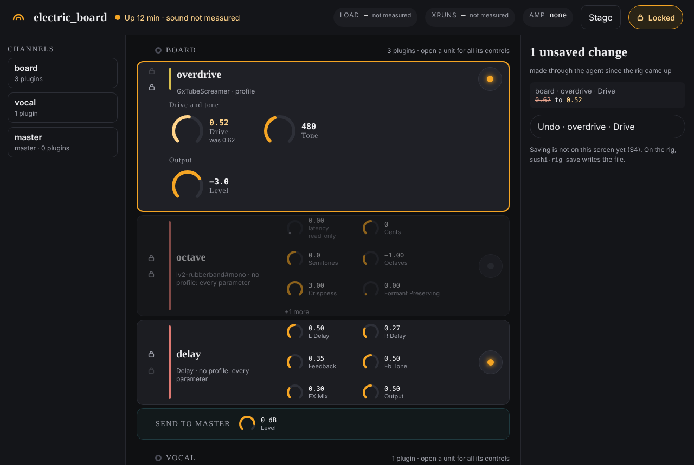
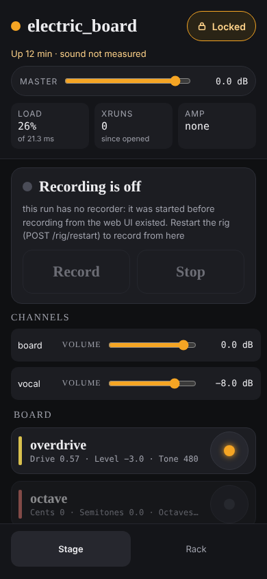

# sushi-rig

A headless guitar rig built on [Sushi](https://github.com/elk-audio/sushi), Elk
Audio's plugin host. Guitar goes in through an audio interface, through a chain
of LV2 plugins, and back out — with no DAW in the signal path and no GUI at
runtime.

The rig is described by a JSON config that Sushi loads at startup. This
repository holds those configs, the patchbay routing that feeds them, and the
tooling that produces them.

## Where this is going: v2

**A live-first DAW that handles configuration as readable code.**

One refinement to that: in v1 you write the code. In v2 the rig writes it, and
you can always read it, diff it and revert it.

v1, everything below this section, was built by putting existing open-source
projects together. v2 builds the product layer ourselves: the control plane,
the data model, the UI and the plugin profiles. That's the only way to get the
experience we want. The engines underneath stay open source (Sushi, the plugins,
PipeWire), because nearly every painful bug here came from the glue between
projects, never from the audio engine.

Decisions so far:

- **Local-first.** The rig runs, and is good to use, entirely on the local
  machine, with its UI in a browser on localhost. The cloud adds reachability
  and nothing else. Nothing possible remotely is impossible locally, and the
  rig never notices the cloud going down.
- **The web is for control**, plus loading library pieces while configuring.
  Nothing real-time crosses the network.
- **Files are machine-written but human-legible.** Nothing like a DAW's XML.
- **Content lives in its own repository**, under version control, separate from
  the code that runs the rig.
- **The local part is portable.** Getting the whole rig onto a suitable machine
  is one paved-road command.

The plan and the reasoning behind it are in the
[v2 roadmap](https://github.com/SonnyDewfall/Sushi/issues/38). v1 gets tagged
as a release before that work starts.

---

## The problem this solves

Sushi's config format is a poor authoring surface. Plugin parameters are
addressed **by the name Sushi assigns them** — derived from the plugin's TTL
metadata, not necessarily the port symbol — and every value is **normalised to
0.0–1.0** regardless of the plugin's real units. A reverb decay of 2.4 seconds
appears in the file as `0.32`.

For one plugin that is merely awkward. For a 10–30 plugin chain it is
unworkable: the file cannot be read, reviewed or corrected by eye, and a wrong
value produces a config that loads cleanly and sounds wrong.

## The architectural decision

**Sushi is both the deployment target and the authoring host.**

The obvious alternative — dial the sound in using a desktop host like Carla or
Ardour, then convert the session file to Sushi JSON — was considered and
rejected. It fails three ways at once:

| | Desktop host | Sushi |
|---|---|---|
| Parameter addressing | port symbol (`gain`) | Sushi's assigned name (`Gain`) |
| Parameter values | real-world (`-12.0 dB`) | normalised (`0.35`) |
| Version drift | silent — renamed ports still "work" | caught by Sushi's own introspection |

Each gap needs a translation layer, and both layers break silently when a plugin
updates. Authoring inside Sushi removes them entirely: the values read back are
already normalised and already named the way Sushi names them, because the same
wrapper code produced both.

The cost: Sushi is headless, so plugins' own GUIs are unavailable. Parameters are
tweaked through generated [Open Stage Control](https://openstagecontrol.ammd.net/)
faders instead. That was an accepted trade-off when scoping the project.

## Quality principles

What "good" means here. These are meant to be **usable in a review** — a change
should be arguable against them, and an audit should be able to fail one.

**1. Isolate decisions from effects.** Unit-test every decision; verify effects
against the real thing.

Most of the value in this codebase is decisions — what to start, where a plugin
should move to, which OSC message means what. Those are kept pure and pinned by
tests. The effects around them, mostly glue to external processes, are verified
by running them.

This replaced "all code covered by unit tests", which was the wrong target here.
Large parts of this project supervise processes, spawn Carla and send OSC; a unit
test for those means mocking everything and proves only that the mocks were
called. Meanwhile the tests that have genuinely earned their place encode
*discovered facts* — that Sushi's `/bypass` accepts an int only, that a `program`
overrides `parameters`, that Carla numbers plugins from zero. None of them came
from chasing coverage.

The corollary, learned the expensive way: **a fixture is a captured artefact,
not a tidied one.** `test_top.py`'s `pw-top` fixture gave every row a quantum,
followers included. Real `pw-top` states quantum and rate on the *driver* row
alone, and Sushi is always a follower. That fixture was neater than reality and
encoded a guess as a fact, so `sushi-rig top` — the one display built to explain
latency — reported `quantum 0 @ 0 Hz` while the rig sat at 42.7 ms per block,
with its tests green throughout. Capture fixtures from the real thing, and where
one has to be written by hand, say in the file which parts are observed and
which are invented.

**2. Every feature is covered by a functional test.** Verified by driving the
real thing, not by a human saying it worked.

**3. Architectural simplicity wherever possible.** Few moving parts, a shape you
can hold in your head. This is about architecture, not line count — see 5.

**4. Customise external components as little as possible.** Prefer configuration
and composition over modification, and record every workaround with what it works
around.

**5. Annotated for human and machine readers.** Comments say *why*, not what: the
constraint that forced the shape, the thing that was tried and failed, the
behaviour that is undiscoverable from the API. Much of this project's hardest-won
knowledge is unobvious and expensive to rediscover.

Some files here are a third comment, and that does not violate 3. Comments are
not moving parts.

**6. Modular and composable wherever possible.** One job per module, and
composition over coupling.

**7. An intuitive and simple user experience.** The rig is played by a musician,
not operated by an engineer. A failure should be understandable without reading
the source.

**8. Failures must be loud.** Prefer a loud failure to silent degradation.

Every serious bug this project has had was silent. qpwgraph exiting with no error
and no log. A track's bypass flag wiping every plugin's. A preset index quietly
overwriting the parameters saved beside it. An amp running with no model loaded,
processing silence while looking perfectly healthy. Not one announced itself, and
each cost hours.

**9. Fail loudly, recover instantly.** The rig may die — it must come straight
back with the state it had.

This is deliberately *recovery*, not self-healing. A rig that quietly compensates
is a rig running at half quality on stage with nobody aware, which puts it
straight at odds with 8. It works because state lives in config files and is not
changed at runtime during performance, only while building a configuration.

It also settles a design question: the supervisor deliberately does **not**
restart children. Under this principle that is right, and the effort belongs in
making restart fast and faithful instead.

### Where these disagree

They are not all compatible, and pretending otherwise would make them useless in
a review.

**3 against 4.** Running the neural amp in Carla, rather than adding `patch:`
support to Sushi's LV2 wrapper, follows 4 — but it buys a smaller *diff* at the
cost of a more complex *architecture*. Both are "simplicity" and they point
different ways. Say which won and why.

**8 against 9.** Resolved above, by making 9 about recovery. The shape to copy is
`start_qpwgraph` in `rig.py`: retry a few times, then report loudly and leave the
rig usable.

## What this project owns (and what it doesn't)

Several projects already drive Sushi — [`elk-audio/sushi-gui`](https://github.com/elk-audio/sushi-gui)
(official, Qt, live parameter and graph editing),
[`scraporchestra`](https://github.com/OlivierSch755/scraporchestra) (web app,
project manager for Elk Pi), and Sushi's own native session save/restore. They
were evaluated deliberately rather than ignored.

They all share one assumption: **live Sushi state is the source of truth.** You
drive a UI, state lives in the engine, and persistence dumps whatever is
currently loaded.

This project inverts that. **A hand-authored `rig.yaml` is the source of truth**,
and configs are versioned, readable, diffable artefacts. That's not a UI
preference — it's what makes a tone reviewable, revertable and reproducible.

The difference is not academic. Deriving structure from a live session is
*lossy*: `sushi-gui` reconstructs internal plugins as
`uid = "sushi.testing." + name`, so a plugin named `internal_reverb` comes back
as `sushi.testing.internal_reverb` rather than `sushi.testing.freeverb` — a
config that will not load. A live session records **observed state, not
intent**. It cannot know what you meant; a source file can.

So the split is:

| | Tool | Why |
|---|---|---|
| **Exploration** — trying plugins, building chains | `sushi-gui` and other live tools | Fast and live. Hand-editing YAML to audition a plugin is friction worth removing, and not friction worth *building* a solution for |
| **Persistence** — this tone is good, keep it | This project | Determinism and version control. Nothing surveyed produces readable, git-diffable, versioned configs |

The bridge between them is `capture` → versioned config. Everything here is
built to keep that bridge tool-agnostic, so adopting a better live editor later
costs nothing.

Where those projects do something well, the intention is to borrow rather than
reinvent — Sushi's native `SaveSession`/`RestoreSession` for runtime switching,
and `sushi-gui`'s live-session-to-config derivation for the cases where no
`rig.yaml` exists yet. **Neither is done yet**: nothing in the code calls
`SaveSession` or `RestoreSession`, and the config this rig writes is derived from
`capture` alone. Both are tracked in
[issue #11](https://github.com/SonnyDewfall/Sushi/issues/11); rationale for the
division of labour is in
[issue #12](https://github.com/SonnyDewfall/Sushi/issues/12).

## The workflow

```
rig.yaml ──emit──> rig.json ──verify──> names confirmed against Sushi
                      │
                      ├──panel──> panel.json ──> Open Stage Control faders
                      │
                   sushi -j -c rig.json
                      │
                   [tweak by ear]
                      │
                   capture ──> state.json
                      │
rig.yaml + state.json ──emit──> rig.json  (now carrying initial_state)
```

Hand-authored: `rig.yaml` (or, for the v2 rigs, `config/rigs/*.yaml`), the
per-machine `machines/<hostname>.yaml` that names physical ports, and any
component profile under `tool/examples/profiles/`. Everything below the rig file
in the diagram is generated.

`verify` answers the question that has caught this project out twice: a config
can load cleanly, name only things that exist, and still not do what it says.
Both times the cause was one key in `initial_state` silently overriding another,
and both times it looked like a save bug rather than a load bug.

```bash
sushi-rig verify config/electric-clean.json   # loads, names exist, and it applies
sushi-rig verify --all                        # every config, about six seconds each
sushi-rig verify --quick                      # skip the check that starts Sushi
```

The deep check loads the config into a throwaway Sushi — `--dummy`, so no audio
hardware, no JACK — and compares the running rig against the file, naming every
parameter, bypass and chain-order difference. It uses a free port and its own
process group, so it is safe to run while you are playing.

SAVE writes from the rig source `up` found for the running config: its
`_meta.source`, or `config/src/<name>.yaml`, or `config/rigs/<name>.yaml`. A
config with none has no rig to save from, `up` says so, and SAVE answers with
why rather than writing a guess. A capture that names processors the source
does not have is refused for the same reason: it is a capture of a different
rig.

The two cheap checks run automatically after `emit` and after the panel's SAVE.
The deep one stays explicit: five seconds on every SAVE would be felt while
dialling in a tone.

A captured session overrides the yaml in two ways, not one: parameter **values**
(via `initial_state`) and plugin **order**. Pedal order is a tonal decision, so
the panel can reorder the chain live and a save keeps it. The consequence worth
knowing: the yaml's plugin order and a saved config's order can drift apart,
exactly as their values already do. The yaml declares where a rig starts; a
capture records where it got to.

The tweak → capture → emit loop at the bottom is where the time actually goes.
`sushi-rig up` runs an OSC listener (`sushi-rig listen`) alongside Sushi, and
the generated panel carries a name field and a save button that trigger that
loop directly — type a name, tweak, press save, and `config/<name>.json`
appears with the current sound baked in. `sushi-rig save <name>` on the CLI
does the same thing without the panel, since the save button is just one
caller of that same underlying capture-and-write step (see issue #10).
The listener acts on unauthenticated UDP — it writes config files and starts
recordings on receipt — so it binds loopback only; `--host` with any other
address exposes both to the network.

---

## Repository layout

This is a **monorepo with two zones**: the *rig* (personal, machine-specific —
the configs and scripts you run daily) at the root, and the *tool* (reusable
software that generates the configs) under `tool/`. They share one workflow, so
they share one repo; if the tool ever needs to stand alone, it can be split out
then.

```
.                               ── RIG (root): what you run daily
├── config/                     Sushi configs — the deployable artefacts
│   ├── electric_board.json       current rig (what `sushi-rig up` launches)
│   ├── *.json                    the other tones, one config each
│   ├── src/                      hand-authored v1 sources (electric_board,
│   │                             electric_stereo, guitar_vocal)
│   ├── rigs/                     every tone as a v2 rig: channels and a master
│   ├── sound/                    nulltest references: what each config sounds like
│   ├── archive/                  auto-written version snapshots,
│   │                             config/archive/<name>/vX.Y.json
│   └── retired/                  hand-retired configs (incl. empty.json), kept
│                                 for recovery only
├── Patchbay/                   qpwgraph sessions
│   ├── rig.qpwgraph              routing loaded at startup; generated from
│   │                             config/src/guitar_vocal.yaml, held by a test
│   ├── Default.qpwgraph
│   └── Test_1.qpwgraph
├── machines/                   the only files that name physical ports,
│   ├── example.yaml              one per machine, as <hostname>.yaml
│   └── sonny-dewfall-XPS-9320.yaml
├── amp/models/                 the neural amp's .nam captures
├── ci/                         Dockerfile for the container the full suite runs in
├── systemd/                    the agent's user unit; `sushi-rig agent install-service` installs it
├── .github/workflows/          ci.yml (fast suite), rig-container.yml (everything)
├── plugin-manifest.txt         every LV2 URI this rig can load (see Plugins below)
│
├── tool/                       ── TOOL: generates the configs above
│   ├── pyproject.toml
│   ├── src/sushi_rig/            42 modules and __init__, one job each:
│   │                             spec, rigfile, convert, emit, dump, probe, probes,
│   │                             profile, plugins, library, live, panel, listen,
│   │                             save, state, procs, rig, supervisor, qpwgraph,
│   │                             patchbay, machine, amp, top, doctor, verify,
│   │                             render, nulltest, signals, analysis, selftest,
│   │                             take, transport, recorder, capture, midi_listener,
│   │                             agent, agent_client, service, yamlmerge, paths,
│   │                             _numpy, cli
│   ├── tests/                    fast suite; fixtures/ holds captured artefacts
│   ├── examples/
│   │   ├── rig.example.yaml       annotated rig spec (real plugins)
│   │   ├── dump.example.json      real --dump-plugins output, test fixture
│   │   └── profiles/gxts9.yaml    a component profile
│   └── spikes/virtual_ui/        the headless-plugin-GUI experiment (#28), with findings
│
├── IMPLEMENTATION_BRIEF.md     the original brief, kept as history (see below)
├── MANIFEST.md                 what is being worked on and what is next
└── README.md
```

Untracked but required at runtime: `Sushi-x86_64.AppImage` (symlinked as
`sushi`) and `plugins/`. See [Plugins and portability](#plugins-and-portability).

`IMPLEMENTATION_BRIEF.md` is the brief the project started from. It is kept as
history, not as a spec: **where it and the code disagree, the code is right.**
Two known cases — the `initial_state` shape it describes does not load in Sushi
1.3.0 (see the docstring of `emit.py`), and its sketch of elkpy's API is wrong in
places (see the docstring of `live.py`).

The single-file prototype the brief refers to (`tool/prototype_reference.py`,
previously `sushi_rig.py`) was deleted on 2026-10-31. The package in
`tool/src/sushi_rig/` had superseded it and nothing imported it; git history
has it.

---

## Running the rig

```bash
sushi-rig up                # tuner, patchbay, Sushi, the amp, and a generated panel
sushi-rig up --headless     # the same rig with no panel — for playing, not tweaking
sushi-rig up electric-clean # any config/<name>.json; defaults to electric_board
sushi-rig status            # what is running, and where its logs are
sushi-rig top               # live CPU load per component, and whether xruns are climbing
sushi-rig restart           # stop and bring the same rig straight back
sushi-rig down              # stop everything, and verify it stopped
```

`up` also takes `--no-amp`, `--no-tuner`, and `--amp-model "Some Model.nam"` to
audition a different amp capture without editing the config.

`up --rig <name>` runs a rig of channels, `config/rigs/<name>.yaml` (#30): the
rig is compiled at start into the runtime directory, never into `config/`, and
its patchbay is generated from the rig and the machine file rather than loaded
from `Patchbay/rig.qpwgraph`. The committed patchbay describes the v1 layout,
and on `guitar_vocal` it would feed the guitar into input 1, the vocal channel
under v2, and wire the microphone to inputs the rig does not read, with the rig
looking healthy throughout; a v2 rig therefore always brings its own. Opt-in
rather than the default while a v1 config of the same name exists: the monitor
path was heard to be the same on 2026-11-01 (two rigs, amp included), but a
two-channel rig has not been. `restart` brings a v2 rig back as one, and
`status` names the rig file. After any `up`, v1 or v2, the supervisor checks
that every link in the patchbay it loaded was actually made, and warns naming
the pairs that were not: a channel whose source never reached it is silent
while everything looks healthy, and that is said rather than discovered. SAVE works on a rig run: the panel's SAVE folds the
live capture back into the rig file itself, in place and keeping its comments
(a new name writes a new file), and never writes a compiled config into
`config/`. A v1 run whose source is a rig of channels still has SAVE off, since
saving the rig would leave the v1 config behind; it says to use `--rig`.

`up` starts everything and hands the prompt back — the rig is detached, so it
survives closing the terminal. Child output goes to log files rather than your
terminal; `status` prints the paths. It refuses to start a second rig on top of
a running one. With the agent running, `up`, `down`, `restart` and `status` go
through it, and say so in one line; see the next section.

### The agent (v2, #29)

```bash
sushi-rig agent                      # serve the rig over HTTP on 127.0.0.1:8029
sushi-rig agent install-service      # or run it as a systemd user service (prints the systemctl commands)
curl localhost:8029/health           # the agent and the rig in one answer, crashed children included
curl localhost:8029/rig              # `status` as data
curl localhost:8029/doctor           # `doctor` as data
curl localhost:8029/rigs             # the rigs of config/rigs/ a start or switch can name
curl localhost:8029/rig/load         # one pw-top sample of the rig's nodes: load, xruns, the block budget
curl -X POST localhost:8029/rig/up -d '{"config_name": "guitar_vocal", "rig": true, "headless": true}'
curl -X POST localhost:8029/rig/down
curl -X POST localhost:8029/rig/restart
curl -X POST localhost:8029/rig/switch -d '{"config_name": "electric-octave-up"}'   # live where it can be (#93)
curl localhost:8029/live             # the running rig's parameters, bypass and chains, with ranges
curl -X POST localhost:8029/live/parameter -d '{"processor": "reverb", "parameter": "Mix", "value": 0.4}'
curl -X POST localhost:8029/live/bypass -d '{"processor": "drive", "bypassed": true}'
curl -X POST localhost:8029/live/move -d '{"processor": "drive", "direction": "up"}'
curl localhost:8029/live/log         # what was changed through /live, newest last
curl -X POST localhost:8029/live/undo   # put back what the newest change not yet undone replaced
curl -X POST localhost:8029/live/undo -d '{"skip": true}'   # give up on the newest one that cannot be
curl localhost:8029/amp              # the amp as last SENT to Carla: its model, each parameter
curl localhost:8029/amp/models       # amp/models, each model's rate and whether it can be played
curl -X POST localhost:8029/amp/parameter -d '{"name": "Output Lvl", "value": -3}'   # dB, clamped and said
curl -X POST localhost:8029/amp/model -d '{"model": "Some Model.nam"}'   # restarts Carla alone: the sound stops for a moment

curl localhost:8029/health | jq .agent.midi   # the pedals: listening, or why not, and what was last heard
```

The control plane every v2 feature needs: one process that owns the rig.
**The agent is the supervisor.** `POST /rig/up` starts Sushi, the patchbay,
the tuner and the amp, and unless headless the listener and the panel, as one
process group the agent holds; it plans them with the same `plan_children`
and writes the same state file as `up` always has, so `status`, `restart` and
`describe_rig` cannot tell which started a rig. `down` and `restart` act on
what the agent holds. A child that exits with no `down` asking it to is
noticed within a fifth of a second and reported: in `/health` under
`agent.supervisor.crashed` (its name, pid, exit status or the signal that
killed it, when, and its log), on the agent's stderr, and as `CRASHED` in
`sushi-rig status`. Each child is judged on its own, so a group signalled from
outside the agent (`down --direct`, a `kill`) shows its children's exits there
too, by signal. It is **not restarted** (principle 9): the agent heals nothing
on its own, and the way back is `restart`, which you ask for. What is wrong
beyond a child, `agent.supervisor.problems` says (and `status`, as `PROBLEM`):
the group holder dying on its own (the rig plays on, but `status` reads it as
orphaned and `up` refuses until `down`), or a failed start whose processes
would not stop, named by pid and still held, so `down` can be asked again. A
child that exits during a start that fails is part of that failure's answer,
not a crash, since there is no rig to restart.

**No lifecycle step holds the agent for ever.** `up`, `down` and `restart` are
each given two minutes (`LIFECYCLE_TIMEOUT`, as when the agent ran them as the
CLI): past it the answer is `504`, saying what was still running (compiling the
rig, clearing a stale qpwgraph, waiting for Sushi...), and what the step had
started is stopped. The stuck part runs in a thread that cannot be interrupted;
it is left to finish and nothing it does afterwards is kept. `agent.supervisor.doing`
in `/health` says what a step is doing while it runs.

**The CLI asks the agent when it is running.** A running agent writes where it
listens to `agent.json` beside the state file (and removes it when it stops),
so `up`, `down`, `restart` and `status` look there first, on whatever `--host`
and `--port` the agent was given, and at 127.0.0.1:8029 when there is no file
or its agent is gone. If one answers, they go through it; if nothing is
listening, they do what they always did, forking their own supervisor. Each
says which in one line on stderr (`asking the agent at ...`, or `no agent is
running at ... (where that address came from), so acting directly`), so stdout
is unchanged. Something there that does not answer as the agent does (an
agent that is stuck, another program) is refused with nothing done, rather
than guessed at; `--direct` on any of the four acts without asking. `up
--amp-model <path>` works through the agent: the CLI makes the path absolute
against the checkout, as `up` always resolved it, and the agent takes a model
by path only from this machine (a loopback peer); from anywhere else a model
is a name in `amp/models/`.

How the group is held, because the obvious ways do not work: the agent cannot
fork a supervisor, since a fork from a threaded server is where deadlocks come
from, and it cannot lead the group itself, since `down` signals the group. So
it starts a tiny **group holder** (a Python that waits for a signal) as the
leader of a new group, and each child straight into that group, with
`subprocess`'s fork-and-exec, which runs no Python in between. The holder is
the state file's `supervisor_pid`, which is why the file reads as before. The
children are the agent's own, which is how it reads a crash's exit status.

**The rig outlives the agent.** Stopping or restarting the agent leaves the rig
playing: the holder keeps the group and the state file describes it. The next
agent finds it there and can stop or restart it, but does not watch it (its
children are not that agent's to wait on), so a crash in it shows as a `DEAD`
child in `/rig` and `status` rather than in `crashed`, and `/health` says so in
`agent.supervisor.note`. The same holds for a rig started with `--direct` or
before the agent was.

**As a service** (`sushi-rig agent install-service`): writes
`systemd/sushi-rig-agent.service` to `~/.config/systemd/user/` with this
checkout's path filled in, enables it for `graphical-session.target` (by the
link `systemctl --user enable` would make), and prints the `systemctl --user
daemon-reload` and `start` to run; it never runs systemctl itself. The unit's
comments say why each line is what it is: the graphical session because the
patchbay, tuner and panel are desktop programs that inherit the agent's
`DISPLAY`; `KillMode=process` so a service restart does not take the rig with
it. `curl localhost:8029/doctor` checks the machine as the service sees it.
**Not yet installed on a real machine, and the agent-run `up` has not been run
against real Sushi and PipeWire**: see MANIFEST.md for the check.

Needs `pip install -e tool[agent]` (aiohttp), and `tool[agent,midi]`
(alsa-midi, and libasound) for the pedals; starting a rig through the agent
needs Python 3.11 or later. One lifecycle command at a
time: a second request while one runs gets `409 busy`, because `up` and `down`
racing is a second rig on top of a running one. `up` must be told which
config (`config_name` is required, so a stray empty POST starts nothing). Every argument is checked
before anything runs — a config name is a name, not a path — and nothing from a
request is passed through as text. A successful `up`'s answer carries its
`warnings` (an unmade patchbay link, an amp that died at start), which the CLI
prints as it always printed them. The agent binds to localhost; `--host 0.0.0.0`
opens it to the LAN, and until the local/remote permission split in #29 exists
that is your call, not a default.

**Live operations** (`/live`) read and change the rig that is running, by name,
over gRPC. A parameter `value` is Sushi's normalised 0 to 1 for now; real units
come with the profiles. A request is refused with `400` before anything changes
if it is mistyped or out of range, or names a processor or parameter the running
rig does not have (or a read-only one, or a track where a pedal is meant); what
the rig has is read for that one request, not by walking every parameter, so a
fader can send many changes a second. `503` means no rig is up; `502` that Sushi
went away, refused, or did not confirm the change, with the reason, and nothing
is logged for it; `500` that elkpy is not installed; `504` that Sushi did not
answer within 20 seconds (`LIVE_TIMEOUT`), where the agent stops waiting and
frees the next request, but the stuck call itself cannot be cancelled (its
connection is closed when it does return), and a change that timed out may or
may not have been applied: read `/live` before trying again. Calls to Sushi run
in a pool of their own, eight at a time; if a Sushi that never answers has them
all, a request is `503` with the count rather than queued, and
`GET /health` shows `agent.stuck_live_calls`. They are `409 busy` while a lifecycle command runs. Changes are
made one at a time so each `previous` is true; reading `/live` does not wait for
them and they do not wait for it, so a panel can poll it. Each request makes one
connection to Sushi and does its reading and changing on it. A move is decided
once, from one look at the chains, and what is sent is what was decided: a
processor already at that end of its chain is `changed: false`, even if it only
got there since the request arrived. Each change that Sushi confirmed is appended to an
in-memory log of the last 500 (`/live/log`: `at`, `op`, `args`, and the
`previous` value where it was known), which is where undo comes from.

**Undo** (`POST /live/undo`, no body) puts back the newest change that is not an
undo and has not been undone: a parameter to its previous value, a bypass to its
previous state, a move by the opposite step, each through the same call the
route makes, under the same lock and timeout and with the same `503`/`502`/`504`
and `409 busy`. The answer is the undo's log entry (`op: "undo"`, `undoes`: the
index of the entry it put back, `args` what it applied, `previous` what that
replaced), the entry `undone`, and the `state` now. An index counts entries since
the agent started, not places in the list, because the list is trimmed at the
front; `/live/log` says the index of the first it holds (`first`). It refuses
rather than guess, with nothing applied or logged, and a `409` carries a `code`
beside its `reason`: `busy`; `nothing_to_undo` (an empty log or one of undos
only, said without a Sushi to ask); `stale`, when the rig is not as the entry
assumes — a move's processor is not exactly where the move left it, a parameter
or bypass was changed since (so an undo never overwrites a hand on the panel),
or Sushi never said what to put back. A processor the rig has lost is `400`, as
on the other routes. A refused entry is not skipped for an older one, so the
way past a stuck one is explicit: `{"skip": true}` checks the newest entry, and
if it is refused marks it `op: "stale"` in the log (it is not removed) so the
next undo goes on to the one before; an entry that can be undone is `409
not_stale`. Any other body is `400`. Undoing an undo (redo) is not built. **Not run against a live Sushi**: shown
against the fake only.

**The library and chain edits** (#32): pick a plugin, add it to a chain, take one out.

```bash
curl localhost:8029/library          # every plugin in plugin-manifest.txt: uri, name, ports, profile, groups
curl -X POST localhost:8029/live/add -d '{"track": "guitar", "uri": "http://guitarix.sourceforge.net/plugins/gxts9#ts9sim"}'
curl -X POST localhost:8029/live/add -d '{"track": "guitar", "uri": "http://drobilla.net/plugins/mda/Delay", "name": "slap", "after": "guitar_overdrive"}'
curl -X POST localhost:8029/live/remove -d '{"processor": "slap"}'
```

`/library` lists the manifest, not the machine: names and port counts come from
the bundles in `plugins/`, read without lilv (and checked against lilv on every
bundle the packages provide), never from the system's LV2 paths. A name that
could not be read is the URI's last segment, marked `name_from: "uri"` with a
`note` saying why; a profile's groups come with its plugin. It is built once,
on first use, and kept until the agent restarts. The amp is listed but
`addable: false`: it runs in Carla, and on a Sushi chain it would have no model.
An add needs a manifest URI and a track; with no `name` it is named from the
plugin (`MDA Delay` is `mda_delay`), and with no `after` it goes last but in
front of the channel's send, never behind it, since the send is what reaches the
monitors; the send is known by its uid in Sushi's session as well as by its
name, and `/live/move` now refuses (`400`) to move a send or the return, or a
pedal past one. A bad request is `400` with Sushi untouched; a name the rig already
has, a track it lacks, an `after` not on that track, or a remove of a send,
the master's return, a track or something not there, is `409`. Both edits are
confirmed by reading the chain back, and one that does not read back as asked
is `502` and not logged. The log entry for an add has the name used and the
chain before; for a remove, the chain before and the plugin's URI, uid and
type, from Sushi's saved session, so an undo can put it back (at its defaults:
parameter values are not recorded). **Not yet run against a live Sushi.**
**Pedals** (#34, #93). What a rig's MIDI map asks of the agent — a bypass, a
pad on a mute, Program Change rig switching; Sushi does the sweeps, blends
and CC mutes itself — the agent serves while the rig is up, by opening the
controller's port itself (the port the machine file names, through the ALSA
sequencer). A pad press (note on) toggles its plugin's bypass, exactly as
`POST /live/bypass` would; a CC bound to a bypass is a switch, the effect on at
64 and above and bypassed below, acting only when it crosses 64, so an
expression pedal or a chattering switch does nothing between crossings; a pad
on a mute toggles the channel's `mute`. Releases and aftertouch (an MPD218 pad
sends it while held) do nothing. A Program Change on the controller switches
rigs: program *n* is the *n*th file of `config/rigs/*.yaml` sorted by file name,
counted from 0 (a pedal may display it as *n*+1), and `GET /rig` lists the
order as `programs` while the running rig switches by them. The switch is
`POST /rig/switch`'s (below): live where it can be, otherwise `down` then
`up --rig` with the mode, tuner and amp choices `restart` would keep (not an
`--amp-model` override, which belonged to the rig being left), about five
seconds of silence; and the next rig switches on only if its own map says
`programs: rigs`. The rig switched to is compiled first, and one that
would not is refused with the running rig left playing; if its `up` fails
anyway, the rig that was playing is brought back. `/live/undo` stops at a rig
switch: what came before it was done to the other rig. A Program Change for the rig already playing does
nothing; one past the last rig is refused and said. Each change is in
`/live/log` with `source: "midi"` and the control that made it. The listener
starts when a rig comes up through the agent (the CLI's `up` included, now
that it asks the agent), or is already up when the agent starts, and stops
before `down`, `restart` or a switch; a rig brought up with `up --direct` while
the agent runs is not heard until the agent is restarted.
`/health` shows it under `agent.midi`: `listening`, `off` with the reason, or
`failed` with the problem — a port that will not open is said once, naming the
port, the controller and what ALSA does list, and not retried until the next
`up` or `restart`. `heard` and `last` (the last message and what it did) are
what to read when a pedal seems to do nothing. Channels are counted from 0 there,
as `aseqdump` prints them. **Not yet heard from a real pedal**: see the list below
the MIDI map in *Channels and a master*.

**The amp from the agent.** The neural amp runs in Carla, not Sushi, and
Carla cannot be read back, so what the agent holds is **what it last sent**:
`GET /amp` answers the model (its path and what the `.nam` declares) and each
parameter with its value, range, unit and whether the panel puts it on a
fader, with `known: "sent"` so nothing can present it as what Carla holds. It
is seeded for each run of the rig from the running config's `_amp`, which `up`
replays, and a parameter the config does not state is `null`, not a guessed
default. `POST /amp/parameter {"name", "value"}` sends one parameter, in its
own unit; a value outside the range is clamped and the answer says so. The
agent opens a TCP connection to Carla's OSC port (Carla serves OSC over TCP and
UDP; the send itself is UDP, which succeeds whether anything listens or not)
on the first send to a Carla, after any failure, and at most every two seconds
otherwise, so a fader's stream of sends costs one: no connection is `502` and
nothing is recorded. Every send also checks Carla's process is alive. That
proves a Carla is listening, not that it applied the value. Each change is in
`/live/log` (op `amp`), and `/live/undo` puts back what was last sent before
it, refusing as `stale` once something else was sent since. `POST /amp/model
{"model"}` plays another model of `amp/models` (a path only from this machine,
as `--amp-model`), refusing one trained at another rate than the rig's as
`doctor` faults it: **the sound stops for a moment**, because Carla is stopped
and started again on a rewritten project, alone, inside the group the agent
holds, with its knobs replayed; Sushi and everything else play on. If the new
model does not come up, the previous one is put back, and the answer says
whether that worked. The state file records the model, so `restart` keeps it.
It needs a rig this agent started (`409 not_held` otherwise), and is refused
while a lifecycle command runs, and while the state file does not name the rig
the agent holds. **With the panel running, the panel owns the amp** (any mode
but `headless`, as a switch and `restart` read it): its faders reach Carla through the listener, which keeps its own
record for SAVE, so the agent says `known: "panel"` and writes nothing
(`409 panel`) rather than keep a second record neither could trust. **Not run
against a real Carla**: Carla is a stand-in in every test (an in-memory one,
and a real UDP and TCP listener), and the restart's silence is not measured.

**Switching rigs live** (#93). `POST /rig/switch {"config_name"}` (and a
Program Change, which takes the same path) turns the running rig into another
rig of `config/rigs/` without restarting Sushi where the live operations can
do it: the processors that differ are removed, moved and added, the
parameters and bypasses that differ are set, the amp's parameters that differ
from what the agent last sent are sent to Carla (the call `POST
/amp/parameter` makes), and the rig is read back and checked against the next
rig's config, and against every value the switch set, before the state file
names it. Carla cannot be read back, so an amp step is checked only by Carla
answering. The
answer says `how`: `live`, or `restart` with `why` -- every reason, by code.
What restarts: a different amp model, or an amp in one rig and not the other
(Carla loads a model only as it starts, and is started, with the patchbay
wired through it, only with the rig), a track added, removed or
reordered or of another shape, a channel on another input, a different host
config or MIDI map (`cc_mappings`, which Sushi loads only with the config), a
program or property to set, a rig run with its panel (whose SAVE listener
belongs to the rig being left) or with `--amp-model` or a model chosen through
`POST /amp/model`, a rig changed by hand
since it came up in a way the plan cannot follow, a step that fails, and a
read-back that is not the next rig. A switch that fails part-way restarts into
the next rig, and brings the previous rig back if that restart fails; if the
restart cannot even take the rig down, `/health` and the answer say the rig is
**half-switched**, naming both rigs, and nothing more is tried: read `/live`
and bring it down and up by hand. Of the committed rigs, 72 of the 110 ordered pairs are
live (26 while the amp's parameters were a restart); the rest have an amp on
one side only, or other tracks. One `op: "rig"` entry goes in
`/live/log` either way, and undo stops at it. A rig that would not compile is
refused (`409 rig_problem`) with the running one left playing. **Not run
against a live Sushi and not heard**: shown against the fake only, and how long
a live switch takes is not measured.

**Two modes, for two ways of using the rig.** The default gives you the Open
Stage Control panel and the save listener behind it, which is what you want when
dialling in a tone: tweak, type a name, press save, and `config/<name>.json`
appears with the current sound baked in (issue #10). `--headless` skips both and
just runs the rig.

**Recovery is the answer to failure, not self-healing** (principle 9). `restart`
stops the rig and brings back the same one — same config, same mode, and the same
`--no-amp` / `--no-tuner` choices, read from the state file rather than from you,
since after a crash you may not remember them. Measured end to end at around five
seconds.

`top` answers the question that predicts trouble: how close to the block deadline
each component is running. It is not total CPU — 100% means a node used its whole
time budget for one block and the rig will drop audio. Xruns are reported as a
change rather than a total, since the cumulative count never resets.

`down` signals the rig's **process group**, which is why it can be trusted where
the old `stop-rig.sh` could not: `sushi.bin` (Sushi re-execs itself out of a
randomly-named AppImage mount), open-stage-control's Electron helpers and the
listener are all group members, so none of them need a pattern to match and none
get left behind. It then checks, and tells you if anything survived.

> Replaced `start-rig.sh`, `start-rig-and-panel.sh` and `stop-rig.sh`. Those
> used bash as a supervisor and identified processes by command-line pattern,
> which is how `killall sushi` came to miss Sushi entirely, how a shutdown could
> kill its own shell, and how open-stage-control was routinely left running.

> **`LV2_PATH` must be set, or Sushi loads no LV2 plugins at all.** It exits 4
> with `Failed to load tracks from the Json config file` — an error that never
> mentions `LV2_PATH`. `lv2ls` is not a proxy for this: it finds plugins using
> lilv's own defaults while Sushi finds none. Running `./sushi -c <config>` by
> hand, outside the scripts, hits this every time:
>
> ```bash
> export LV2_PATH="$HOME/Sushi/plugins"
> ```
>
> That single path is deliberate and complete — see
> [Plugins and portability](#plugins-and-portability). Do not add
> `/usr/lib/lv2`: it would let a config load against system plugins that
> `plugins/` doesn't carry, which is exactly the silent portability break the
> current layout exists to prevent.

### The web UI (v2, #31)

```bash
sushi-rig agent                      # then open http://127.0.0.1:8029/ (the rack)
                                     # or http://127.0.0.1:8029/#stage (the stage screen; the default on a phone)
```





The agent serves the UI at `/`, from `tool/src/sushi_rig/ui/static/`: plain HTML, CSS
and JavaScript with no build step and no framework, because the rig machine has
no Node and the UI has to run from a checkout. Two screens from the mockups:

- **The rack (S1).** Every channel as a row of plugin cards, each with its
  knobs: the profile's controls in its groups and labels for a plugin that has
  one (`tool/examples/profiles/`), every parameter in a plain list for one that
  does not. Values are in the plugin's own range, never 0 to 1. A turned knob is
  sent at once and marked unsaved, with what it was; the side panel lists what
  changed since the rig came up and undoes the newest change.
- **The stage screen (S5).** One glance: the rig, up or down, load and xruns,
  each channel's level, and the last error. One tap: a 56 px bypass per plugin,
  or a card opened for its knobs. Locked by default; unlocking takes two taps.
- **Start, stop and switch (v0.1, #111).** The rigs of `config/rigs/` in a
  list (the rack's left column; on the stage screen only while the lock is
  off): pick one and Start it (a rig of channels, headless, since the page
  replaces the panel), Switch to it, or Stop the one that is up, which takes a
  second tap because it cuts the sound. A switch says whether it was made live
  or by restart, and why. While a command runs, from this page or another,
  nothing else is offered and what is running is said; a refusal shows the
  agent's reason.
- **The amp.** A card at the top of the rack, since the amp is in front of the
  board: the model's name and what it declares, faders for Input and Output in
  dB, Quality shown but not on a fader (it trades CPU for accuracy, not tone),
  and a model picker that takes a confirm saying the sound cuts out for a
  moment, refused while locked. Values are labelled as what was last sent,
  never as read back. On the stage screen, only the model's name and the
  output level, and only while the lock is off, as the rig picker is. With
  the panel running, the faders and picker are off and say the panel owns the
  amp.

It polls `/health` once a second, and `/live` only while a rig is up: a rig
that is down is shown as a state, in grey, not as an error a second in the
console (#111), while a `/live` failure with the rig up is still shown as the
failure it is. Load and xruns come from `GET /rig/load`, asked every two seconds
while a rig is up: one `pw-top -b -n 2` at a time, its sample shared by every page
asking within 1.5 s, so two pages do not keep pw-top running beside the rig. LOAD is the rig's nodes' share of the
block (B/Q, summed as `sushi-rig top` sums it) against the block's length from
Sushi's driver, XRUNS how many since the page opened, counted per node, marked
when rising. A
pw-top that is missing or fails shows as "unreadable" with the reason. Each
change is sent as it happens. A change the agent refuses shows the agent's
reason on screen, beside the knob; nothing is put back without saying why.

Not done yet, and said on screen where it shows: the sound (nothing measures
it, so an up rig reads "sound not measured" and is never green, #49);
saving (S4); the lock is the page's own, since the agent has no performance
lock yet (#29); "unsaved" counts only changes made through the agent since the
rig came up, so a change from the OSC panel, or a `sushi-rig save` since, is not
reflected; changes go over HTTP, not a WebSocket. Library, Record, Broken, Save
and Pedals from the canvas are not built. v0.1 answers a session on the real rig
but has not run on it: the load route has not read a real `pw-top` (it parses
the format `tool/tests/test_top.py` holds), the `ELKPY:` lines were silenced
against elkpy 1.3.0 with no Sushi listening, and start, stop and switch from the
page have not driven a real rig. All of it is tested against the agent over a fake rig
(`tool/tests/ui_fake.py`, which says what in it is observed), and which plugin
each processor is comes from Sushi's saved session, unverified against 1.3.0 as
for the agent's add and remove.

To try it without a rig: `cd tool && PYTHONPATH=src:tests python tests/ui_fake.py`
serves the UI against that fake on port 8029 (`--down` to start with no rig up,
`--amp` to give it an amp, with invented models and a stand-in Carla).
`/ui/` and `/ui` redirect to the page.

### Ports by role, not by device name

`Patchbay/rig.qpwgraph` names ALSA device *profiles*, so changing interface (or
profile) silently orphans it: qpwgraph keeps the dead links and nothing reports
them. Three commands address that (issue #54):

**`machines/<hostname>.yaml` is committed, deliberately.** It is the one
hand-authored file naming physical ports, and it is tracked for the same reason
the patchbay is: setting up a second machine proved it the most expensive thing
to recreate, and the next machine should start from a worked example rather than
from scratch. The hostname in the name is what keeps two machines' files from
colliding. Nothing in `.gitignore` excludes them, and nothing should — a
`machines/` entry added later on the assumption that these are per-machine
scratch would quietly undo this.

```bash
sushi-rig patchbay check                      # saved links whose node is not in the live graph
sushi-rig machine check [machines/x.yaml]     # validate a machine file on its own
sushi-rig patchbay generate rig.yaml -o /tmp/p.qpwgraph   # from machines/<hostname>.yaml
```

`patchbay check` sorts every node the saved file names into three states.
**Missing** (nothing live answers to that name) is the only one that exits 1, so
exit 1 means *a node is definitely gone*, not *something is wrong*. **Not
running** is a node the rig starts itself, absent because the rig is down: it is
listed, it does not fail, and it is not a pass for those links either — run
`sushi-rig up` and check again to cover them. **Present** needs no comment.

> Run it with the rig **up**. The first real run was made with the rig down and
> reported `sushi` and the tuner as gone alongside one genuinely dead profile —
> three findings where there was one. That was the tool's fault, and the two
> states above are the fix.

`generate` builds a patchbay from the machine file's roles and the `source:` /
`sink:` a track names, plus a tuner tap on the guitar role. It prints to stdout
or the path you give. **`Patchbay/rig.qpwgraph` is now generated** — from
`config/src/guitar_vocal.yaml` and `machines/sonny-dewfall-XPS-9320.yaml` — and
a test asserts the committed file is byte-for-byte what the command produces, so
editing it in qpwgraph's GUI fails the build. Regenerate instead:

```bash
sushi-rig patchbay generate config/src/guitar_vocal.yaml -o Patchbay/rig.qpwgraph
```

A role with one port feeding a stereo bus is an error unless the role *declares*
it means to feed both halves:

```yaml
roles:
  guitar-in:
    ports: ["Audient iD14:capture_AUX0"]
    mono_to_stereo: true
  monitor-out: ["Audient iD14:playback_AUX0", "Audient iD14:playback_AUX1"]
```

That is stated rather than inferred from the port count because the saved
patchbay shows both wirings: the dead `Pro` profile duplicates one input across a
bus, and the live `Multichannel` profile wires one input per channel. It is also
what centres a mono guitar — one port into both halves of the bus. Without it
the guitar came out of the left speaker only.

### Channels

A channel is a role, a chain and an engine bus. `config/src/guitar_vocal.yaml`
is the first rig with two: a guitar on bus 0 and a vocal on bus 1, summing into
one monitor pair.

Adding a third is a declaration, not an edit in five places — which is the
actual deliverable of issue #18. Give the track a `source:` role, put the role
in the machine file, and regenerate the patchbay. In particular the amp and the
tuner follow the **`guitar-in` role**, not an input index: both used to take
whatever fed `sushi:audio_input_0` to be the guitar, which is a position, and
positions move. Put the vocal channel on bus 0 and the amp would have been
reprofiling the singer.

Plugin names carry their channel (`guitar_eq`, `vocal_eq`) because Sushi's
processor names are global rather than per track — two plugins called `eq` are
refused outright — and because those names are the panel's tab labels, so the
prefix is what says which channel a tab belongs to.

#### Channels and a master (v2, #30)

`config/rigs/` holds rigs written the v2 way: a list of channels, each a name,
an input role, `mono` or `stereo`, and a chain, plus a master that says where
the mix goes. No engine bus or channel number is written by hand.

A channel's level in the mix is `level:` on the channel, in dB, 0 being unity.
It is the send's gain: the stem is unaffected, which is why it is not a strip
(a strip acts after the send and would change the stem). This is where the
expression pedal's blend between two channels lives (#34): one CC driving two
channels' levels in opposite directions. SAVE writes a level moved live back
as dB to a thousandth.

A rig can carry its MIDI map (#34). The machine file describes the
controller, since pedals vary by machine and venue, and the rig names its
controls:

```yaml
# machines/<hostname>.yaml
controllers:
  mpd218:
    port: "MPD218:MPD218 Port A"
    channel: all                 # or 0 to 15, as Sushi counts it
    controls:
      knob1: {cc: 3}
      knob2: {cc: 9}
      knob3: {cc: 12}
      pad1: {note: 36}

# config/rigs/<name>.yaml
midi:
  controller: mpd218
  controls:
  - {control: knob1, blend: [clean, lead]}        # one pedal fades clean out as lead comes in
  - {control: knob2, parameter: lead/hall/Mix}     # a sweep, 0 to 1 normalised, or range: [a, b]
  - {control: knob3, mute: lead}                   # a whole channel, native
  - {control: pad1, bypass: lead/drive}            # one plugin: the agent's, Sushi has no CC-to-bypass; a CC here is a switch
```

Blend, parameter and mute compile into Sushi's own `cc_mappings` and run in
the engine with no Python in the path; a blend is two mappings on the two
channels' sends with their ranges reversed, each channel's own level being
its loudest. Bypass, a pad on a mute, and rig switching by Program Change go
through the agent, which reads them from the compiled config's `_midi_agent` and
opens the controller's port itself while the rig is up (`sushi-rig agent`, with
the `midi` extra; see *The agent*): so they work only with the agent running.
To switch rigs from the pedal, add `programs: rigs` to `midi:`; program 0 is the
first rig in `config/rigs/` by file name, and every rig you switch to needs it
too for the next switch to work. A blended channel's
send gain is a pedal position, so SAVE does not write it back as the level.
A rig with a map refuses to compile to a config without its controller, since
a rig running without its pedals would be the silent failure. Still to verify
on the rig: that Sushi counts MIDI channels from 0, and the name PipeWire
gives Sushi's MIDI input so the patchbay can link the pedal to it. For the
agent's own listener, which counts channels from 0 as ALSA does: that the
machine file's `port` is exactly how the sequencer names the pedal (client,
`:`, port, as `aseqdump -l`'s two name columns), that a footswitch sends what
it is written to (and which way round its CC is), and that the agent hears the
pedal while PipeWire and Sushi are also subscribed to it.


```bash
sushi-rig emit config/rigs/guitar_vocal.yaml -o /tmp/gv.json
```

`emit` reads either kind of file. For this kind it allocates everything: one
engine input per mono channel (feeding both halves of its stereo chain), each
channel's own output for its stem, a send at the end of each chain, and a
master track — last, on output bus 0, with its own chain for the limiter — that
is all the monitors hear. A rig has at most three channels, because the master
and three stereo stems fill Sushi's eight outputs; more is refused with the
arithmetic.

The patchbay and selftest's probes read these files too:

```bash
sushi-rig patchbay generate config/rigs/guitar_vocal.yaml -o /tmp/rig.qpwgraph
sushi-rig probes config/rigs/guitar_vocal.yaml --amp
```

Every tone in `config/*.json` has a rig here too, written by `convert`, which
refuses to write one that does not compile back to every plugin and setting the
config held:

```bash
sushi-rig convert config/electric-clean.json            # -> config/rigs/electric-clean.yaml
sushi-rig convert config/x.json --input vocal=vocal-in:mono   # more than one track
```

A chain entry carries its settings (`bypassed`, `parameters`, ...), a channel
its `strip` (gain, pan, mute), and the rig its `amp`. Until `up` runs these,
each tone exists in both forms and CI holds them together: the same plugins and
settings, and the same sound, rendered through the master against the
reference the v1 config was calibrated to.

Rig files keep their comments when the tool rewrites them: `write_rig` updates
the file in place (comments, blank lines and key order stay), and `convert
--force` on an existing file does the same.

Each input is linked once, the master's outputs go to the monitors, and the
stems are linked to nothing. The probes follow each channel through its stem
and, through its send, out of the master. Not yet what `up` runs: the new
monitor path wants hearing first.

### Choosing a plugin

Before a plugin goes into a rig, `probe` answers what you'd otherwise only
find out by trying it:

```bash
sushi-rig probe                 # everything on LV2_PATH, one line each
sushi-rig probe <uri>           # full detail for one plugin
sushi-rig probe <uri> --json    # same, machine-readable
sushi-rig probe amp/models/X.nam  # a NAM amp model: architecture, quality tiers,
                                  # and whether its sample rate matches the rig
```

It reads the plugin's own TTL through lilv, so every value is the plugin
author's declaration rather than our inference:

```
GxTubeScreamer  (Distortion Plugin)
  uri     http://guitarix.sourceforge.net/plugins/gxts9#ts9sim
  audio   1 in / 1 out
  config  drivable — all state lives in control ports
  4 parameter(s):
    Level                          [-20.0, 4.0]             default=-16.0
    Tone                           [100.0, 1000.0]          default=400.0
    Drive                          [0.0, 1.0]               default=0.5
    BYPASS                         [0.0, 1.0]               default=1.0  toggled
```

Two things there are invisible everywhere downstream. **Real-world ranges** —
Tone is 100–1000 Hz, which in a Sushi config appears only as a normalised
`0.0–1.0`. And **`config drivable`**, which is the question that actually
decides whether a plugin can be used at all.

A plugin is drivable only if all of its state lives in control ports. If it
keeps state elsewhere — a file, a model, an impulse response — it reaches it
through the LV2 `patch:`/`state:` extensions, which **Sushi does not support**.
Such a plugin loads without complaint and then silently ignores the part you
cared about. `probe` checks three signals for this (atom ports,
`patch:writable`, `state:interface`), because any one alone is insufficient:
`zeroconvolv` declares no atom ports and no `patch:writable` yet is entirely
driven by an IR file, and only `state:interface` reveals it.

Note that `probe` reads and reports — it doesn't write a catalogue or decide
which parameters are worth showing. Those are judgment calls, and keeping them
out of generated data is what makes the generated half safe to regenerate.

### Checking a config loads

No guitar, no audio interface, no extra dependencies needed:

```bash
./sushi --dump-plugins -c config/electric_board.json
```

This starts Sushi with the dummy frontend, prints every hosted plugin's
parameters as JSON, and exits. It is the authoritative source for parameter
names, and the cheapest way to know a config is loadable.

### Takes

A recording is a folder, not loose WAVs: the stems, a copy of the config that
was live when it was made (amp included), a copy of the v2 rig file it was
compiled from when there was one, and a `take.yaml` saying how the stems line
up and which commit the library was at. Because the rig is in the folder, a
take can be re-amped through the exact rig that made it months later. Takes go
in `~/sushi-rig-takes/`, outside the checkout, so `git clean -x` cannot delete
them.

```
~/sushi-rig-takes/riff-idea/
    take.yaml         how the stems line up, what made them, and the library commit
    config.json       the rig, as it was live: what ran
    rig.yaml          the v2 rig it was compiled from: what was meant (v2 rigs only)
    guitar.wav        what you heard
    guitar-dry.wav    what went in
```

The processed stems are a block later than the dry ones — 5.35 ms at the rig's
quantum. They are written exactly as captured and `take.yaml` says how far to
slide them, rather than being shifted on write.

```bash
sushi-rig take check ~/sushi-rig-takes/riff-idea       # whole, and how it lines up
sushi-rig verify ~/sushi-rig-takes/riff-idea/config.json  # the rig that made it
```

```bash
sushi-rig take repair ~/sushi-rig-takes/riff-idea      # after the rig was killed mid-take
```

The recorder writes float32, so a chain pushed past 0 dBFS is kept as it was
rather than clipped, and it rewrites each stem's header after every block, so a
take cut off by a crash is readable after `take repair`. If its writer ever
falls behind, the stems lose the same frames together and stay aligned, and
`take.yaml` lists where audio was lost.

The panel's record bar (#57) is a take name, RECORD and STOP, with its own
status line. Like the save bar, the name is its own message and the buttons
carry nothing, and the listener decides whether a take is running, so a panel
reloaded mid-take cannot show it stopped. A take without a name is called
`take-<date>-<time>`; recording again under a name moves the earlier take to
`_archive/`, and the status line says so.

The capture engine (#53, `tool/src/sushi_rig/capture.py`) is the part that takes
audio from PipeWire: a JACK client with one input port per column of a take,
each linked to the port the take names, copying every block into the recorder.
It is written and its decisions are tested, but **it has not been run against a
live PipeWire**, and the listener does not construct one yet, so the record bar
is still off and RECORD says there is no engine rather than doing nothing. A
Python callback was measured on the rig to keep up at quantums of 128 and 256,
under load, with room to spare (the numbers are in `capture.py`), so this is the
engine and not a stopgap before a native helper. It needs the `[capture]` extra
(`pip install -e ".[capture]"`, plus `libjack-jackd2-0`) and has to be started
under `pw-jack`. A stereo stem is captured from the consecutive ports starting at
the one `take.yaml` names (`sushi:audio_output_0` and `_1`); a stem whose port
has no number to count from is refused rather than guessed at.

A take also says if a port went silent. The recorder counts, per port, any block
of exact zeros that follows a block with signal (#81): a dropped link looks
exactly like that, with nothing lost and no xrun, and one was seen on the rig,
256 samples of zeros on three of six ports. `take.yaml` lists them under
`capture.silent_blocks` with the time of the first, and `take check` names each
with the port it came from. A noise gate looks the same, so it is evidence, not a
verdict. The engine's own `xruns`, block size changes and uncopyable blocks are
under `capture.engine`. To check the record bar's layout on the rig, with the rig
up, write a panel with the bar over the one `up` made and reload it in
open-stage-control; a reorder keeps the bar, because the listener keeps whatever
the panel it replaces had:

```bash
sushi-rig panel config/guitar_vocal.json --record-bar -o /tmp/sushi-rig-panel.json
```

### Running the tests

```bash
cd tool && python -m pytest -m "not slow" -rs   # fast suite; lilv/Sushi-guarded tests skip without them
cd tool && python -m pytest -m slow         # starts a real Sushi, seconds per test
cd tool && PYTHONPATH=src python -m pytest -rs   # everything, on a machine with all of it
```

The web UI's browser tests (`tests/test_ui.py`) need Playwright and a Chromium for
it; without them those tests skip, and the rest of the file still runs:

```bash
pip install -e "tool[ui-test]" && python -m playwright install chromium
```

**Every test must run somewhere, and a skip counts as a failure.** CI is two
workflows because no single runner has everything:

- `ci.yml` runs the fast suite on a bare runner. Tests that need `python3-lilv`
  or `./sushi` skip there — expected, and not a pass.
- `rig-container.yml` builds `ci/Dockerfile` (system lilv, the distro plugins,
  a real Sushi 1.3.0) and runs the **whole** suite in it, failing the job on any
  `SKIPPED`. That is what makes the first workflow's skips safe.
- The same job runs `nulltest --all`, so **a change in a config's sound fails
  the build**. References live in `config/sound/` and are calibrated in that
  container. When the check fails, the job calibrates every config afresh and
  attaches the result (`sound-reference-candidates`, and printed in the log).
  Commit those only if the change was meant; if it was not, they are the
  evidence and the fix is in the config. A config is rendered whole when Sushi's
  offline frontend can host it, which also checks how its channels mix. One it
  cannot — the offline frontend has one stereo bus, and `guitar_vocal`'s vocal
  is on the second — is checked one channel at a time, each with its own
  reference (`config/sound/<config>.<channel>.yaml`). To add a reference
  without re-baselining the rest, `nulltest <config> --calibrate --missing`.

Only `-m slow` used to run in the container, so the lilv- and Sushi-guarded
tests ran in neither workflow and nothing said so. If a test genuinely cannot
run in the container (it would need the NAM amp or Carla, which the image
deliberately lacks), give it a registered marker that says what it needs and why
CI cannot provide it, and exclude that marker in the container run — a declared
exemption, not a silent skip. There are none today: `tests/test_amp.py` is pure.

## Environment

Verified on this machine:

| | Status |
|---|---|
| Sushi 1.3.0 | ✅ built with `vst3, lv2, jack, rpc control, ableton link` |
| LV2 plugins discoverable | ✅ every URI in `plugin-manifest.txt` (55), from the bundles in `plugins/`; `sushi-rig plugins check` is the test |
| PipeWire / JACK, qpwgraph, fmit | ✅ |
| `lilv` Python bindings (system) | ✅ `python3-lilv` + `liblilv-dev` |
| `elkpy` (in `tool/.venv`) | ✅ imports cleanly on Python 3.14 |
| `python-osc` (in `tool/.venv`) | ✅ for `sushi-rig listen` — the panel's save button |

Sushi's LV2 support is **Linux-only** — it is excluded from the macOS and Windows
builds. Authoring has to happen here.

To set this up from scratch:

```bash
sudo apt install python3-pip python3-venv python3-lilv lv2-dev lilv-utils liblilv-dev
cd tool && python3 -m venv --system-site-packages .venv
source .venv/bin/activate
pip install -e ".[dev,live]"
pip install -e ".[audio]"   # optional: numpy, for the audio test signals and analysis (#40)

# put `sushi-rig` on PATH, so `up`/`down` work from any directory
mkdir -p ~/.local/bin
ln -sf "$PWD/.venv/bin/sushi-rig" ~/.local/bin/sushi-rig
```

That last step links only the `sushi-rig` entry point, not the venv's `python`
and `pip`. Debian and Ubuntu's stock `~/.profile` already adds `~/.local/bin` to
`PATH` when the directory exists — but it is read at **login**, so an existing
terminal will not see it until you log out and back in. For this shell only:

```bash
export PATH="$HOME/.local/bin:$PATH"
```

The command resolves the rig from its own install location, not your working
directory, so it does the same thing from anywhere.

If you already have a `tool/.venv` from before `python-osc` was added, re-run
that last `pip install -e ".[dev,live]"` to pick it up — `sushi-rig up`
launches `sushi-rig listen`, which needs it.

Two snags this hit in practice. **`lv2-dev` alone is not enough** —
`python3-lilv`'s ctypes binding looks for the unversioned `liblilv-0.so`, which
is shipped by `liblilv-dev`, not `lv2-dev`; without it, `import lilv` fails with
`OSError: liblilv-0.so: cannot open shared object file`. And a venv will not see
the system `python3-lilv` at all unless created with `--system-site-packages`.

The brief's predicted risk — Python 3.14 being too new for `elkpy` — did not
materialise; it installs and imports cleanly.

### Preflight

```bash
sushi-rig doctor          # the audio environment: will this machine run the rig
sushi-rig plugins check   # every plugin the rig needs resolves from plugins/ alone
```

`doctor` exits non-zero on any failure and **every failure says what to do**,
not just what is wrong. It replaces five commands a human had to run and then
interpret, and it covers what those did not: the audio environment, which is
where every fault in the 2026-10-26 new-machine session actually was — a dead
amp, a webcam clocking the graph at a 2048 quantum, a tuner dragging that webcam
into the rig's clock domain.

Three states, and the third is the point: a check that *could not run* is
reported as `unchecked`, never as a pass. Most of these questions need PipeWire
and a running rig, so on a bare machine `doctor` tells you what it could not
look at rather than going quiet.

It also checks there is room to record — at least an hour of a take of the
largest rig in `config/`, two stems per channel — and that every `.nam` model
the rig can play, in `amp/models` or wherever a config's `_amp` points, was
trained at the rig's 48 kHz, since a model at the wrong rate changes the tone
without saying so.

What it does not cover yet: whether Carla really starts a JACK client under
`pw-jack` (that needs launching it), `clock.allowed-rates` (that needs
`pw-metadata`), and a loopback cable. The
quantum it reports is the one Sushi *asked the graph for*; the delay that
actually results is a measurement, and belongs with `selftest` (issue #49).

`selftest` itself is half built. What a capture means is decided and tested;
where to capture is too, and can be read before anything is linked:

```bash
sushi-rig probes config/src/guitar_vocal.yaml         # every port each probe links
sushi-rig probes config/src/guitar_vocal.yaml --amp   # as run with an amp model
```

Every half of every track's output is its own probe, so a chain that comes out
of one side only fails on the silent side; with `--amp`, the amp is probed on
its own and through Sushi, both required to add harmonics. What the plan cannot check it lists —
today that includes whether guitar and vocal leak into each other, since both
come out of bus 0. Linking the ports and capturing needs the rig machine.

**A probe never shares an input with the instrument** (#81). It is played
through `selftest_probe`, a copy of the chain under test on a Sushi input and
output the rig leaves free — for `config/rigs/guitar_vocal.yaml`, input 2 and
outputs 6/7; for `electric_board`, input 1 and outputs 4/5 — so the guitar
keeps playing through its own track, the player hears nothing, and the guitar's
noise is not in the measurement. Injecting beside the instrument, as the plan
used to, measured wrong on the rig: Sushi reads only the first 64 frames of
each quantum of an input with two links. The listing's `track` line says what
the copy carries. What the copy cannot see — a fault only the running instance
has, and the send and return into the master — is listed under NOT CHECKED. The
amp cannot be copied, so its probes still go into the amp the guitar plays
into, and say so (`beside guitar-in`): run those with the guitar quiet. A rig
of three channels fills Sushi's eight outputs and leaves no room for the copy;
its chains are listed as not probed rather than probed beside the instrument.
A probe track left behind by a selftest that was killed is inaudible; SAVE
leaves it out with a warning, and `sushi-rig restart` removes it.

**If a URI is absent from `lv2ls`, Sushi cannot load it** regardless of what is
on disk. That is the single most common failure in this project, and
`plugins check` is the version of it that fails loudly — it resolves every URI
the rig needs with `LV2_PATH` set to `plugins/` alone.

## Plugins and portability

`plugins/` is **not tracked** — it holds third-party GPL binaries that a package
manager reproduces in seconds, and tracking it would add hundreds of MB for no
benefit.

It is structured deliberately:

```
plugins/
├── <name>.lv2        one bundle per plugin family the manifest and the configs
│                     need (`plugins assemble` copies them), at the top level
│                     where LV2_PATH looks
└── archive/          everything else — off the path, ignored by lilv
```

**`LV2_PATH` is set to `plugins/` and nothing else** — no `/usr/lib/lv2`
fallback. That is the whole point: a missing or renamed plugin now fails loudly
at startup instead of silently resolving against the system copy and hiding the
fact that the rig is not actually self-contained.

`plugin-manifest.txt` means **every LV2 URI this rig can load** — 55 of them,
counted by URI — and it must include every plugin a config in `config/`
uses; `sushi-rig plugins check` fails if one is missing. Since Sushi addresses
plugins by URI and never by path, that manifest plus those bundles is the whole
dependency set.

`plugins/archive/manifest.ttl` is an LV2 manifest that declares nothing: a
single comment line. `archive/` sits inside a directory on `LV2_PATH`, and lilv
probes every subdirectory there for one; without it, every startup logs a
spurious "failed to open .../archive/manifest.ttl". A zero-byte file used to do
the job, but with serd 0.32 (Ubuntu 24.04) lilv logs "Error loading file" for
it on every startup, while a comment-only file parses cleanly and stays quiet —
which keeps a real plugin-loading error visible instead of buried in known
noise.

To rebuild `plugins/` from distro packages, and to prove it is self-contained:

```bash
sushi-rig plugins assemble --from /usr/lib/lv2 --to plugins \
    --waive http://github.com/mikeoliphant/neural-amp-modeler-lv2
sushi-rig plugins check --waive http://github.com/mikeoliphant/neural-amp-modeler-lv2
                                   # every other URI resolves with LV2_PATH = plugins/ alone
```

The waiver is the right answer, not a workaround. The neural amp's URI is
required, and no distro packages it, so `/usr/lib/lv2` has no provider and a bare
`assemble` refuses — correctly. NAM is the one component you must carry by hand
(build it from `mikeoliphant/neural-amp-modeler-lv2`). Waiving it by name makes
`assemble` and `check` report it on every run, so that fact is something the tool
says out loud rather than something you have to remember.

`assemble` copies exactly the bundles the rig needs and nothing else, and fails
without copying if any required URI has no provider, listing all of them. "Needed"
is the manifest **plus every plugin the configs in `config/` use**, because the
manifest can fall behind them; both commands say which URIs it is missing. A URI the
packages cannot provide can be accepted by name with `--waive URI`, and is
reported on every run. `ci/Dockerfile` does this inside a container with a real
Sushi, so the whole test suite can run without the rig machine.

> **This replaces a long-standing defect.** `plugins/` used to be a flat copy of
> the system LV2 tree with all 262 bundles one level *down* in `plugins/lv2/`,
> where `LV2_PATH` never looked. The rig worked only because `/usr/lib/lv2` was
> also on the path, so portability was never actually being tested.

---

## Where to start reading

1. **[MANIFEST.md](MANIFEST.md)** — current state and what is being worked on.
2. **[IMPLEMENTATION_BRIEF.md](IMPLEMENTATION_BRIEF.md)** — the original brief,
   kept as history. §2 lists domain facts that are easy to get wrong; several
   contradict a reasonable first guess. Where it and the code disagree, the code
   is right (see *Repository layout*).
3. **[tool/examples/rig.example.yaml](tool/examples/rig.example.yaml)** — what a
   rig spec looks like.
