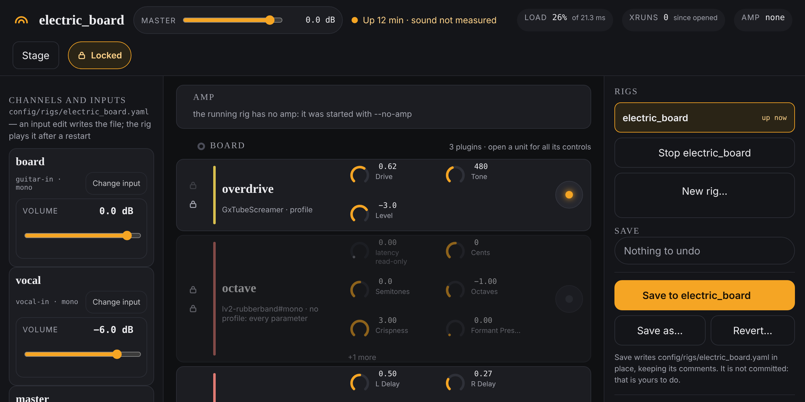

# User guides

How to play, shape, save and record with the rig, one guide for each thing you
do with it. Each takes a few minutes to read. Start with the first; after that,
read whichever you need.

A few words used throughout:

- A **rig** is one saved setup: its channels, the effects on each, and the amp.
- A **channel** is one input (a guitar, a microphone) with its own row of effects.
- A **plugin** is one effect. The page also calls a plugin's box a "unit".
- The **agent** is the small program that runs the rig and serves the page you
  control it from.
- The **rack** is the main page, laid out like a mixing desk. The **stage** is
  the simpler page for playing, and what a phone opens.

| Guide | What it covers |
|---|---|
| [Getting started](getting-started.md) | Start the agent, open the page, start a rig, use a phone |
| [Playing live](playing-live.md) | The stage screen, switching rigs, the lock, pedals |
| [Shaping a sound](shaping-a-sound.md) | Plugins, knobs, bypass, the amp, undo |
| [Mixing](mixing.md) | Each channel's volume, and the master |
| [Saving and going back](saving.md) | Save, Save as, Revert |
| [Building a rig](building-a-rig.md) | A new rig, adding a channel, changing an input |
| [Recording](recording.md) | Takes, what is in a take's folder, names |
| [The audio interface](audio-interface.md) | The iD14's volume fix, and what to do if one side goes quiet |
| [When something's wrong](troubleshooting.md) | No sound, restarting the agent after an update, `doctor` |

The pictures in these guides are of the real page, run against a stand-in rig,
so the rig's name, its plugins and its values are examples. Yours will differ.

For the detail behind any of this (the files, the commands, what the agent
does), see the [reference](../reference/README.md).
