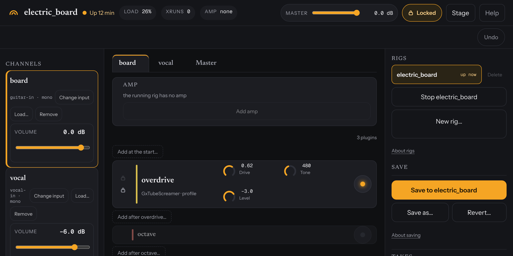

# User guides

How to play, shape, save and record with the rig, one guide for each thing you
do with it. Each takes a few minutes to read. Start with the first; after that,
read whichever you need. On the rig's page, **Help** opens them, served by
the rig itself, so they work without the internet, on a phone too.

A few words used throughout:

- A **rig** is one saved setup: its channels, the effects on each, and the amp.
- A **channel** is one input (a guitar, a microphone) with its own row of effects.
- A **plugin** is one effect. The page also calls a plugin's box a "unit".
- The **agent** is the small program that runs the rig and serves the page you
  control it from.
- The **rack** is the main page, laid out like a mixing desk. The **stage** is
  the simpler page for playing, and what a phone-sized screen opens.

The page's messages use a few names of their own:

- **Sushi** is the effects engine: the program the plugins run in. "Sushi
  exited", "nothing is running in Sushi" and "Up, but Sushi did not answer" are
  all about that program.
- **Carla** is the program the amp runs in. "Carla is not running" means the amp
  has stopped.
- **Stems** are a take's sound files, one for each thing recorded: "5 stems"
  is five files.
- **Headless** means started from the page, with no separate control panel
  beside the rig. Every rig the page starts is headless; "Started …, headless."
  is the normal message.

## Where the page tells you things

The top of the rack and of the stage screen has three parts:

- **The rig**, at the top left: its name, a dot that says whether it is up
  and, on a laptop, for how long, the **LOAD**, **XRUNS** and **AMP**
  readings, and any problem in a word or two, such as **No amp**. Hover over
  any of them for the whole of it. On a phone only the name and the dot
  show: tap the dot for the rest.
- **What you can change**, at the top right: **MASTER**, the **Lock**, and
  the **Stage** and **Help** links (at the foot of the page on a phone).
- **What happened**, in the bar under them. Every answer to something you
  did is said there: what worked ("Saved electric_board"), what was refused
  ("Not removed"), and anything waiting for your answer, such as
  **Restart?** with **Yes** and **No**. **Undo** is at its right end. The bar
  stays at the top of the window when you scroll, so you never have to go
  looking for a question. The channel's name beside a message is a button:
  tap it to go to that channel. The strip a question is about has a red edge
  while it waits. When more has happened than fits, a **+** and a number
  opens the rest, with what has gone by. A change made from another phone or
  page, such as a switch of rig, shows there too, marked **elsewhere**. A message that worked goes by itself after a while or
  stays until the next one; one that was refused stays until you close it
  with **×**.

| Guide | What it covers |
|---|---|
| [Getting started](getting-started.md) | Start the agent, open the page, start a rig, reach it from a phone |
| [Playing live](playing-live.md) | The stage screen, switching rigs, the lock, pedals |
| [Playing out](playing-out.md) | The phone at home, on its hotspot or the laptop's, when it cannot reach the laptop, the lid closed |
| [Shaping a sound](shaping-a-sound.md) | Plugins, knobs, bypass, the amp, undo |
| [Mixing](mixing.md) | Each channel's volume, and the master |
| [Saving and going back](saving.md) | Save, Save as, Revert |
| [Building a rig](building-a-rig.md) | A new rig, adding a channel, changing an input, deleting a rig |
| [Use a channel from another rig](channel-from-another-rig.md) | Any rig's channel, loaded onto a channel of yours |
| [Tremolo, flanger, tape echo and shimmer](effects.md) | Four effects: what each knob does, and how to try one |
| [String machine and synth lead](string-machine.md) | The string-machine and synth-lead rigs, and what to try on each |
| [Recording](recording.md) | Takes, what is in a take's folder, names |
| [The audio interface](audio-interface.md) | The iD14's volume fix, and what to do if one side goes quiet |
| [When something's wrong](troubleshooting.md) | No sound, restarting the agent after an update, `doctor` |

The pictures in these guides are of the real page, run against a stand-in rig,
so the rig's name, its plugins and its values are examples. Yours will differ.

For the detail behind any of this (the files, the commands, what the agent
does), see the [reference](../reference/README.md).
