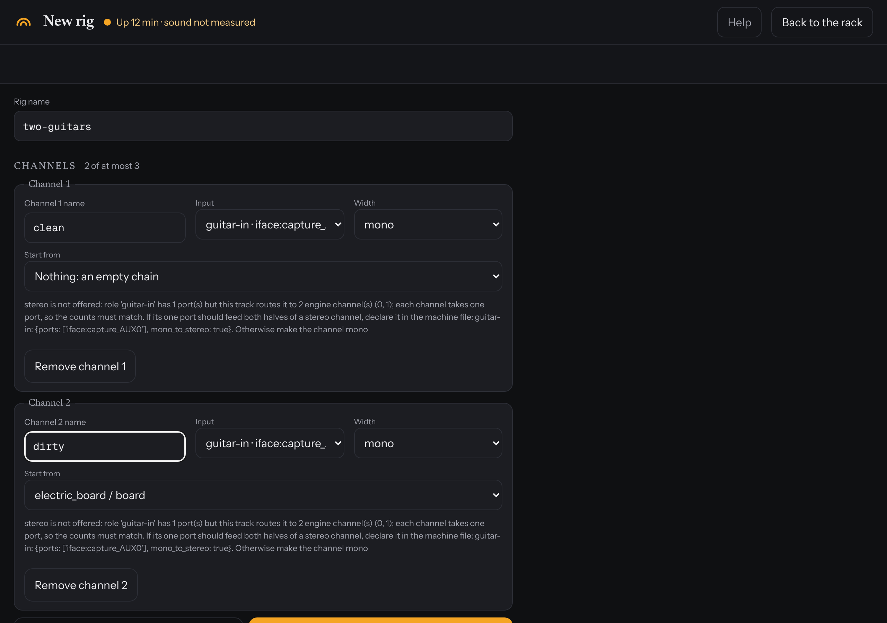

# Building a rig

This is how you make a new rig, add a channel to the one that is playing,
change which input a channel listens to, and delete a rig you no longer play.

A **rig** is one saved setup. A **channel** is one input with its own effects: a
guitar, a microphone. A rig has between one and three channels, and they all mix
into one **master** that goes to the monitors.

These screens are on the rack only, and work whether or not the page is locked.

## Make a new rig

1. On the rack, under **RIGS** on the right, click **New rig…**. The
   **New rig** screen opens.
2. Type a name under **Rig name**, such as `two-guitars`. Names are lowercase
   letters, digits, `-` and `_`. The line under the box tells you the file it
   will write, or what is wrong with the name.
3. Fill in **Channel 1**:
   - **Channel 1 name**: what to call it, such as `guitar`. This name is also
     the name of its file in a recording.
   - **Input**: where it listens. Each choice is an input's name and the socket
     behind it, such as `guitar-in` or `vocal-in`.
   - **Width**: **mono** for one socket, **stereo** for a pair. If an input
     cannot give one of them, that choice is greyed out and a line under the
     channel says why.
   - **Start from**: leave it at **Nothing: an empty chain** for a channel with
     no effects, or pick a channel of another rig to copy its effects and its
     volume, or a channel preset, listed first
     ([Channel presets](channel-presets.md)).
4. For another channel, click **Add channel** and fill it in the same way.
   Each channel then has a button to take it out again, **Remove channel 1**,
   **Remove channel 2** and so on. The count beside **CHANNELS** shows
   how many you have, of at most three.
5. Click **Create** and the rig's name.

A box headed **Made** confirms the file, and offers a button to play it:
**Start** and its name if nothing is running, **Switch to** and its name if a
rig is. **Back to the rack**, at the top right, leaves the screen.



## Add a channel to the rig that is playing

1. Save first if you have unsaved changes: the rig has to restart to play a new
   channel, and the page will refuse the edit until you have saved.
2. On the rack, at the bottom of the left column, click **Add channel**.
3. Fill in **New channel name**, **Input**, **Width** and **Start from**, as
   above.
4. Click **Add** and the channel's name.
5. A box headed **Added** confirms it. The channel is now in the rig's file but
   not yet in the sound. Click **Restart … to play it**, then **Restart now**.
   The sound stops for a few seconds while the rig comes back. **Not now** puts
   it off; the channel then plays the next time the rig starts.

## Change a channel's input

1. Save first, as above.
2. On the rack, in the channel's strip on the left, click **Change input**.
3. Pick the new **Input**, and the **Width** if that changes too.
4. Click **Apply to** and the channel's name, or **Cancel**.
5. Click **Restart … to play it**, then **Restart now**.

## Delete a rig

1. On the rack, under **RIGS** on the right, click **Delete** beside the rig.
   The rig that is playing has its **Delete** greyed out, with the reason under
   the list: switch to another rig, or stop it, first.
2. A box asks whether to delete the rig's file, `config/rigs/<name>.yaml`. It
   says what happens to the file,
   whether git can bring it back too, and, if your pedal's program numbers
   change, which rigs move, such as "electric-delay moves from program 6 to 5".
3. Click **Delete** and the rig's name, or **Cancel**.

A box headed **Deleted** says where the file went, and under it **Undo: put
back** and the rig's name. Both go by themselves after about 15 seconds, or
straight away with their **×**. Undo is not offered again after that, nor
after you reload the page.

The file is not gone: it is moved into `config/rigs/.deleted/`, a folder the
page, the pedal numbers and git all leave alone. If the rig was committed to
git, `git checkout` brings it back too; the box gives you the exact command.

### Put a deleted rig back by hand

Each deleted rig is one file in `config/rigs/.deleted/`, named after the rig
and the moment it was deleted, in UTC: `clean` deleted at 10:15:02 on 16
November 2026 is `clean-20261116T101502Z.yaml`. A rig deleted twice in the same
second gets `-2`, `-3` before `.yaml`. To put one back, in the checkout on the
rig's laptop:

```sh
ls config/rigs/.deleted/
mv config/rigs/.deleted/clean-20261116T101502Z.yaml config/rigs/clean.yaml
```

Check first that there is no `config/rigs/clean.yaml` already: `mv` would
replace it. Reload the page to see the rig in the picker again. Leave the
folder's `.gitignore` where it is.

## Things that may surprise you

- **Adding a channel or changing an input needs the rig to restart**, which is
  a few seconds of silence. Nothing changes in the sound until then.
- **A new channel with an empty chain has no effects.** Add them on the rack
  once the rig is running ([Shaping a sound](shaping-a-sound.md#add-a-plugin)),
  or use **Start from** to copy another channel's chain.
- **Two channels in one rig cannot both be copied from the same rig's
  channel.** Every plugin in a rig needs a name of its own, and a second copy
  would repeat the first's names. The page refuses it and says so. Two
  channels can start from the same **channel preset**: a preset's plugins are
  named for each channel they land on
  ([Channel presets](channel-presets.md)).
- **Three channels is the most a rig can have.** Asking for a fourth is refused
  with the reason.
- **The inputs on offer come from the machine's own file**, which lists the
  sockets on this laptop's interface. The page never changes that file. If a
  rig needs an input it does not list, the page shows the lines to add to it by
  hand ([The machine file](../reference/machine-file.md)).
- **Nothing here is committed to git.** Each box tells you what git thinks of
  the file; the commit is yours to make. Pushing a new rig leaves the checks
  green, with a warning and a sound reference for it to commit
  ([Saving](saving.md#when-you-push-a-saved-rig)).
- **A new rig can move the other rigs' pedal numbers.** If you switch rigs by
  program change from a pedal, the rigs are numbered in name order, so a new
  name can shift the ones after it. The **Made** box shows a table of which
  moved.
- **Deleting a rig moves the pedal numbers of the rigs after it** down by one,
  as a new rig moves them up. The box before you delete lists which.
- **Undo is refused if a rig of that name has been made since**, so a new file
  is never replaced; the box says so, and stays until you close it. The
  deleted file stays in `config/rigs/.deleted/`, to move back by hand if you
  want it ([Put a deleted rig back by hand](#put-a-deleted-rig-back-by-hand)).
  Undo is not offered at all once the deleted file has been removed from
  there.
- **`git clean -x` empties `config/rigs/.deleted/`**, because git is told to
  ignore it. A deleted rig that was never committed is then gone for good.
- **Undo is on this page only, and for about 15 seconds.** Another phone or
  laptop does not offer it, nor this one after a reload, but the file is in
  `config/rigs/.deleted/` for anyone to move back.
- The page has no way to rename a rig. A rig is one file in the project's
  `config/rigs/` folder.
- Adding a channel from the page and restarting to play it has been done on the
  rig: a vocal channel was added to a guitar rig that way. Making a whole new
  rig on the **New rig** screen, **Change input** and **Delete** are not yet
  recorded as tried on the rig.

## If something goes wrong

- **"… cannot be deleted"** in the delete box. It is the rig that is playing,
  usually because it was switched to from another page or a pedal meanwhile.
  Switch away, then try again.
- **A box headed "Not put back".** It gives the reason: a rig of that name is
  there again (the deleted one is still in `config/rigs/.deleted/`), or the
  deleted file is no longer there.
- **"… cannot be deleted now"** with **Try again**: the agent was busy with
  another command, such as a rig starting. Click **Try again**.
- **A box headed "Not made", "Not added" or "Not changed".** The agent checks
  that the rig would really run before it writes anything, and refused. The box
  gives the reason, and nothing was written.
- **The box mentions unsaved changes.** Save, then try again.
- **The restart is refused because of changes since.** The box offers
  **Restart anyway, dropping them**. Save instead if you want to keep them.
- **The left column says no rig is running**, or that the rig is a "v1 config".
  Start a rig from the list under **RIGS** first.
