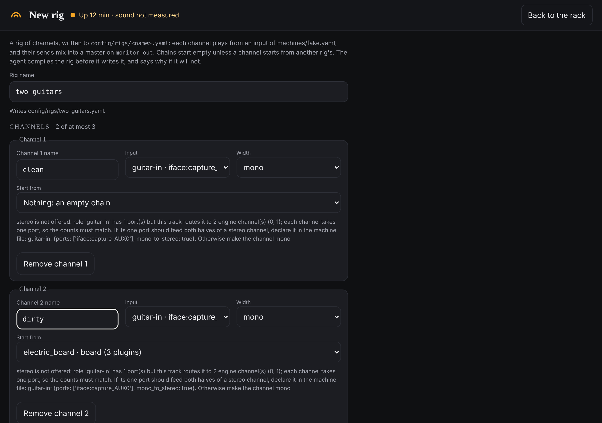

# Building a rig

This is how you make a new rig, add a channel to the one that is playing, and
change which input a channel listens to.

A **rig** is one saved setup. A **channel** is one input with its own effects: a
guitar, a microphone. A rig has between one and three channels, and they all mix
into one **master** that goes to the monitors.

These screens are on the rack only, and work whether or not the page is locked.

## Make a new rig

1. On the rack, under **RIGS** on the right, click **New rig…**. The
   **New rig** screen opens.
2. Type a name under **Rig name**, such as `two-guitars`. Names are lowercase
   letters, digits, `-` and `_`. The line under the box tells you the file it
   will write, or what is wrong with the name.
3. Fill in **Channel 1**:
   - **Channel 1 name**: what to call it, such as `guitar`. This name is also
     the name of its file in a recording.
   - **Input**: where it listens. Each choice is an input's name and the socket
     behind it, such as `guitar-in` or `vocal-in`.
   - **Width**: **mono** for one socket, **stereo** for a pair. If an input
     cannot give one of them, that choice is greyed out and a line under the
     channel says why.
   - **Start from**: leave it at **Nothing: an empty chain** for a channel with
     no effects, or pick a channel of another rig to copy its effects and its
     volume.
4. For another channel, click **Add channel** and fill it in the same way.
   **Remove channel** takes one out again. The count beside **CHANNELS** shows
   how many you have, of at most three.
5. Click **Create** and the rig's name.

A box headed **Made** confirms the file, and offers a button to play it:
**Start** and its name if nothing is running, **Switch to** and its name if a
rig is. **Back to the rack**, at the top right, leaves the screen.

## Add a channel to the rig that is playing

1. Save first if you have unsaved changes: the rig has to restart to play a new
   channel, and the page will refuse the edit until you have saved.
2. On the rack, at the bottom of the left column, click **Add channel**.
3. Fill in **New channel name**, **Input**, **Width** and **Start from**, as
   above.
4. Click **Add** and the channel's name.
5. A box headed **Added** confirms it. The channel is now in the rig's file but
   not yet in the sound. Click **Restart … to play it**, then **Restart now**.
   The sound stops for a few seconds while the rig comes back. **Not now** puts
   it off; the channel then plays the next time the rig starts.

## Change a channel's input

1. Save first, as above.
2. On the rack, in the channel's strip on the left, click **Change input**.
3. Pick the new **Input**, and the **Width** if that changes too.
4. Click **Apply to** and the channel's name, or **Cancel**.
5. Click **Restart … to play it**, then **Restart now**.

## Things that may surprise you

- **Adding a channel or changing an input needs the rig to restart**, which is
  a few seconds of silence. Nothing changes in the sound until then.
- **A new channel with an empty chain has no effects, and the page cannot add
  any yet.** To get effects on a new channel, use **Start from** to copy another
  channel's chain, or edit the rig's file by hand
  ([The rig file](../reference/rig-file.md)).
- **Two channels in one rig cannot both be copied from the same chain.** Every
  plugin in a rig needs a name of its own, and a second copy would repeat the
  first's names. The page refuses it and says so.
- **Three channels is the most a rig can have.** Asking for a fourth is refused
  with the reason.
- **The inputs on offer come from the machine's own file**, which lists the
  sockets on this laptop's interface. The page never changes that file. If a
  rig needs an input it does not list, the page shows the lines to add to it by
  hand ([The machine file](../reference/machine-file.md)).
- **Nothing here is committed to git.** Each box tells you what git thinks of
  the file; the commit is yours to make.
- **A new rig can move the other rigs' pedal numbers.** If you switch rigs by
  program change from a pedal, the rigs are numbered in name order, so a new
  name can shift the ones after it. The **Made** box shows a table of which
  moved.
- The page has no way to rename or delete a rig. A rig is one file in the
  project's `config/rigs/` folder.
- The project's log last recorded these screens as not yet tried on the rig
  itself. Rigs with a second channel have been saved from the laptop since, but
  the log does not say they were made here.

## If something goes wrong

- **A box headed "Not made", "Not added" or "Not changed".** The agent checks
  that the rig would really run before it writes anything, and refused. The box
  gives the reason, and nothing was written.
- **The box mentions unsaved changes.** Save, then try again.
- **The restart is refused because of changes since.** The box offers
  **Restart anyway, dropping them**. Save instead if you want to keep them.
- **The left column says no rig is running**, or that the rig is a "v1 config".
  Start a rig from the list under **RIGS** first.
