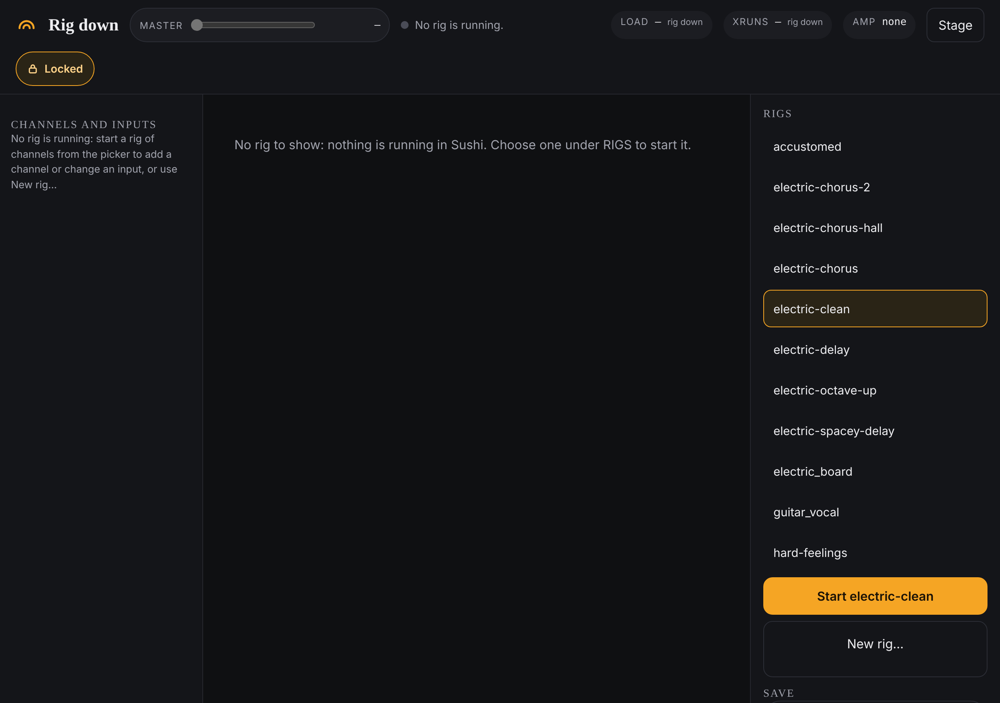

# Getting started

This takes you from a laptop that is switched on to a guitar you can hear:
start the agent, open the page, start a rig.

A **rig** is one saved setup of channels, effects and amp. The **agent** is the
small program that runs the rig and serves the page you control it from. It has
to be running before the page will open.

This guide assumes the laptop is already set up (see
[Environment](../reference/environment.md) if it is not) and that the interface
has had its one-time volume fix (see [The audio interface](audio-interface.md)).

## Start the rig

1. Plug in the interface, with the guitar in its first input and, if you sing,
   the microphone in its second. Turn the monitors or headphones down.
2. Open a terminal and run:

   ```bash
   sushi-rig agent
   ```

   It answers with a line like
   `sushi-rig agent … on http://127.0.0.1:8029  (Ctrl+C to stop)`. Leave that
   terminal open: closing it, or pressing Ctrl+C, stops the agent.
3. In a browser on the laptop, open <http://127.0.0.1:8029/>. This is the
   **rack**. With nothing playing, the top left reads **Rig down**.
4. On the right, under **RIGS**, click the rig you want. The big button under
   the list now reads **Start** and the rig's name.
5. Click **Start …**. It takes about five seconds. When it is done, a line
   appears saying **Started …, headless.**, the top left shows the rig's name,
   and beside it you see **Up** and how long, then **sound not measured**.
6. Turn the monitors up and play.



**sound not measured** is normal. Nothing in the rig listens to its own sound
yet, so the page tells you the rig is up but never claims it sounds right.

## Stop the rig

1. Under **RIGS**, click **Stop** and the rig's name.
2. The page asks again, because stopping cuts the sound. Click **Stop now**
   within a few seconds, or **Cancel**.

Stopping throws away any changes you have not saved. See
[Saving and going back](saving.md).

Closing the browser does not stop the rig, and neither does stopping the agent:
the rig keeps playing until you stop it.

## Use your phone as well

The agent normally answers only to the laptop it runs on. To reach it from a
phone:

1. Start the agent with this instead:

   ```bash
   sushi-rig agent --host 0.0.0.0
   ```

2. Find the laptop's address on your network (`hostname -I` prints it).
3. On the phone, on the same network, open `http://<that address>:8029/`.

A phone opens on the **stage** screen, which is made for playing: see
[Playing live](playing-live.md). The phone and the laptop show the same rig, and
a change on one appears on the other within a second.

Started this way, anyone on the same network can open the page and change the
rig. There is no password. Use it on a network you trust.

## If something goes wrong

- **The page will not open, or the top left reads "Agent not answering".** The
  agent is not running. Start it (step 2).
- **A box appears starting "Not started:".** The agent refused, and the box says
  why in its own words. Read that first.
- **The rig says it is up but you hear nothing, or only one side.** See
  [When something's wrong](troubleshooting.md).
- **You pulled an update and the page behaves oddly.** The agent keeps running
  the old code until it is restarted. See
  [When something's wrong](troubleshooting.md#after-an-update).
