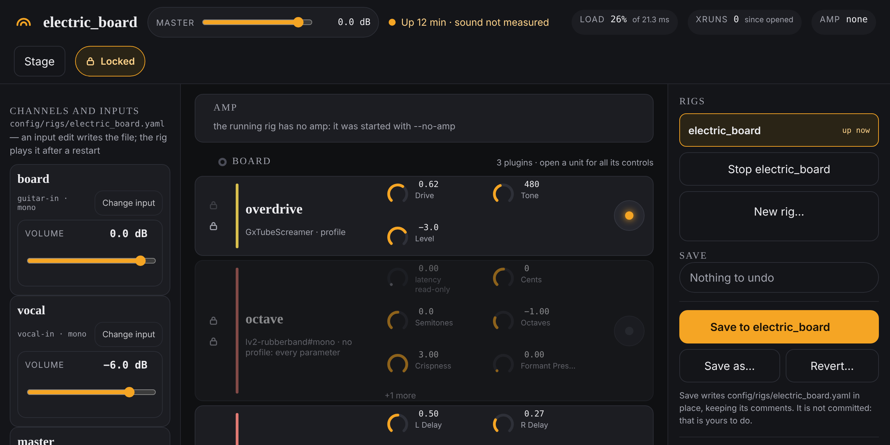

# Mixing

Mixing here means two things: how loud each channel is against the others, and
how loud the whole rig is. Each channel has a **VOLUME** fader, and there is one
**MASTER** fader for everything.

A **channel** is one input with its own effects: the guitar is one channel, a
microphone is another.

## Where the faders are

- **MASTER** is in the header, at the top of both the rack and the stage screen.
- Each channel's **VOLUME** is in that channel's strip, down the left of the
  rack, and under **CHANNELS** on the stage screen.

They are the same faders in both places: move one on the phone and it moves on
the laptop.

## Set a volume

1. Find the fader.
2. Move it in any of these ways:
   - **Drag** it. It settles on whole numbers of dB as you pass them.
   - **Type**: click the number beside it, type a value and press Enter. You can
     type `-6`, `-6 dB`, or `mute`, `off` or `-inf` for silence.
   - **Scroll** over it with the wheel or trackpad, after resting the pointer
     on it for a moment. Each notch is half a dB; hold Shift for finer.
   - **Keys**: click the fader, then use the arrow keys for half a dB, Page Up
     and Page Down for 5 dB, Home for silence and End for the top.

The fader runs from **−∞** (silent) at the bottom, then from −60 dB up to
+6 dB. At **0.0 dB** nothing is added or taken away.

The volumes work while the page is **Locked**, and never ask you to confirm:
they are meant to be reached for while you play.

## What each one changes

- A channel's **VOLUME** is how much of that channel goes into the mix. It
  comes after the channel's effects, so it does not change how hard the sound
  hits them.
- **MASTER** is the level of the finished mix, on its way to the monitors.

The strip at the bottom of the left column, **master**, is the mix itself. It
says how many plugins are on the master's own chain; click its name to jump to
them. Its volume is the **MASTER** fader in the header.

Like any other change, a volume can be taken back with **Undo** and is kept only
when you save: see [Saving and going back](saving.md).

## Things that may surprise you

- **A recording's channel files ignore the channel volumes.** Each channel is
  recorded as its effects left it, before its fader. Only the mix file follows
  your faders. See [Recording](recording.md).
- **A fader that says "driven by" and a name cannot be moved.** A pedal is set
  up to fade that channel, and it would undo whatever you set. See
  [Playing live](playing-live.md#pedals).
- **The faders show "—" and will not move** when no rig is running.
- The volume faders are newer than most of the page. The project's log still
  lists them as not yet tried on the rig itself.

## If something goes wrong

- **You hear nothing from one channel.** Check its **VOLUME** is not at −∞, and
  that none of its plugins is doing the silencing: bypass them one at a time.
- **You hear nothing at all.** Check **MASTER**, then see
  [When something's wrong](troubleshooting.md).
- **A box appears starting "Not changed:".** The agent refused the change; the
  box says why.
