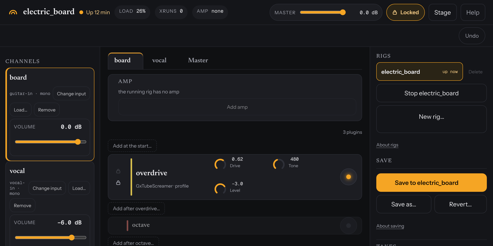

# Mixing

Mixing here means two things: how loud each channel is against the others, and
how loud the whole rig is. Each channel has a **VOLUME** fader, and there is one
**MASTER** fader for everything.

A **channel** is one input with its own effects: the guitar is one channel, a
microphone is another.

## Where the faders are

- **MASTER** is in the header, at the top of both the rack and the stage screen.
- Each channel's **VOLUME** is in that channel's strip, down the left of the
  rack, and under **CHANNELS** on the stage screen.

They are the same faders in both places, and on every device: move one and it
moves everywhere within a second.

On the rack the strips stay together down the left whichever channel's plugins
are open in the middle. Clicking a strip's name opens that channel's tab there
([Shaping a sound](shaping-a-sound.md#pick-the-channel-to-work-on)); moving
its fader does not.

## Set a volume

1. Find the fader.
2. Move it in any of these ways:
   - **Drag** it. It settles on whole numbers of dB as you pass them.
   - **Type**: click the number beside it, type a value and press Enter. You can
     type `-6`, `-6 dB`, or `mute`, `off` or `-inf` for silence.
   - **Scroll** over it with the wheel or trackpad, after resting the pointer
     on it for a moment. Each notch is half a dB; hold Shift for finer.
   - **Keys**: click the fader, then use the arrow keys for half a dB, Page Up
     and Page Down for 5 dB, Home for silence and End for the top.

The fader runs from **−∞** (silent) at the bottom, then from −60 dB up to
+6 dB for a channel, and up to **0.0 dB for MASTER**. At **0.0 dB** nothing is
added or taken away.

On the stage screen each volume also has **−0.5** and **+0.5** buttons either
side of its fader: a tap is half a dB, and holding one keeps stepping. See
[Playing live](playing-live.md#what-is-on-the-stage-screen).

The volumes never ask you to confirm: they are meant to be reached for while
you play. On the rack they work while the page is **Locked**. On the stage
screen the lock holds them, so a thumb that knocks one mid-song changes
nothing: unlock to move them (see [The lock](playing-live.md#the-lock)).

## What each one changes

- A channel's **VOLUME** is how much of that channel goes into the mix. It
  comes after the channel's effects, so it does not change how hard the sound
  hits them.
- **MASTER** is the level of the finished mix, on its way to the monitors.

Adding, taking out or moving a plugin dips the whole mix for a moment, a few
hundredths of a second, and brings it back to where **MASTER** was; the fader
does not move. If you move **MASTER** during the dip, your level wins. See
[Shaping a sound](shaping-a-sound.md#the-short-dip-when-the-chain-changes).

Every rig's master ends with a **limiter**, a safety net the rig always has:
below −1 dBFS it does not touch the sound at all, and above it, it pulls a
sudden loud peak (a feedback squeal, a pedal stamped on at full) back toward
full scale. It is not a wall: something very loud still gets through, louder
than full scale, and at extreme levels it may not turn it down at all (it can
even come out louder than it went in). It is a net for an accident, not a
reason to play into it. You cannot turn it off, move it or
change it from the page; the **Master** tab shows it as one line, at the end.
That is also why **MASTER stops at 0.0 dB**: it comes after the limiter, so
turning it up past 0 would turn up what the limiter let through. To make the
mix louder, raise the channels' volumes instead. A rig started before the
limiter came in may still have **MASTER** above 0 dB: its fader says "over the
top", scrolling or pressing up does nothing, and the first move down, or any
add, removal or move of a plugin, brings it to 0 dB.

The strip at the bottom of the left column, **master**, is the mix itself. It
says how many plugins are on the master's own chain; click its name to open
the **Master** tab in the middle and see them. Its volume is the **MASTER**
fader in the header.

Like any other change, a volume can be taken back with **Undo** (at the top of
the page; one drag is one step) and is kept only
when you save: see [Saving and going back](saving.md).

## Things that may surprise you

- **A recording's channel files ignore the channel volumes.** Each channel is
  recorded as its effects left it, before its fader. Only the mix file follows
  your faders. See [Recording](recording.md).
- **A fader that says "driven by" and a name cannot be moved.** A pedal is set
  up to fade that channel, and it would undo whatever you set. See
  [Playing live](playing-live.md#pedals).
- **The faders show "—" and will not move** when no rig is running.
- The channel **VOLUME** faders have been mixed with on the rig. The **MASTER**
  fader is not yet recorded as tried on the rig itself.

## If something goes wrong

- **You hear nothing from one channel.** Check its **VOLUME** is not at −∞, and
  that none of its plugins is doing the silencing: bypass them one at a time.
- **You hear nothing at all.** Check **MASTER**, then see
  [When something's wrong](troubleshooting.md).
- **A box appears starting "Not changed:".** The agent refused the change; the
  box says why.
