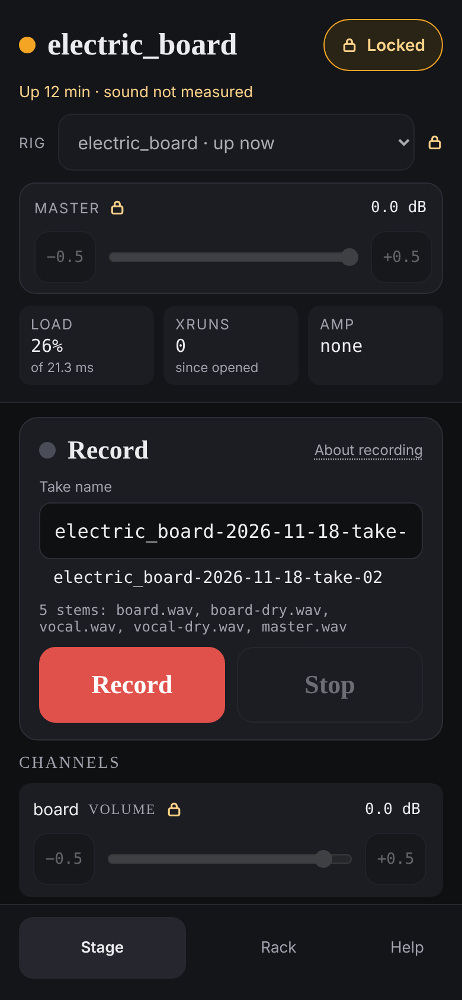

# Playing live

The **stage** screen is the page for playing: everything you might reach for
mid-song is big, and everything that could cut the sound by accident is put out
of reach. This guide covers that screen, switching between rigs, the lock,
pedals, and the visualiser.

A screen as narrow as a phone's opens the stage screen by default. To reach it
from a phone, see
[Getting started](getting-started.md#use-your-phone-as-well), and away from
home [Playing out](playing-out.md). On the laptop,
click **Stage** at the top of the rack; **Rack**, at the bottom of the stage
screen, takes you back.

## What is on the stage screen

From the top:

- **The rig's name**, beside the **Locked** button. It is also a dropdown of
  your rigs, for switching: see [Switch to another rig](#switch-to-another-rig).
  A name too long for the screen ends in **…**. Under it, whether the rig is up
  and for how long. With no rig up it says **Rig down**.
- **MASTER**: the overall volume. See [Mixing](mixing.md).
- **LOAD**: how much of its time budget the rig is using. Near 100% the sound
  starts to break up, and the tile says **over budget**.
- **XRUNS**: how many times the sound has dropped out since you opened the
  page. If it says **rising**, it is dropping out now.
- **AMP**: the amp model that is playing, or **none**.
- **Record**: see [Recording](recording.md).
- **CHANNELS**: a volume for each channel, under the channel's name.
- **A card for each plugin** (each effect), grouped under its channel's name.

Every volume is one row: its name with its level in dB under it, then a
**−0.5** button, the fader and a **+0.5** button. Tap the level to type one.
A tap on a button moves the volume by exactly half a dB, which is easier on a
phone than nudging the fader. Hold a button and it keeps stepping, about ten
steps a second, for up to 6 dB; let go and hold again to go further. It stops
as soon as your finger slides off the button or you switch to another app.
**MASTER** stops at 0 dB, as its fader does, and a channel's volume at +6 dB.
If the master is above 0 dB because the rig was started before that limit,
**+0.5** does nothing and **−0.5** brings it straight down to 0 dB. The volumes
only move while the page is unlocked: see [The lock](#the-lock).

## Turn an effect on or off

Each card has a round button on its right. Tap it to **bypass** the effect,
which switches it off without removing it. Tap again to switch it back on. The
button glows when the effect is on, and the whole card dims when it is bypassed.

To reach an effect's main knobs, tap its name. The card opens; tap the name
again to close it. For every control an effect has, use the rack: see
[Shaping a sound](shaping-a-sound.md).

## The lock

The page starts **Locked**. On the stage screen that holds every volume and
puts stopping and switching the rig out of reach, so a stray thumb cannot cut
the sound or change a level mid-song. The rack keeps its **Stop** and
**Switch to** buttons, and its volumes, even while locked: the lock does not
protect you there.

While locked you can still turn knobs, bypass effects and record. What the lock
takes away:

- on the stage screen, every volume: **MASTER** and each channel's volume do
  not move by dragging, tapping, the mouse wheel, the keyboard, a typed value
  or the **−0.5** and **+0.5** buttons. Each shows a small lock beside its
  name, and its fader and buttons are greyed out;
- on the stage screen, switching rigs (the rig's name shows no dropdown arrow
  and does nothing when tapped), **Start** and **Stop**, and the amp;
- on the rack, moving a plugin up or down its chain, changing the amp's
  model, and assigning a pedal (the pedal buttons still open, to show what is
  assigned, but their choices are greyed out).

To unlock:

1. Tap **Locked**. It changes to **Tap again to unlock**.
2. Tap it again within four seconds. It now reads **Lock off · editing**.

To lock again, tap **Lock off · editing** once.

Two things to know. Each browser remembers its own lock, so unlocking the laptop
does not unlock the phone. And it is only this page's lock: it does not stop a
pedal, or another device that is unlocked, from changing the rig.

## Switch to another rig

On the stage screen:

1. Unlock. The rig's name at the top gets a dropdown arrow.
2. Tap the rig's name and choose the rig you want; the one playing is already
   selected. There is no second question: choosing a different rig switches
   to it at once.

While the switch runs, the name cannot be tapped and a line under the tiles
says what is happening. With no rig up, choosing a rig does not start it: tap
**Start** and its name, under the tiles. **Stop** is there instead while a rig
is up, and asks again before it stops the sound.

On the rack the list of rigs is always there, under **RIGS** on the right: tap
the rig you want, then **Switch to** and its name.

A line then tells you how it went. **Switched to … live** means the change was
made without restarting anything: on the rig this took about a second or less,
with no click or gap heard. **Switched to … by restart**, followed by the
reason, means the rig had to stop and start again, which is about five seconds
of silence. That happens when the two rigs differ in ways that cannot be changed
on the fly: different channels, a different amp model, or an amp on one and not
the other.

**A switch throws away unsaved changes without asking.** If you have turned
knobs you want to keep, save first: see [Saving and going back](saving.md).

If a take is recording when you switch, the take is finished first (not yet
tried on the rig).

## Pedals

A rig can be set up to answer a MIDI pedal or pad controller: a footswitch or
pad that switches one effect, or one channel, on and off, an expression pedal
that sweeps a knob, rides a channel's volume or fades from one channel to
another, and program changes that switch rigs. The pedal itself is described
once, in the machine's file; what each of its controls does on a rig is the
rig's own, and is assigned on the rack (below), or written into the rig's file
by hand. The details are in [MIDI](../reference/midi.md).

The pedalboard is a Line 6 FBV Express MkII, with four footswitches and a pedal:

- **A and B** step to the previous and next rig, in the order of the rig list,
  on every rig. They stop at the first and last rig rather than wrapping round.
  A step may restart the rig, which is about five seconds of silence. A press
  while a switch is still running is ignored rather than saved up, so press
  again once the rig is playing.
- **C and D** each turn an effect or a channel on and off, as assigned on each
  rig. One press turns it on, the next turns it off.
- **The pedal** sweeps a knob, or rides a channel's volume, as assigned on
  each rig. On a volume, the heel is silent and the toe is the channel's own level,
  never louder; half way is about 20 dB quieter. The silence at the heel needs
  the agent running: without it the heel is quiet, not silent. It cannot ride
  the master volume.

### Assign a pedal on the rack

On the rack, beside each effect's on/off switch and beside each channel's
name, is a small pedal button. It is dashed while nothing is assigned there,
and shows the control's name (**C**, **pedal**) once something is. To assign:

1. Unlock (see [The lock](#the-lock)).
2. Tap the pedal button beside what you want the board to work. A small panel
   opens under it, with a choice for each thing you can assign there:
   - beside an effect: **On/off** (a footswitch turns the effect on and off)
     and **pedal sweeps** (the pedal sweeps one of the effect's knobs, which
     you pick from the list);
   - beside a channel: **On/off** (a footswitch turns the whole channel on and
     off) and **Volume** (the pedal rides its volume).

   Only the controls that can do that are offered: footswitches for on/off,
   the pedal for a volume or a knob. A and B are never offered: they step rigs.
3. Pick the control. Pick **none** to take it off again.

If the control you pick is already doing something else on this rig, the page
asks first, naming what it is on now: **Move C** moves it, **Keep it** leaves
everything as it was. A control does one thing on a rig, so moving it takes it
off the other.

What you assign is written into the running rig's file, keeping the file's
comments, and not committed. A footswitch on an effect, or a momentary
footswitch on a channel, works at once. The pedal on a volume or a knob, and a
latching footswitch on a channel, need the rig to restart (about five seconds
of silence) before they work: the page says so and offers **Restart**. If you
have turned knobs since the last save, that restart would lose them, so the
page asks you to save first. Undo does not take an assignment back: assign
again, or pick **none**.

The rig's file says which board its pedals are for. The first assignment on a
rig fills that in for you when the machine's file describes one board; if it
describes several, the **PEDALS** section asks which.

### What each control does, and whether the board is heard

Under the channel strips, **PEDALS** lists each control of the board and what
it does on this rig: for example **C** board/drive on/off, **D** vocal on/off,
**pedal** lead volume, with A and B as previous and next rig. Above the list is
the board's state:

- **listening**: the board is plugged in and the agent is reading it;
- **not connected**: it is not plugged in, and this rig does not need it;
- **waiting**: this rig has pedals assigned and the board is not plugged in.
  Plug it in and it is picked up at once.

Each control has a light that comes on briefly whenever a message from it
arrives, and the pedal's row shows the last value it sent (0 at the heel, 127
at the toe). The pedal button of whatever a control is assigned to lights up
too. Press each switch and rock the pedal to check that the board is connected
and sending: a control whose light never comes on is not sending what the
machine's file says. This is only a check: pressing a control assigns nothing.

### Playing with them

If a pedal is riding or fading a channel, that channel's **VOLUME** says
**driven by** and the pedal's name, and cannot be moved from the page. To change
how loud the toe is, change the channel's level in the rig's file and start the
rig again.

If the pedal is not plugged in, A and B do nothing and nothing is shown as
wrong, unless the rig's own pedal settings are for it: then the page says the
rig is waiting for its pedal. Plug it in (or back in, if it was knocked out
mid-set) and it works at once, without restarting the rig.

Not yet tried on the rig: the FBV has not arrived, so its settings in the
machine file are a best guess, and none of the saved rigs has a pedal set up.
Nothing has been played through a real pedal; only the pad controller's own
messages have been checked. Assigning on the rack, and the lights, have been
tried only against a stand-in for the board and for Sushi.

## The visualiser

Leave the laptop alone for a few seconds while a rig is running and the page
turns into a visualisation that moves with your playing, like a screensaver.
Touch the screen, move the mouse or press a key and the page comes straight
back. That touch or key does nothing else: it will not press the button under
your finger.

It only runs on the rig's own laptop, in a browser open at
`http://localhost:8029/` (or `http://127.0.0.1:8029/`), in a window at least
900 pixels wide. Phones do not get it: they are for working the rig.

**What it listens to: the rig's output.** When the visualiser is about to
start, the page asks the agent to offer what the rig sends to your monitors
to the browser, as an input called **Sushi rig output**: the whole mix after
the amp, the effects, the master chain, the master limiter and the master
volume, which is what you EQ. The visualiser listens to that first. While it
listens the page keeps asking for it; when it stops (you touch the page, the
tab is hidden, the page closes), it lets go, and a few minutes later the
agent takes the input away again. If the agent cannot offer it (the rig was
started with `--no-visualiser-tap`, the agent is not the one running the rig,
or PipeWire would not give it realtime priority), the visualiser listens to
the guitar's input on the audio interface, and failing that to the browser's
default input.

Nothing is added to the path to the monitors, and no delay. It is not
nothing to the rig, though: while the rig's output is offered, PipeWire does
a little work for it in each of the rig's cycles, and now and then that work
can be late, which is a cycle the rig did not finish in time (see below).
That is why it is only there while the visualiser is listening.

**The first time it starts, the browser asks to use the microphone.** That is
how the page hears the rig. Choose **Allow**: if the browser offers to allow it only
this time, choose the one that keeps it for this site instead, and in Firefox
tick **Remember this decision** first. Then it will not ask again. Whatever input the question offers, the page then
picks **Sushi rig output**, or the guitar's own input from the rig's machine file.

The line at the very bottom of the page holds its settings:

- **Visualiser**: untick it to turn it off. This browser remembers.
- **after … s without a touch**: how long to wait, 3 to 600 seconds. 10 to start with.
- **listening to**: **automatic** (the rig's output, else the guitar's input)
  or another input, and which channel of it. An input you choose here wins
  whenever it is there. The line says which one it heard, for example
  "Sushi rig output (the rig's output: the master, after its limiter)".
- **Show now**: try it straight away.
- **look**: **random** to begin with: the looks come in a random order, each
  for half a minute to a minute, never the same one twice running, and each a
  little different in colour and movement every time it comes on. **random,
  monochrome** keeps to the black-and-white and one-colour ones; **random,
  equalisers** to the four that show the spectrum. Pick one by name to keep it
  on, say while you work on a sound.

If it does not start, the same line says why: no rig running, the window too
narrow, the browser told not to use the microphone (allow it again in the
browser's site settings for this page), the computer asking for reduced
motion, or a browser that would draw it without the graphics card. That last
would take the processor the rig needs, so it stays off.

**If the rig glitches while it is up, it stops.** If XRUNS rises while the
visualiser is listening, it goes, and the line says "Stopped: the rig
glitched while the visualiser was listening". If it was listening to the
rig's output, that is taken away at once too, and the line says so. It stays
off until you reload the page or tick **Visualiser** again. The glitch may
not have been its doing, but it is not worth finding out on stage.

**Check once that PipeWire can keep up with it.** Run `sushi-rig doctor` and
look for `pulse-realtime` and `visualiser-tap`. "pipewire-pulse runs realtime"
is what you want for the first; the second fails if PipeWire would not give
the rig's output realtime priority (the agent then never offers it, and the
visualiser hears the guitar's input), and says what to install. Even
realtime, the rig's output was late between once in 20 seconds and five
times in 15 seconds when measured (on a busy test machine, not on the rig),
and each time is a cycle the rig did not finish: if you
would rather not have that at all, start the rig with
`sushi-rig up --no-visualiser-tap`, and `restart` and switching rigs keep
that choice; or turn the visualiser off. You can
check by hand too: `ps -L -o tid,cls,rtprio,comm -p "$(pgrep -x pipewire-pulse)"`
should show a thread (`pw-data-loop`) with `FF` in the `CLS` column.

### The looks

Thirteen, all made for the rig. **Embers**, **Tide** and **Bloom** are the
soft, colourful ones. **Tunnel**, **Shutter**, **Smoke**, **Mirror**, **Storm**
and **Eclipse** are stark: black and white or a single colour, with hard
edges, deep zooms and smoke. Some of them flash on a loud attack, never more
than twice in any second. **Bars**, **Curve**, **Aurora** and **Mono bars**
are like an equaliser's display, and show what frequencies you are playing.

### Reading the equaliser looks

Bars, Curve and Aurora all use the same frequency scale and the same colours,
so once you learn them, they read the same in all three. Low notes are on the left and
high ones on the right, and each octave takes the same width: there are eight,
from almost an octave below the low E on the left to 12 kHz on the right. There are no
numbers on screen. Where a colour is lit, and how bright, tells you what is sounding:

- **deep red**: the lowest notes: the low E and drop tunings, boom and thump.
- **red**: the low strings' fundamentals.
- **orange**: low-mids, mud, and the high strings' open notes.
- **yellow**: boxiness, and notes high up the neck.
- **green**: the mids: honk and nasal tones.
- **cyan**: upper mids: bite, where a guitar cuts through a band.
- **blue**: presence: pick attack and edge, where fizz starts.
- **violet**: fizz, hiss and air.

In **Bars**, each colour is a block of six bars with a wider gap between
blocks. A small cap above each bar holds its peak for a moment, then falls
back slowly. **Curve** is a single glowing line, with faint lines at each
octave's edge. In **Aurora** a note you hold builds up a haze in its colour
that stays a few seconds after it stops, so a build-up you keep hitting, such
as mud in orange, shows as a glow that will not go. A picked note flickers
and is gone. Faint marks along the bottom show where each octave starts.
**Mono bars** is Bars in one colour, without the colour map.

The display rescales to the loudest part, so it reads the same whatever your
level is. It shows which parts are louder than the others, not how loud you are.

## If something goes wrong

- **A box appears at the top saying something "exited".** A part of the rig has
  stopped. The box says which part and what it means for the sound. Nothing
  restarts by itself: see [When something's wrong](troubleshooting.md#a-part-of-the-rig-has-stopped).
- **XRUNS is rising, or the sound crackles.** See
  [When something's wrong](troubleshooting.md#crackles-and-dropouts).
- **A box starts "Not switched to".** The agent refused, or the switch failed,
  and the box gives the reason. The rig that was playing is left playing where
  that is possible.
- **The top reads "Agent not answering".** The agent has stopped. The rig itself
  may well still be playing. Start the agent again: see
  [Getting started](getting-started.md).
