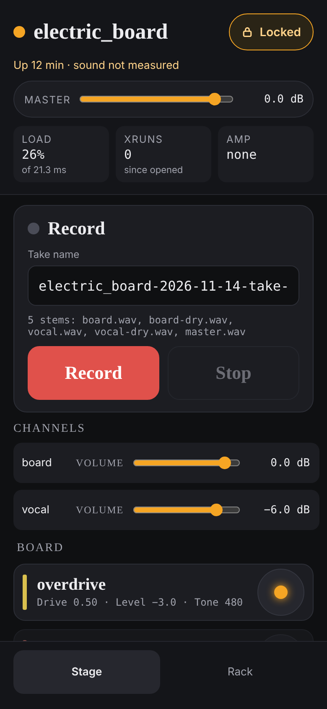

# Playing live

The **stage** screen is the page for playing: everything you might reach for
mid-song is big, and everything that could cut the sound by accident is put out
of reach. This guide covers that screen, switching between rigs, the lock, and
pedals.

A screen as narrow as a phone's opens the stage screen by default (from a real
phone this is not yet recorded as tried: see
[Getting started](getting-started.md#use-your-phone-as-well)). On the laptop,
click **Stage** at the top of the rack; **Rack**, at the bottom of the stage
screen, takes you back.

## What is on the stage screen

From the top:

- **The rig's name**, and under it whether it is up and for how long.
- **MASTER**: the overall volume. See [Mixing](mixing.md).
- **LOAD**: how much of its time budget the rig is using. Near 100% the sound
  starts to break up, and the tile says **over budget**.
- **XRUNS**: how many times the sound has dropped out since you opened the
  page. If it says **rising**, it is dropping out now.
- **AMP**: the amp model that is playing, or **none**.
- **Record**: see [Recording](recording.md).
- **CHANNELS**: a **VOLUME** fader for each channel.
- **A card for each plugin** (each effect), grouped under its channel's name.

## Turn an effect on or off

Each card has a round button on its right. Tap it to **bypass** the effect,
which switches it off without removing it. Tap again to switch it back on. The
button glows when the effect is on, and the whole card dims when it is bypassed.

To reach an effect's main knobs, tap its name. The card opens; tap the name
again to close it. For every control an effect has, use the rack: see
[Shaping a sound](shaping-a-sound.md).

## The lock

The page starts **Locked**. On the stage screen that puts stopping and switching
the rig out of reach, so a stray thumb cannot cut the sound mid-song. The rack
keeps its **Stop** and **Switch to** buttons even while locked: the lock does
not protect you there.

While locked you can still turn knobs, bypass effects, move every volume and
record. What the lock takes away:

- on the stage screen, the list of rigs (so no start, stop or switch) and the
  amp;
- on the rack, moving a plugin up or down its chain, and changing the amp's
  model.

To unlock:

1. Tap **Locked**. It changes to **Tap again to unlock**.
2. Tap it again within four seconds. It now reads **Lock off · editing**.

To lock again, tap **Lock off · editing** once.

Two things to know. Each browser remembers its own lock, so unlocking the laptop
does not unlock the phone. And it is only this page's lock: it does not stop a
pedal, or another device that is unlocked, from changing the rig.

## Switch to another rig

1. On the stage screen, unlock, then scroll to the very bottom: **RIGS** is the
   last thing on the screen, below every plugin's card. (On the rack the list
   is always there, under **RIGS** on the right.)
2. Under **RIGS**, tap the rig you want. The one playing is marked **up now**.
3. Tap **Switch to** and its name. There is no second question: it switches at
   once.

A line then tells you how it went. **Switched to … live** means the change was
made without restarting anything: on the rig this took about a second or less,
with no click or gap heard. **Switched to … by restart**, followed by the
reason, means the rig had to stop and start again, which is about five seconds
of silence. That happens when the two rigs differ in ways that cannot be changed
on the fly: different channels, a different amp model, or an amp on one and not
the other.

**A switch throws away unsaved changes without asking.** If you have turned
knobs you want to keep, save first: see [Saving and going back](saving.md).

If a take is recording when you switch, the take is finished first (not yet
tried on the rig).

## Pedals

A rig can be set up to answer a MIDI pedal or pad controller: a pad that switches
one effect on and off, an expression pedal that sweeps a knob or fades from one
channel to another, and program changes that switch rigs. This is written into
the rig's file and the machine's file by hand; the page has no screen for it.
The how is in [MIDI](../reference/midi.md).

If a pedal is fading a channel, that channel's **VOLUME** says
**driven by** and the pedal's name, and cannot be moved from the page.

Not yet tried on the rig: none of the saved rigs has a pedal set up, and nothing
has been played through a real pedal. Only the pad controller's own messages
have been checked.

## If something goes wrong

- **A box appears at the top saying something "exited".** A part of the rig has
  stopped. The box says which part and what it means for the sound. Nothing
  restarts by itself: see [When something's wrong](troubleshooting.md#a-part-of-the-rig-has-stopped).
- **XRUNS is rising, or the sound crackles.** See
  [When something's wrong](troubleshooting.md#crackles-and-dropouts).
- **A box starts "Not switched to".** The agent refused, or the switch failed,
  and the box gives the reason. The rig that was playing is left playing where
  that is possible.
- **The top reads "Agent not answering".** The agent has stopped. The rig itself
  may well still be playing. Start the agent again: see
  [Getting started](getting-started.md).
