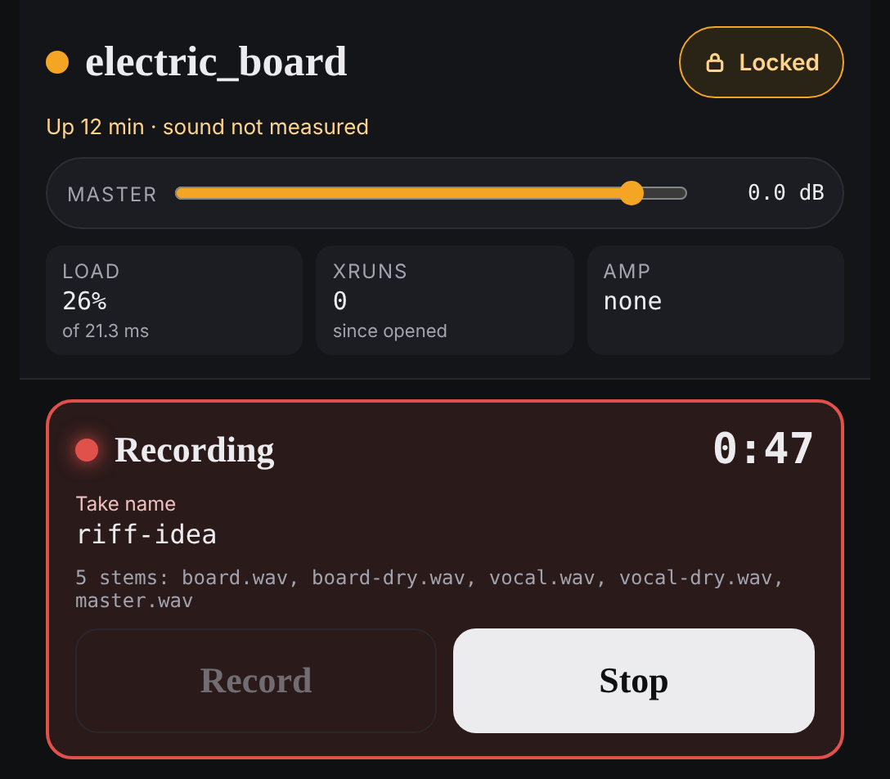

# Recording

The rig can record what you play, straight from the page. A **take** is one
recording. It is saved as a folder holding a sound file for each channel, the
mix you heard, and a copy of the rig that made it.

Recording is on the **stage** screen, and works while the page is **Locked**.



## Record a take

1. Start a rig from the page, if one is not playing
   ([Getting started](getting-started.md)).
2. Open the stage screen: on a phone it is the first screen; on the laptop,
   click **Stage** at the top of the rack.
3. Optionally type a name under **Take name**, such as `riff-idea`. Names are
   lowercase letters, digits, `-` and `_`. With no name, the take is named from
   the date and time it starts, like `take-20261106-203817`.
4. Tap **Record**. The bar turns red and reads **Recording**, with the take's
   name and a running clock. The line under the name lists the files being
   written.
5. Play.
6. Tap **Stop**. There is no second question, because stopping loses nothing.

A line headed **Recorded** and the take's name gives the verdict: its length,
then **Whole** and **nothing lost** if all is well, or the first problem found
if not.

## Find your takes

Takes go in a folder called `sushi-rig-takes` in your home folder on the rig's
laptop, one folder for each take. The rack lists them on the right, under
**TAKES**, newest first, each with its length and its verdict.

The page cannot play a take or open its folder. Use a file manager, or your
recording software.

## What is in a take's folder

For a rig with a channel called `guitar` and one called `vocal`:

| File | What it is |
|---|---|
| `guitar.wav`, `vocal.wav` | Each channel by itself, after its effects, **before its volume fader** |
| `guitar-dry.wav`, `vocal-dry.wav` | Each input exactly as it came into the interface: no amp, no effects |
| `master.wav` | The mix as you heard it, with the channel volumes, the master's effects and the master volume |
| `take.yaml` | Notes about the take: what was recorded, whether it is complete, and how the files line up |
| `config.json`, `rig.yaml` | The rig exactly as it was, so the take can be remade through the same sound later |

The files are named after your channels, so a rig whose one channel is called
`board` gives `board.wav`, `board-dry.wav` and `master.wav`.

Three things worth knowing about these files:

- **The channel files are deliberately without the channel's volume.** Whatever
  the **VOLUME** faders were at, each channel is recorded at the level its
  effects left it, so you can rebalance later. If you want the balance you
  heard, that is `master.wav`.
- **The dry files are for re-amping**: playing the bare guitar back through a
  different sound later.
- **The dry files run slightly ahead of the others**, by about five thousandths
  of a second. They are written exactly as captured; `take.yaml` says how far
  to slide them to line up.

## Names

- Recording under a name you have already used does not overwrite the earlier
  take. The earlier one is moved into a folder called `_archive` inside the
  takes folder, and the bar warns you before you start:
  **Will replace the earlier …, which moves to _archive/…**.
- A name the rules do not allow is refused before the take starts, with the
  rule shown under the box.

## Things that may surprise you

- **Stopping the rig, switching rigs or changing the amp's model while
  recording finishes the take first.** The take is kept, up to that moment.
- **Recording needs a rig started the way the page starts one.** A rig started
  from a terminal in an older way cannot be recorded here. If the bar reads
  **Recording is off**, the line under it says why.
- There are no level meters, and the page does not show how much disk space is
  left.
- One take has been recorded on the rig so far to prove this works, with a
  one-channel rig. A two-channel rig records more files at once, and that has
  not yet been tried on the rig.

## If something goes wrong

- **The bar reads "Recording is off".** Read the reason under it. Most often no
  rig is running.
- **A line headed "Not recording".** The take did not start; the reason
  follows.
- **The verdict names a problem**, or a take in the **TAKES** list has a
  warning. For the full story, run this in a terminal, with the take's name:

  ```bash
  sushi-rig take check ~/sushi-rig-takes/riff-idea
  ```

- **The rig crashed or was killed mid-take.** The take is cut off but not
  lost. This makes it readable:

  ```bash
  sushi-rig take repair ~/sushi-rig-takes/riff-idea
  ```

The detail of how takes are stored and checked is in
[Takes](../reference/takes.md).
