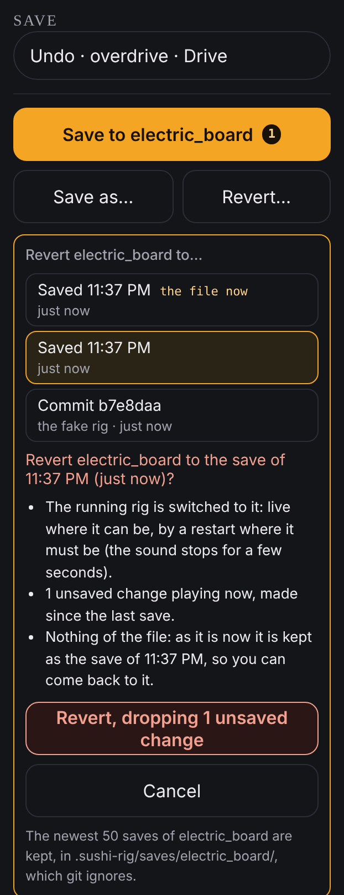

# Saving and going back

Everything you change on the page is heard at once but kept only when you save.
This guide covers the three buttons that deal with that: **Save**, which keeps
the rig as it sounds now; **Save as…**, which keeps it under a new name; and
**Revert…**, which goes back to an earlier save.

They are on the right of the rack, under **SAVE**. They are not on the stage
screen.

A **rig** is one saved setup, and each rig is one file on the laptop, in the
`config/rigs/` folder of the project.

## Save

1. Look at the big button, **Save to** and the rig's name. A number on it is
   how many changes you have made since the last save.
2. Click it.

A box headed **Saved** and the rig's name tells you which file was written. The
number on the button goes away.

Saving works while the page is **Locked**, and does not interrupt the sound.

## Save under a new name

Use this to keep a variation without touching the rig you started from.

1. Click **Save as…**.
2. Type a name under **New rig name**. Names are lowercase letters, digits,
   `-` and `_`, such as `electric-board-2`. The line under the box tells you
   the file it will write, or what is wrong with the name.
3. Click **Save as** and the name.

The new rig appears in the list under **RIGS**, and it becomes the rig that is
playing: from now on **Save** writes to the new name, and the old rig is left as
it was at its last save.

## Go back to an earlier save

Every time you save, the rig keeps a copy of the file as it was written. The
newest 50 for each rig are kept.

1. Click **Revert…**. A list opens, headed **Revert … to…**. Each line
   starting **Saved** is one of your saves, with its time; the one marked
   **the file now** is what the file holds at this moment. Lines starting
   **Commit** are older versions kept by git, if there are any.
2. Click the one you want to go back to.
3. Read the question that appears. It says what will happen to the sound and
   exactly what, if anything, will be lost.
4. Click **Revert now**. If you have unsaved changes the button instead reads
   **Revert, dropping** and how many; clicking it throws those changes away.
   **Cancel** backs out.

The rig then changes to that save. Where it can, it changes without stopping;
where it cannot, it restarts, and the sound stops for a few seconds. A box
headed **Reverted** says which it was.

Usually you can come back the same way, because the save you left is still in
the list. The question in step 3 tells you when it is not.

Reverting has not yet been tried on the rig itself, only against a stand-in.

## Things that may surprise you

- **Switching to another rig, or stopping the rig, throws away unsaved changes
  without asking.** Save first.
- **A save writes the file and does not commit it.** If you use git to keep the
  project's history, or to move rigs between machines, the commit is yours to
  make. The **Saved** box tells you what git thinks of the file.
- **The number on Save counts only what the agent has seen**: changes made
  through the page since the rig started or was last saved. After the agent
  has been restarted it starts again from nothing, so no number does not prove
  the file matches what you hear. That is why **Save** is always offered. If in
  doubt, save.
- **Undo is not Revert.** **Undo**, the button above **Save**, takes back one
  change at a time since you started; **Revert…** goes back to a whole saved
  version. See [Shaping a sound](shaping-a-sound.md#take-a-change-back).
- **The amp is saved as the page last set it.** The amp cannot be asked what it
  is set to.
- **The copies Revert lists live on this laptop only**, in a hidden folder of
  the project called `.sushi-rig`. They are not part of what git shares.

## If something goes wrong

- **A box headed "Not saved" or "Not saved as …".** The agent refused; the box
  gives the reason. A name that another rig already has is refused.
- **The buttons are greyed out.** The line under them says why. Usually no rig
  is running. If it says the rig is a "v1 config" or runs "with its panel", the
  rig was started from a terminal in an older way: stop it and start it from
  the page.
- **A box headed "Not reverted".** Nothing was changed; the box says why. If it
  mentions unsaved changes the page had not counted, it offers
  **Revert anyway, dropping them**.
- **A box headed "Reverted the file, but … is not playing it".** The file went
  back but the running rig did not follow. Stop the rig and start it again to
  hear the reverted version.
