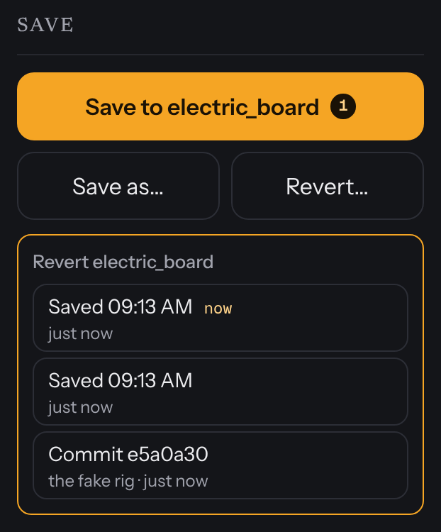

# Saving and going back

Everything you change on the page is heard at once but kept only when you save.
This guide covers the three buttons that deal with that: **Save**, which keeps
the rig as it sounds now; **Save as…**, which keeps it under a new name; and
**Revert…**, which goes back to an earlier save.

They are on the right of the rack, under **SAVE**. They are not on the stage
screen.

A **rig** is one saved setup, and each rig is one file on the laptop, in the
`config/rigs/` folder of the project.

## Save

1. Look at the big button, **Save to** and the rig's name. A number on it is
   how many changes you have made since the last save.
2. Click it.

A box headed **Saved** and the rig's name tells you it worked; hover over it for
the file and what git thinks of it. The number on the button goes away.
**Undo**, at the top of the page, puts the file back as it was before the save.

Saving works while the page is **Locked**, and does not interrupt the sound.

## Save under a new name

Use this to keep a variation without touching the rig you started from.

1. Click **Save as…**.
2. Type a name under **Name**. Names are lowercase letters, digits,
   `-` and `_`, such as `electric-board-2`. A short line under the box says
   what is wrong with the name, if anything.
3. Click **Save as** and the name.

The new rig appears in the list under **RIGS**, and it becomes the rig that is
playing: from now on **Save** writes to the new name, and the old rig is left as
it was at its last save.

## Go back to an earlier save

Every time you save, the rig keeps a copy of the file as it was written. The
newest 50 for each rig are kept.

1. Click **Revert…**. A list opens, headed **Revert** and the rig's name. Each
   line starting **Saved** is one of your saves, with its time; the one marked
   **now** is what the file holds at this moment. Lines starting **Commit**
   are older versions kept by git, if there are any.
2. Click the one you want to go back to. It happens at once: **Undo** takes it
   back.
3. If you have unsaved changes, the page asks **Drop changes?** instead:
   **Yes** reverts and throws those changes away (Undo cannot bring them
   back); **No** leaves everything as it was.
4. If going back means restarting the rig, the page asks **Restart?** first,
   since the sound stops for a few seconds: **Yes** reverts, **No** leaves
   everything as it was.

The rig then changes to that save, without stopping where it can. A box
headed **Reverted** says how. **Undo** asks the same two questions when
taking a revert back needs them.

Usually you can come back the same way, because the save you left is still in
the list. The question in step 3 tells you when it is not.

Reverting has not yet been tried on the rig itself, only against a stand-in.

## When you push a saved rig

The project's checks run on every push. One of them plays each rig through
Sushi and compares how it sounds with a recording of the numbers kept for it,
its sound reference. What happens to a rig you saved:

- **You changed a setting, or added a rig.** The checks stay green. They play
  the rig anyway and make sure it makes a sound on both sides and nothing
  broke, and then leave a warning on the run that names the rig and says its
  reference is out of date ("STALE"). The warning has the new reference in
  it, and the run keeps it as a download called `stale-sound-references`.
- **To clear the warning**, commit that file as `config/sound/<name>.yaml`,
  with the name the warning gives. From then on the rig is compared with it
  exactly again. Until you do, the rig is only checked for working, not for
  sounding as it did.
- **You renamed or removed a rig or a channel.** Its old reference is left
  behind. The checks stay green and warn about it ("orphaned"); delete the
  file the warning names.
- **The checks go red when the sound changed and you did not change the
  rig**: an update to the code or a plugin changed it. That is for whoever
  changed them, not for you. They also go red if a rig plays nothing, or plays
  on one side only, whatever its reference says.

Saving the file again with a number written differently (`1` where it said
`1.0`), or with its comments or layout changed, does not count as a change.
Nor does a change to the amp, the pedals' MIDI map, the rig's description or
which inputs it plays from: the check plays the rig's effects through Sushi,
and none of those reaches it.

## Things that may surprise you

- **Switching to another rig, or stopping the rig, throws away unsaved changes
  without asking.** Save first.
- **A save writes the file and does not commit it.** If you use git to keep the
  project's history, or to move rigs between machines, the commit is yours to
  make. The **Saved** box tells you what git thinks of the file.
- **The number on Save counts only what the agent has seen**: changes made
  through the page since the rig started or was last saved. After the agent
  has been restarted it starts again from nothing, so no number does not prove
  the file matches what you hear. That is why **Save** is always offered. If in
  doubt, save.
- **Undo is not Revert.** **Undo**, at the top of the page, takes back one
  change at a time; **Revert…** goes back to a whole saved version (and Undo
  takes a revert back too). See [Shaping a sound](shaping-a-sound.md#take-a-change-back).
- **The amp is saved as the page last set it.** The amp cannot be asked what it
  is set to.
- **The copies Revert lists live on this laptop only**, in a hidden folder of
  the project called `.sushi-rig`. They are not part of what git shares.

## If something goes wrong

- **A box headed "Not saved" or "Not saved as …".** The agent refused; the box
  gives the reason. A name that another rig already has is refused.
- **The buttons are greyed out.** The line under them says why. Usually no rig
  is running. If it says the rig is a "v1 config", the rig was started from a
  terminal in an older way: stop it and start it from the page.
- **A box headed "Not reverted".** Nothing was changed; the box says why. If it
  mentions unsaved changes the page had not counted, it offers
  **Revert anyway, dropping them**.
- **A box headed "Reverted the file, but … is not playing it".** The file went
  back but the running rig did not follow. Stop the rig and start it again to
  hear the reverted version.
