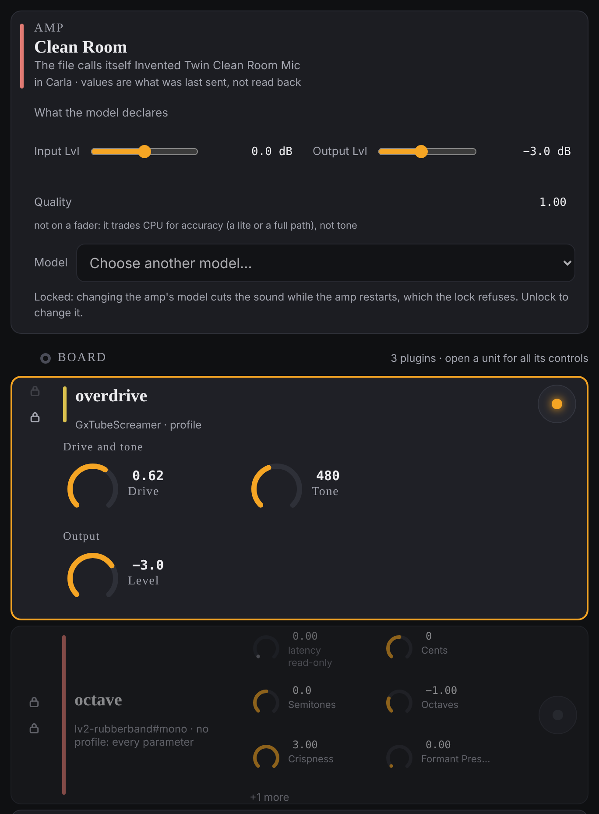

# Shaping a sound

This is how you change what the rig sounds like: open a plugin, turn its knobs,
switch it off and on, change its place in the chain, set the amp, and take a
change back. All of it is on the **rack**, the main page.

A **plugin** is one effect: a compressor, an overdrive, a delay. A channel's
plugins sit in a row, in the order the sound passes through them; that row is
its **chain**. The page calls a plugin's box a "unit".

Every change is heard at once. None of it is kept until you save: see
[Saving and going back](saving.md).

## Open a plugin and turn a knob

1. In the middle of the rack, find the plugin under its channel's name. Each
   row shows the plugin's name, a few of its knobs and, on the right, a round
   bypass button.
2. Click the plugin's name. The row opens to show all its controls, in groups.
   Click the name again to close it.
3. Change a knob in any of these ways:
   - **Drag** it up or down. Hold Shift, or put a second finger down, to move
     ten times more finely.
   - **Type**: click the number beside the knob, type a value and press Enter.
     Escape puts the old value back.
   - **Scroll** with the wheel or trackpad, after resting the pointer on the
     knob for a moment.
   - **Keys**: click the knob, then use the arrow keys for a step, Page Up and
     Page Down for ten, Home and End for the ends.

Some controls are switches, which you click, and some are lists, which you pick
from.

Values are shown in each plugin's own range. A plugin
that says **no profile: every parameter** under its name has not been tidied up
for the page yet: it shows every control it has, in a plain list.

## Switch a plugin off and on

Click the round button at the right of the plugin's row. This is **bypass**: it
switches the effect off without removing it. The button glows when the effect is
on; the row dims when it is bypassed.

## Move a plugin along its chain

1. Unlock the page: click **Locked**, then **Tap again to unlock**. (See
   [Playing live](playing-live.md#the-lock).)
2. Click **▲** or **▼** at the left of the plugin's row to move it one place
   earlier or later.

While the page is locked those two buttons show a padlock.

## Set the amp

The **AMP** card sits above the chains, because the amp comes before the
effects. If the rig has no amp, the card says so.

- **Input Lvl** and **Output Lvl** are faders, in dB. Drag them, or type a
  value in the box beside them.
- **Quality** is shown but cannot be changed here. It trades computer effort
  for accuracy, not tone.
- **Model** changes which amp is playing:
  1. Unlock the page.
  2. Pick a model from the **Model** list.
  3. Click **Load** and the model's name, or **Cancel**.

  The sound cuts out for a moment while the amp restarts (a little over a second
  on the rig); the rest of the rig keeps running. In the list, **(playing)**
  marks the current model and **(cannot be played here)** marks one made for a
  different sample rate.

The card says its values are **what was last sent, not read back**. The amp
cannot be asked what it is set to, so the page shows what it last told it.

On the stage screen, with the lock off, you get the amp's model name and
**Output Lvl** only.

## Take a change back

On the right of the rack, under **SAVE**, the top button names the last change,
for example **Undo · overdrive · Drive**. Click it to put that change back.
Click again for the one before.

- It takes back knobs, bypasses, moves, volumes and the amp's levels, newest
  first.
- It also takes back a change of the amp's model. That restarts the amp, so the
  sound cuts out for a moment, just as the change did.
- There is no redo.
- It stops at a rig switch: the button then reads
  **Nothing to undo past the rig switch**.
- If the rig has changed since in a way that makes the undo unsafe, a box
  explains and offers **Skip it**, which gives up on that change so you can undo
  the one before.

Undo has not yet been tried on the rig itself, only against a stand-in.

## What you cannot do from the page yet

- **Add or remove a plugin.** The page can only work with the plugins a rig
  already has. To give a channel different plugins, start a new channel from
  another rig's chain ([Building a rig](building-a-rig.md)), or edit the rig's
  file by hand ([The rig file](../reference/rig-file.md)) and start the rig
  again.

## Small things you will notice

- A small **mono** mark beside a plugin's name means the plugin works on one
  side only and its output is copied to both. If the mark is amber, the plugin
  sits after a stereo one and flattens its width; hover over it to see which.
  Putting mono plugins before stereo ones avoids that.
- A greyed knob marked **read-only** is something the plugin reports, not
  something you can set.

## If something goes wrong

- **A knob shows "refused:" under it, and a box appears starting
  "Not changed:".** The agent would not make the change; the reason is in the
  box and in the knob's tooltip.
- **A box headed "Not moved:" and the plugin's name, with a reason starting
  "Locked:".** You tried to move a plugin while the page is locked. Unlock it
  and try again.
- **The Model list is greyed out, with a line starting "Locked:" under it.**
  The same: unlock the page to change the amp's model.
- **A box starts "Amp model not changed:".** The model did not load. The box
  says whether the previous model was brought back; if it was not, see
  [When something's wrong](troubleshooting.md#a-part-of-the-rig-has-stopped).
- **Everything in the middle is replaced by "No rig to show".** No rig is
  running. Start one: see [Getting started](getting-started.md).
