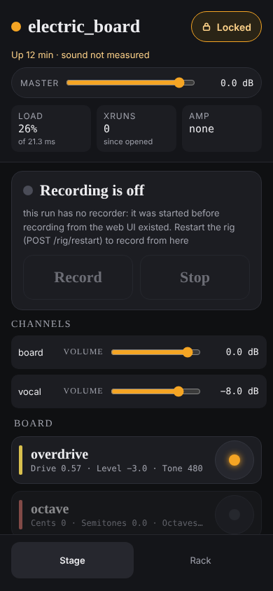

# The web UI

How the page the agent serves is built and how it behaves, control by control.
To use it, read the [user guides](../guide/README.md); this page is for
changing it, or for finding out exactly what a control does.

```bash
sushi-rig agent                      # then open http://127.0.0.1:8029/ (the rack)
                                     # or http://127.0.0.1:8029/#stage (the stage screen; the default on a phone)
```




The agent serves the UI at `/`, from `tool/src/sushi_rig/ui/static/`: plain HTML, CSS
and JavaScript with no build step and no framework, because the rig machine has
no Node and the UI has to run from a checkout. Two screens from the mockups
(the `S` numbers below are the mockups' frame names), and the New rig screen:

- **The rack (S1), laid out as a mixing desk (2026-11-06).** Three columns,
  because that is how a desk is read: a **strip per channel on the left** (its
  name, a small, quiet input line, and its volume as the large part, then a
  strip for the master, which leads to its chain), **the
  chains and the amp in the middle**, the widest part, and **the files on the
  right**: the rig picker, New rig…, Start, Stop and Switch, Undo, Save,
  Save as…, Revert…, and the takes. The **master volume is in the header**,
  not in a column. At phone width the columns stack in that order, strips
  first, since volume is what a hand reaches for. Every chain is a row of
  plugin cards, each with its knobs: the profile's controls in its groups and
  labels for a plugin that has one (`tool/examples/profiles/`), every
  parameter in a plain list for one that does not. Values are in the plugin's
  own range, never 0 to 1. A turned knob is sent at once. **Nothing comes,
  goes or moves as values change** (the player's first request: "was 0.5 dB"
  labels that popped in and out). Each knob's text, label and note have a
  size of their own whatever they hold, and the one sign of unsaved work is a
  count on the Save button, in a box that is always there; the itemised list
  of changes and the per-knob "was" are gone. Undo stays, above Save: it is an
  action, not a view of history. A browser test compares every element's box
  before and after four changes.
- **Knobs that can be set (2026-11-06).** A knob is dragged **vertically, 320
  px for its whole travel**, with the pointer
  captured, so leaving the knob mid-drag does not drop it; **shift, or a
  second finger, is a tenth of the speed**. **The wheel and a trackpad** step
  it a notch at a time, but only over the dial or fader itself (never its
  label or text), only when it can be set, and only when meant: the pointer
  has rested on it 300 ms since it arrived and since the page last scrolled,
  or it has the focus. Otherwise the wheel scrolls the page, so a scroll down
  a rack of knobs passes over them rather than stopping at one and turning
  it. A step is about 1 % of the range, rounded to 1, 2 or 5
  times a power of ten so steps land on values one would type (a send's 144
  dB in 1 dB steps, the overdrive's 24 dB Level in 0.2, a 0-to-1 Drive in
  0.01, a 900 Hz Tone in 5 Hz; an integer one at a time; a log scale 1 % of
  its travel); the profiles have no step of their own to give. The keys do
  the same: arrows a step, PageUp and PageDown ten, Home and End the ends.
  **The value under each knob is a text field** in the knob's units: a click
  selects it, Enter or leaving commits, Escape puts it back; it is read with
  or without the unit, a typographic minus, a comma, "-inf"; clamped to the
  range; exact, never snapped; and nonsense is refused in place (red, its
  reason in the title) and not sent. A poll never writes into a field that
  has the focus, and only what was typed is ever committed: a field left
  untouched while the value moved under it shows the value again. **Whole
  numbers are sticky**: within 0.15 of a whole number in the units shown
  (dB, %, plain numbers), a drag lands on it and holds it until 0.35 away; a
  scroll notch always moves the value the way it was turned, and lands on a
  whole number it crosses; a normalised 0-to-1 parameter with no unit is held
  to hundredths instead. Fine control does not snap: it is for the
  values between. The amp's faders and every volume take a typed value and
  the wheel the same way. The decisions are rig.js's (`dragPosition`,
  `sticky`, `stepped`, `scrolled`, `wheelNotches`, `parseTyped`), each
  tested on its own.
- **Volume (2026-11-06): the master's and each channel's.** One fader for
  both, in dB: **−∞, then −60 to +6 dB**, a range safe to reach for in the
  dark, where −∞ is the gain's own floor (−120 dB on the −120 to +24 range a
  track's gain and a send's have, below hearing) rather than a mute
  parameter, so one parameter is the volume, one undo puts it back and one
  line of the file holds it. Each takes a drag (sticky to whole dB), the wheel
  (0.5 dB a notch, a tenth with shift), the keys (Home is −∞) and a typed
  value ("-6", "−6 dB", "mute", "-inf"). **The master's** is in both screens'
  headers, on the master track's own gain, through the same POST
  /live/parameter as a knob: it is in the log, Undo takes it back, Save writes
  it as `master: level: <dB>` (new, compiled to that gain as a channel's
  `level:` is to its send's; unity writes nothing, so every committed rig
  compiles exactly as before, checked byte for byte), and a live switch sets
  it as a step, never a restart. **A channel's** is its send's gain, its
  `level:` (#101), at the top of its strip on the rack and in the stage's
  levels; it replaces the small "send to master" knob that ended each row, so
  there is one control per channel. Both are **usable while locked**, with no
  confirm: volume is a performance control. **A channel a MIDI blend drives**
  says "driven by <control>" on its fader and cannot be set from here: the
  pedal's next move would undo it, and a save does not write a blended
  channel's gain as its level (`fold_state`), so a move would be neither kept
  nor heard for long. Which channels are blended comes from `GET
  /rigs/<rig>/channels`'s `blended`.
- **The stage screen (S5).** One glance: the rig, up or down, load and xruns,
  each channel's level, and the last error. One tap: a 56 px bypass per plugin,
  or a card opened for its knobs. Locked by default; unlocking takes two taps.
- **Start, stop and switch (v0.1, #111).** The rigs of `config/rigs/` in a
  list (the rack's right column; on the stage screen only while the lock is
  off): pick one and Start it (a rig of channels, headless, since the page
  replaces the panel), Switch to it, or Stop the one that is up, which takes a
  second tap because it cuts the sound. A switch says whether it was made live
  or by restart, and why. While a command runs, from this page or another,
  nothing else is offered and what is running is said; a refusal shows the
  agent's reason.
- **The amp.** A card at the top of the rack, since the amp is in front of the
  board: the model's name and what it declares, faders for Input and Output in
  dB, Quality shown but not on a fader (it trades CPU for accuracy, not tone),
  and a model picker that takes a confirm saying the sound cuts out for a
  moment, refused while locked. Values are labelled as what was last sent,
  never as read back. On the stage screen, only the model's name and the
  output level, and only while the lock is off, as the rig picker is. With
  the panel running, the faders and picker are off and say the panel owns the
  amp.
- **Save (S4).** In the files column, under Undo: Save writes the
  running rig's own file of `config/rigs/` in place, keeping its comments, and
  is offered whenever a rig that can be saved from here is up, since the
  count on it is only what the agent saw (its title says since when, and
  that a count of none is not proof the file holds what is playing); for a
  v1 run or one with its panel both buttons are off and say how to save
  instead. Save as… asks for a name, checks it by
  the rule the agent saves by (lowercase letters, digits, `-` and `_`) before
  sending, and writes a new rig that becomes the running one. The answer says
  what was written, that it is **not committed** (the agent never commits) and
  the commit it sits on, or the agent's reason for refusing (another rig's
  name, a plugin on the rig the agent did not add, or one gone that it did
  not remove). The count then
  starts from that save: a change after it, or an undo past it, is unsaved
  again. Allowed while locked, since it changes neither the sound nor the
  structure. Not on the stage screen: saving is not a stage action.
- **The compiler's copies to stereo, and "mono" (2026-11-06).** A copy to
  stereo (`<plugin>_to_stereo`, stereo.py) is the compiler's, and is shown
  nowhere: not as a card on either screen, nor among bypasses, unsaved
  changes or undo. The page knows one by whatever says so first, its uid,
  the reserved suffix no other name may carry, or a role of "stereo", before
  any role `/live/plugins` gives (on the rig, copies were drawn as plugins;
  a browser test makes `/live/plugins` give one a null role and finds it
  nowhere). The plugin a copy follows carries a small **mono** badge, its
  title "mono: processes the left side and its output is copied to both";
  where it follows a stereo plugin on the same chain, with nothing mono
  between, the badge is amber and says "after <that plugin>: this collapses
  its stereo width", since Sushi gives a mono plugin channel 0 alone (#119).
  Each plugin's width comes from plugin-ports.txt, the compiler's own table,
  as `width` on `/live/plugins`.
- **Revert to a previous save (2026-11-06).** The only view of history the
  rack has, beside Save. **Every save from here keeps a snapshot** of the file
  exactly as it was written, with when, the rig, and the commit it sat on, in
  `<checkout>/.sushi-rig/saves/<rig>/`: with the checkout, because a snapshot
  is a version of one of its files (the runtime dir is tmpfs and forgets them
  at logout, and the user's state dir would need keying by checkout and would
  outlive one deleted). The directory ignores itself (a `.gitignore` of `*`
  inside, beside the line in the repository's own), so `git status` stays
  clean in any checkout. **The 50 written last per rig are kept**, pruned by
  the order they were written, never by the clock (the rig's can run behind),
  and never the one just written; the commits are there for anything older.
  A git that does not answer leaves the saves listed and says why the
  commits are not. "Revert…" lists the saves by time and how long
  ago, the one the file is now marked, then **the file's own commits** (`git
  log`, read-only, off the agent's loop, with a timeout). Choosing one opens a
  confirm that **names what is lost**: the unsaved changes playing now, and
  the file as it stands, unless a save or its commit keeps it. The agent
  writes the point back **byte for byte** (a plain write, not `write_rig`,
  which merges into the file that is there and so keeps *its* comments, not
  the snapshot's), compiling it first and refusing with the compiler's reason
  if it no longer compiles. **The running rig is switched to it through the
  live switch** (#112): live where it can be (values, bypasses, plugins added,
  removed or moved), by restart where it must be, and the result says which
  and why. With unsaved live work the agent refuses (409 `unsaved`, as an edit
  of the file does), and the page's confirm offers "Revert, dropping N unsaved
  changes"; a refusal for work the page had not counted offers the same as a
  second tap. The revert's entry in the log is the new baseline: nothing is
  unsaved after it, and Undo stops there. `GET /rigs/<name>/saves` and `POST
  /rigs/<name>/revert {"save", "discard"?}` are the agent's routes.
- **New rig, and a channel's input.** "New rig…" under the rack's rig picker
  opens the New rig screen (`#new-rig`): a name, then a channel per row, each
  with a name, an input picked from the machine file's roles (each shown with
  its port), mono or stereo, and optionally a channel of another rig to start
  from. Stereo is offered only where the role can give it: otherwise the
  option is there but off, with the patchbay's reason under it (one port
  needs `mono_to_stereo`). "Add channel" adds rows up to three, and past that
  refuses with the compiler's own arithmetic; the agent's reasons for those
  hints come from `GET /machine/roles`, which asked the compiler. Create
  writes the file and offers to start it (or switch to it, with a rig up);
  the agent's refusal is shown in place, with the lines to add to the machine
  file when a role is missing. On the rack, each channel's strip shows its input as the running
  rig's file has it, with "Change input", and "Add channel" is under the
  strips. With no rig of channels up, the column still says CHANNELS AND
  INPUTS and why nothing can be edited there, and what to do instead (start
  a rig of channels from the picker, or New rig…, which the picker offers
  whatever is running): on the rig, a v1 run drew nothing at all, and
  nothing said why a vocal channel could not be added. Each edit
  writes the file, says what git says of it, and offers the restart that
  plays it, which takes a confirm since the sound stops for a few seconds. The
  edits are not behind the page's lock (they write a file, and the restart is
  a separate tap); with unsaved changes the rack says Save comes first, and
  the agent refuses until then. A change made after the edit makes the
  offered restart refuse too, with the reason in place and "Restart anyway,
  dropping them" as a second tap. A new rig that moves other rigs' Program
  Change numbers says so under Create, with a table of before and after.
  Nothing of this is on the stage screen.
- **Record (S7, S8).** A record bar on the stage screen, as the canvas's Record
  frame has it: a take name, a big Record and a big Stop, and while a take
  runs its name and elapsed time in red. Both work locked (recording is a stage
  action), and Stop takes no confirm, since stopping a take loses nothing.
  Whether a take is running is the agent's answer, never the page's, so a page
  opened mid-take shows it running. The name field is filled in with the
  agent's default for the next take (`<rig>-<date>-take-<nn>`,
  [Takes](takes.md#names)), so Record can be pressed straight away. Entering
  the field selects the whole default, so typing replaces it; what was typed
  is the player's to edit and is left alone, and it stays through polls, a rig
  switch and other pages' takes until it is recorded with or cleared. A field
  left empty shows the default again. Only what was typed is sent as a name:
  Record on an untouched field sends none, and the agent names the take by its
  count at that moment. **Selecting the default on a tap is untested on
  WebKit, so on a real phone**: only Chromium is in the tests, and the
  selection is deferred past the tap because WebKit places the caret after the
  focus event (`app.js`, `nameField`). At a phone's width the field is
  narrower than a default name: at 390 px it shows
  `electric_board-2026-11-14-take-` and not the number (seen in
  `docs/guide/img/stage-phone.png`). A name
  already taken says the earlier take moves to `_archive/`. Why recording is
  off is said on the bar (no rig, the panel, a v1 run, no recorder, or the
  recorder's own reason). The rack lists the takes beside Save, each with its
  length and `take check`'s verdict: whole, or its first problem, a take cut
  off saying so.
- **A child of the rig that exits** (the tuner, the amp, Sushi, qpwgraph, the
  recorder) is on both screens, in the same box and colour as the agent's last
  error, from `agent.supervisor.crashed`: which process, how it ended, what it
  means for the sound ("the tuner (fmit) ... sound is unaffected; there is no
  tuner"), and that restarting the rig brings it back, since nothing restarts it
  on its own. The supervisor's own problems (a group that would not stop, its
  holder lost) are shown the same way. A crash outlives its rig in the record,
  and once that rig is down the box says so instead of telling you to restart.
- **The amp is named by its file** on both screens and in the picker
  (`Neve 2`), and the name the `.nam` gives itself is shown under it as what
  the file calls itself, with the rest of its metadata under "What the model
  declares".

## How it reads the rig

It polls `/health` once a second, and `/live` only while a rig is up: a rig
that is down is shown as a state, in grey, not as an error a second in the
console (#111), while a `/live` failure with the rig up is still shown as the
failure it is. Load and xruns come from `GET /rig/load`, asked every two seconds
while a rig is up: one `pw-top -b -n 2` at a time, its sample shared by every page
asking within 1.5 s, so two pages do not keep pw-top running beside the rig. LOAD is the rig's nodes' share of the
block (B/Q, summed as `sushi-rig top` sums it) against the block's length from
Sushi's driver, XRUNS how many since the page opened, counted per node, marked
when rising. A
pw-top that is missing or fails shows as "unreadable" with the reason. Each
change is sent as it happens. A change the agent refuses shows the agent's
reason on screen, beside the knob; nothing is put back without saying why.

## Not built yet

Not done yet, and said on screen where it shows: the sound (nothing measures
it, so an up rig reads "sound not measured" and is never green, #49);
the lock is the page's own, since the agent has no performance lock yet (#29);
"unsaved" counts only changes made through the agent since the rig came up or
was last saved through it, so a change from the OSC panel, or a `sushi-rig
save` since, is not reflected; changes go over HTTP, not a WebSocket. Of the
canvas's Save, the commit (with its message), "throw all away" and the rig
file shown on screen are not built; of its history, Revert is the whole of
it, by the player's choice (2026-11-06). Of its Record, the
meters (nothing measures levels yet), the free space and hours of takes left,
and opening a take are not built. Library, Broken and Pedals from the canvas
are not built: in particular **the page cannot add or remove a plugin**, though
the agent has the routes ([the agent](agent.md#the-library-and-chain-edits)).

## What has run on the real rig

On the rig machine on 2026-11-02 (`tool/spikes/live_rig/RESULTS-ui-2026-11-02.md`):
start, stop and a live switch from the page, load and xruns read from a real
`pw-top`, a crashed child shown, the amp's output fader and a model change,
Save and Save as. A take recorded on 2026-11-06 (MANIFEST). Everything is
also tested against the agent over a fake rig (`tool/tests/ui_fake.py`, which
says what in it is observed). Which plugin each processor is comes from
Sushi's saved session; that its `path` holds an LV2 plugin's URI is an
assumption `live.py` records as unverified against 1.3.0.

Used on the rig since, at Sonny's word (MANIFEST, 2026-11-14): each channel's
volume fader, Add channel followed by the restart it offers, and a take of a
two-channel rig.

Not recorded as run against a live Sushi (MANIFEST, 2026-11-07): Undo, the
master volume on the master track's `gain` (its range is read from Sushi's
parameter_info, and rigfile.py records it as -120 to +24 dB from 1.3.0's
source, unobserved), a revert's live switch into the rig already up, the New
rig screen and a channel's input change, and the knobs' feel on the rig's
touch screen. Nor is the page recorded as opened from a phone's own browser
(MANIFEST, 2026-11-02): the stage screen is tested at a phone's width in
Chromium.

## Trying it without a rig

`cd tool && PYTHONPATH=src:tests python tests/ui_fake.py`
serves the UI against the tests' fake rig on port 8029 (`--down` to start with no rig up,
`--amp` to give it an amp, with invented models and a stand-in Carla, `--save`
to give it a rig file to save into, in a temporary checkout with a machine
file (which is also what the New rig screen and the rack's channel edits
write into), `--record` to give
that checkout a recorder, whose takes are real folders made by a stand-in engine).
`/ui/` and `/ui` redirect to the page. The page and its files are served
with `Cache-Control: no-cache`, so a browser asks again on every load (an
unchanged file is a 304 against its ETag): without it, a browser kept the
app.js it had before the agent was updated and ran it against the new one.

The user guides' screenshots (`docs/guide/img/`) are taken from that same fake:
`cd tool && PYTHONPATH=src:tests python tests/guide_shots.py` writes them all
afresh, at twice the screen's density. Run it after the page changes, and read
the guide beside each picture: the guides name every control in words, taken
from `app.js` and `rig.js`.
