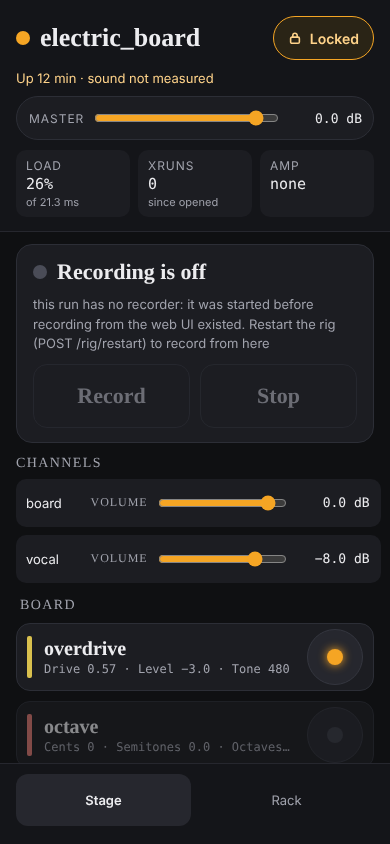

# The web UI

How the page the agent serves is built and how it behaves, control by control.
To use it, read the [user guides](../guide/README.md); this page is for
changing it, or for finding out exactly what a control does.

```bash
sushi-rig agent                      # then open http://127.0.0.1:8029/ (the rack)
                                     # or http://127.0.0.1:8029/#stage (the stage screen; the default on a phone)
```

![The rack as a mixing desk: the master volume in the header; on the left a strip per channel with its input and a volume fader, the board's marked as the open tab's, and the master's strip; in the middle the tabs board, vocal and Master, and under them the board's chain, the overdrive open with its profile's groups and each knob's value as a text field, the bypassed octave a slim row, and the delay; on the right the rigs of config/rigs, Save with a count of the unsaved changes, Save as, Revert, and the takes](../ui/rack.png)



The agent serves the UI at `/`, from `tool/src/sushi_rig/ui/static/`: plain HTML, CSS
and JavaScript with no build step and no framework, because the rig machine has
no Node and the UI has to run from a checkout. Two screens from the mockups
(the `S` numbers below are the mockups' frame names), and the New rig screen:

- **The rack (S1), laid out as a mixing desk (2026-11-06).** Three columns,
  because that is how a desk is read: a **strip per channel on the left** (its
  name, a small, quiet input line, and its volume as the large part, then a
  strip for the master), **one chain at a time in the middle**, the widest
  part, behind a tab per channel and Master (below), and **the files on the
  right**: the rig picker, New rig…, Start, Stop and Switch, Save,
  Save as…, Revert…, and the takes folder. The one **Undo** is in the
  activity zone under the header (#209, #245, below). The **master volume is in the header**,
  not in a column. At phone width the columns stack in that order, strips
  first, since volume is what a hand reaches for. A chain is a row of
  plugin cards, each with its knobs: the profile's controls in its groups and
  labels for a plugin that has one (`tool/examples/profiles/`), every
  parameter in a plain list for one that does not. Values are in the plugin's
  own range, never 0 to 1. A turned knob is sent at once. A profile may also
  give a knob that sets several of the plugin's parameters at once (its
  `controls`, `profile.py`): the hall's **Mix**, 0 to 100 %, sets its dry
  level, early reflections and tail along an equal-power curve. A control
  may drive one parameter over part of its range instead: the shimmer's Mix
  (its Dry/Wet, 0 to 0.15, short of the plugin's own 0.5) and the tape echo's
  Mix (Swell, to 0.7), Repeats (Sustain, to 0.3) and Level (Output, 0.725 to
  1.17, where the plugin's own knob reaches +78 dB). These bound the page
  only: a rig file can still set the parameters to anything; see
  [the effects guide](../guide/effects.md). Each step
  of it is one `POST /live/parameters` of the three: all or none (a level
  Sushi refuses part-way puts back the ones already set), one change in the
  log, one Undo, and Save writes them as it writes any parameter. It is
  shown from what those parameters are, at the nearest point of its curve
  when a rig's saved values are not on it (and its note says so), and
  nothing is sent until it is turned; turned from off the curve, each level
  goes from where it is to the curve's own value at 0 % or 100 %, at the
  curve's pace, so the first step moves each a little and one way
  (`R.mixPath`). A value asked for while a send that then failed was in
  flight is still sent, and the failure said. **Nothing comes,
  goes or moves as values change** (the player's first request: "was 0.5 dB"
  labels that popped in and out). Each knob's text, label and note have a
  size of their own whatever they hold, and the one sign of unsaved work is a
  count on the Save button, in a box that is always there; the itemised list
  of changes and the per-knob "was" are gone. Undo is an action, not a view
  of history: one button, in the activity zone (#209, #245). A browser test compares every
  element's box before and after four changes.
- **The top of each screen: status, activity, controls (#245, 2026-11-26).**
  The owner, after #209: "a lot of scrolling is required to read and
  address some of the messages", and then: "show status information in one
  area, changes and any action needed in another, and then anything that we
  can change (eg. volume) in another." So the top is three zones:
  - **Status**, read only, in the header: the rig's name, up or down and for
    how long (`R.rigStatus`; its "· sound not measured" is the line's
    `title` on the rack, as the note always was), the LOAD, XRUNS and AMP
    tiles, and the rig's problems in a word or two (`R.agentProblems`: "No
    amp", "Amp not wired", "Links not made" from `agent.warnings` and
    `amp_wiring`, a child that exited, the last error, a profile that would
    not load), each a small box whose `title` is the whole of it. They are
    states of the rig, not answers to a tap, so they stay here. On a phone
    the status is the rig's name and its dot; the words are the dot's
    `title`, and a tap on it shows them and the tiles (`state.statusOpen`).
  - **Controls**, in the header beside the status: the master volume, the
    Lock (an icon on a phone, its label its `aria-label` and `title`), and
    the Stage and Help links, which on a phone are a bar at the foot, as on
    the stage. Nothing else is there: a channel's volume belongs to its
    strip, and Start, Stop and Switch to the rig picker, beside what they
    act on.
  - **Activity**, a bar under the header, `position: sticky`, so once the
    header has scrolled away it is pinned at the top of the window. It holds
    the **question** open (Stop?, Restart?, Restart amp?, Drop changes?,
    Remove?), the newest only, with Yes and No; what is **running**
    ("Switching to clean…", "Restarting electric_board…", "Saving…",
    `R.activityBusy`); the **last results**, three on a laptop with their
    times and one on a phone, newest first, each with its second tap
    (Restart, Restart anyway, Load anyway, Remove anyway, Add anyway, Save &
    assign) and ×; and **Undo**, at its right end, beside what it would take
    back. The rest is a **+n** chip that drops a list over the page: the
    older questions, still answerable there, and the results not shown.
    Each result or question about a channel has the channel's **chip**: a
    tap shows that strip (and opens its tab); the strip a question came from
    is marked with an edge in the refused colour (`.strip.asking`). Which is
    shown is `R.activityView`'s: a result keeps the place and the time it
    was first seen (`R.activitySeen`), so the newest is the one drawn last.
    Every region still decides what it says and runs what it ran before:
    it hands its result or its question to the zone as it draws
    (`actResult`, `actAsk` in `app.js`), with the same buttons calling the
    same functions, so an answer still goes to the strip and the rig it was
    asked for, as each action's own code checks. A result that worked and
    goes by itself still goes after 15 s (Undo's, a take's, Open folder's);
    the rest stay until dismissed or answered.
  - **What stays in place**: what belongs to an open editor, which is where
    the hand is: a picker's own check (Save as's name, a take's name, Add
    channel's name, the New rig form's checks and its result with Start or
    Switch, on a screen that is one form), the Library drawer's "why", a
    knob's or a fader's own "refused:" note, the amp card's state (Carla
    down, Amp not wired), "Last channel" and what a removal takes in a
    strip's Remove panel, and an add's "Adding…" on its place.
  - **The stage** has the same bar under its header, with Undo (no longer
    in its first row) and Stop?; it is narrow, so it shows a question or
    the latest result, as a phone does.
- **One Undo for everything, and few words (#209, 2026-11-23).** The
  owner's words: "too much text explaining various decisions … give me an
  undo button and if there does need to be a message about deleting
  something or overwriting something, make it simple 1-2 words." So:
  - **One Undo button**, in the activity zone of the rack and of the stage
    (#245; in the header beside the Lock until then). It steps back the newest change, whatever it was, and pressed
    again goes further back, to 50 steps. It reads `GET /undo` with every
    poll and sends `POST /undo` ([the agent](agent.md#one-undo)). It covers
    a knob, a fader or a bypass (a drag is one step), a move, a plugin added
    or removed, an amp parameter or model; a channel added, an input
    changed, a pedal assigned (rig file writes, put back byte for byte);
    a Save over the running rig's file; a revert; a new rig (it goes into
    the bin); a rig deleted (back from the bin). Its `title` (and name, for
    a screen reader) says what the next press does ("Undo delete clean"),
    "Nothing to undo", or "Can't undo: …" with the reason, for a step the
    agent cannot put back (the file changed since, the bin entry gone, a
    Save as, a live change too old for the live log); pressed then, it says
    "Can't undo: delete clean", naming the step on the page (a phone shows
    no title), and the step is dropped, so the next press goes on. A press
    names the step it was shown (`seq`): one another page, or a change since,
    put on top is "Changed: press again", not undone in its place. Sushi or
    the agent not answering is said so ("Sushi not answering", "Timed out",
    "Agent not answering"). After a press, a few words in the activity zone say what it
    did ("Undone: delete clean"), for 15 s; where the rig plays the change
    until a restart, "· restart" and a **Restart** button, which asks
    **Restart?** with **Yes** and **No**. The history is the agent's, so a
    reload keeps it and every page shares it; an agent restart clears it.
  - **The lock.** Locked, the button holds what the lock holds of the change
    itself: a move, an add, a remove, the amp's model, a pedal's assignment
    (title "Locked: pedal c"), and the Undo of a revert or a channel load,
    which switches the rig. A knob, a fader and a bypass are let through,
    and so are the rack's file edits that are not behind the lock (a
    channel, an input, a Save, a delete). **On the stage** it is for the live edits: a step of a file
    or the bin is off there, its title "Undo … on the rack".
  - **What it replaced.** The live-edit Undo above Save, its "Skip it" after
    a refusal, and the 15 s "Undo: put back" offers under the rig picker
    (#129, #189) are gone, and their behaviour is the one button's.
  - **Confirms.** None is left over what Undo takes back: **Delete** on a
    rig, **Remove** on a plugin, a point in **Revert…**, and a pedal moved
    off what it did act at once. What still asks is what cuts the sound or
    cannot be taken back, in one or two words with **Yes** and **No**:
    **Stop?** (still a second tap, forgotten after eight seconds),
    **Restart?** (after an edit, a pedal, a Save as or an Undo that waits
    for one; and before a revert, or the Undo of a revert or a load, whose
    switch would restart Sushi: the page sends `restart: false` first and
    asks on `restarts`; and before **Amp on**, **Add amp**'s model and
    **Load with amp**), **Restart amp?** (a model change), and **Drop
    changes?** (a revert, or the Undo of one, that would drop unsaved work,
    which no Undo brings back).
    A restart the agent refuses for unsaved work offers **Restart anyway**.
  - **Text.** Paragraphs explaining choices are gone from the sidebars,
    panels and results: what is left is a heading, the control, and a short
    status or error. A result says its title ("Saved electric_board", "Not
    assigned: C"); everything else it said (the file written, what git
    says, the agent's reason) is its `title`, for a hover. A refusal says
    what is wrong beside its title, cut to its first clause (`R.shortSaid`,
    which passes over a leading "error: ", "nothing was written: " or a
    repeat of the title), the whole of it in the `title`; so does a take
    that is not whole ("1 problem"). PEDALS' pedal-map line (#210) is "Not
    playing yet" or "Ranges changed" with **Restart**, and an assignment
    refused for unsaved work offers **Save & assign**. The "About …" and
    Help links stay: the guide keeps the explanations.
- **A tab per channel, and bypassed plugins minimised (#135, 2026-11-15).**
  The middle column is a tablist: **one tab per channel in the rig's order,
  then Master**, and the open tab's chain under them, nothing of another
  channel's. A rig of one channel has two tabs, so the layout is the same on
  every rig of channels; a v1 run has a tab per track and no Master; with no
  rig up there are no tabs, and while the rig is up and `/live` is not read (a
  command running) or fails, the tabs stay as they were, so nothing above the
  chain moves. **The strips stay together**, since they are the
  mix: a strip's name is a button that opens its tab (so is a tap on the strip
  that lands on nothing else; its fader, its value and Change input are their
  own gestures and do not), the master's strip opens Master, and the open
  tab's strip is marked. On a phone a strip tapped also brings the tabs into
  view, since the chain is below the strips. **The amp's card is in one tab**,
  the channel it is in front of: the first channel **the running rig** plays
  from `guitar-in` (`patchbay.GUITAR_ROLE`), as `GET /machine/roles`'s
  `used_by` says from the running config's own wiring, so Change input, which
  writes the file, does not move it before the restart that plays the edit.
  Only when the running rig cannot say (the answer failed, or its config was
  not read) is the rig's file asked (`GET /rigs/<rig>/channels`); the first
  channel where neither says, or the run has nothing on that role, or there
  is no rig file (a v1 run). It is decided **once a run**: until then the
  open chain is held back with the card, "Reading the rig…", for at most two
  seconds and then the first channel, so the chain is never drawn and then
  pushed down by the card arriving above it. With no tabs at all (no chain
  read) the card is shown on its own, as before #135.
  **The open tab is remembered per device**, in the browser's storage, as one
  record of the rig and the tab (`sushi-rig.tab`): a reload comes back to it,
  another rig opens on its first channel (even one seen before), as does a
  remembered channel the rig no longer has, and a browser that refuses storage
  remembers nothing and works. **A bypassed plugin is a slim row**: its name,
  its switch and its mono badge, in its place in the chain. Switching it on
  opens it and switching it off minimises it, **from anywhere**: every page
  follows the bypass it reads, so a pedal's or another device's shows within a
  poll. Its name is a button (`aria-expanded`): on a slim row it, or a tap on
  the row, **opens the row without switching it on**, with all its controls,
  to set it up; that lasts until the name is tapped again or the tab changes.
  On a row that is on, the name shows all the controls or the main ones, as
  before. A plugin being used when its bypass arrives (a knob mid-drag, a
  value half typed) is not minimised under the hand: its row stays open as one
  tapped open does. A slim row has no move buttons: open it to move it.
  **Nothing moves on a poll**: a row changes size only when its bypass changes
  or the player taps it, and a browser test compares every element's box
  across values changing on an open row, a slim row and a closed tab. **A
  view change never interrupts a gesture**: each plugin's row is drawn on its
  own, and a bypass only hides or shows what the row already holds, so a
  bypass from a pedal, a neighbour opening, or a plugin added, removed or
  moved from elsewhere rebuilds nothing under a drag or a half-typed value
  (the rows are put in their new order round the ones in use, which hold the
  focus or a drag, and are never taken out of the page). The chains of the
  same rig changing are shown at once with the plugins already known, and
  `/live/plugins` read after, so only a new plugin's row is rebuilt when it
  answers. Another rig (a switch, a restart) is shown at once, so nothing of
  the rig before stays on the page taking input, with its chain held back,
  "Reading the rig…", until its plugins are read (at most two seconds, then
  drawn without them). A change still waiting to be sent when the page comes
  to show another rig is dropped, not sent to it; one already in flight
  cannot be, since the agent's `/live` routes take no word of which rig a
  change is meant for. "Another rig" is a new name or start in `/health`,
  or a live switch the log shows by an `op: "rig"` entry newer than any
  seen (`R.switchesSeen`); a log trimmed past that entry (it keeps 500) or
  one `/live/log` that fails is never one. The agent numbers its log from 0
  again when it starts again (Sushi keeps running), so a log of another
  agent start (`/health`'s `agent.started_at`) counts any rig entry in it. The first chain is drawn once the
  profiles have answered (at most two seconds), so its rows are not drawn
  plain and again a moment later; the plugin's name under a unit's, which
  the library may give later still, is written in place. A row rebuilt all
  the same gives the focus back to the control that had it, found by what it
  is in the row (`data-focus`: the dial or value of a parameter, the switch,
  a move button, the name), never by a label that its state changes. A row
  with a knob being dragged is not rebuilt (its profile arriving late): it
  takes the change when the drag ends. Tabs held while `/live` fails are
  held for their own run only, and the amp's tab is decided only against
  this run's tabs, and kept by the page for the run, not by the rack: leaving
  for the stage and coming back does not decide it again. A drag ends when
  its pointer capture is lost, so a press after it is a drag of its own. A
  bypass that hides the control with the focus (a knob, a value not typed
  into) moves the focus to the row's name, which opens it again.
  Tabs and opening a row are **allowed while locked**: they change what is
  shown, not the rig. **Nothing that matters is behind a closed tab**: a
  refusal is in the activity zone and a child that exited in the status
  zone, both above the tabs (#245); and a
  tab carries a red dot, with the reason as its title, while a change to one
  of its plugins stands refused or anything the amp's card says is wrong
  (Carla not running, the amp not wired, the amp unreadable, a problem with its model, the
  model's rate warning, the models not listed: `ampFaults`); while the amp's
  tab is not decided yet, every channel's tab carries its faults. Undo, Save, the unsaved count and Revert take no notice of the tab: a
  change on a closed tab counts and is undone as any other. The keyboard: the
  tabs are `role="tab"` in a `tablist`, the open one alone in the tab order,
  the left and right arrows, Home and End move and open, and the panel is a
  `tabpanel` labelled by its tab. The decisions are rig.js's (`rackTabs`,
  `openTab`, `rememberedTab`, `tabKey`, `ampTab`, `ampFaults`, `tabMarks`, `unitRow`,
  `unitTapped`, `bypassSeen`), tested on their own and through the page in
  `tool/tests/test_ui_tabs.py`. The stage screen is unchanged: its cards do
  not minimise.
- **Adding, removing and moving plugins: the Library drawer (#130,
  2026-11-16).** The open tab's chain has a place to add a plugin **at its
  start** ("Add at the start…") and **under each plugin** ("Add after
  overdrive…"), each a dashed line of its own height that goes where its
  plugin goes, since "after" names the plugin. A place opens **the Library
  drawer** for it: every plugin of the manifest (`GET /library`), searchable
  (every word typed, in any case, in the plugin's name, its bundle or its
  group's name, hidden in place, nothing rebuilt), grouped by kind, Drive,
  Mod, Delay, Reverb, Dynamics and EQ, then **Other**. A plugin's kind is its
  own bundle's LV2 class (`library.KINDS`: a reverb is lv2:ReverbPlugin, a
  compressor lv2:CompressorPlugin), never a guess from its name: a plugin
  whose bundle declares none of the six (a pitch shifter, an instrument, a
  filter) or was not read is under Other. Of the manifest's 55, 27 were under
  Other over Ubuntu 24.04's packages as installed where this was written, the
  amp and the four Rubber Band shifters among them (zynaddsubfx's chorus was
  not installed there, so is counted as Other unread); the Live shifter the
  octave added (#164) declares no kind either, and is a 28th. Each entry shows its
  name, its bundle and a **mono** badge where `plugin-ports.txt` gives it one
  output, with the rack's own tooltip; the amp is listed, off, with the
  library's reason. **The add** (`POST /live/add`) sends `after` the plugin
  above the place, or `"first": true` from the start, which no `after` can
  say (the agent keeps the master's return in front of it). Its name is the
  agent's own (`R.addName`): none is sent when the name the agent would
  derive is free across the whole rig (Sushi's names are one namespace,
  tracks included), its copy to stereo's name too for a mono plugin; else
  that name and a number, `mda_delay_2`, the first free, never past 64
  characters or ending as the compiler's copies do. The names of this page's
  adds still in flight count as taken, so the same plugin added twice at once
  is named twice; a name another device took since the last read comes back
  `409` with `code: "name_taken"`, and the page reads `/live` again and sends
  the next free name, once, saying "try again" if that is taken too, never
  the agent's "give a name", which is for a client that chooses none. The drawer closes, the
  place reads "Adding mda_delay…" (`aria-busy`, and it keeps the focus)
  until the agent has confirmed and the row is drawn in its place, and a
  refusal is said in the activity zone (#245), "Add after delay · Not
  added", with the channel's chip, the agent's reason on hover and a
  dismiss that gives the focus back to the place: a plugin Sushi cannot host is refused from the manifest (400)
  before Sushi is asked anything, and an add while the rig's load is over
  80 % of its block (409 `over_budget`, #137) is refused with the load
  measured ("Not added: the rig is using 86% of its 21.333 ms block, over
  the 80% a live add may start from…"), the page adding nothing of its own
  to it. No other row is rebuilt: the new plugin's
  row is drawn once, as what it is, since the page already knows from the add
  which plugin it is and does not wait for `/live/plugins` to say. **The
  collapse** a mono plugin makes of a stereo one before it (#119) is said on
  the entry, in amber, before it is added ("after delay: this collapses its
  stereo width", the badge's own words), as is a stereo plugin put in front of
  a mono one ("od comes after it and collapses its stereo width"); a width the
  ports table does not give is not guessed. **Remove** is at the foot of an
  open row, one tap with no confirm (#209: Undo puts the plugin back with its
  settings); a slim row is opened first, as it is to move it. It is never offered on the send,
  the return or a copy to stereo, none of which is a row. **Moves** are the
  row's ▲ and ▼, as before; the agent steps a mono plugin and its copy as one
  and steps past a neighbour's pair whole, so nothing ever lands between
  them. All three are **live work**: in the log, counted on Save, undone by
  Undo (an add's undo takes the copy too; a remove's puts the plugin back with
  its settings and its bypass), written by Save and dropped by Revert or a
  restart with discard. **Locked**, the places still open the drawer to look
  through, and every entry is off with the lock's reason; Remove's refusal,
  "delay · Locked", is in the activity zone, the lock's reason on hover. With no rig up, the centre column offers "Browse the
  library…" and the drawer says why nothing can be added; a drawer open while
  a command runs says that command is running, and comes back on after. **At
  a phone's width** the drawer is a sheet from the bottom of the screen, its
  full width and at most 88 % of its height, over the page and not a column
  beside the rack; its list scrolls inside it, and nothing is wider than the
  screen. **The drawer is modal**: the rest of the page is inert while it is
  open, Tab and Shift+Tab go round its own controls, Escape closes it
  wherever the focus is (as do Close and a tap outside it), and the focus is
  put back in it if it is lost (an entry with the focus turned off, say). It
  goes into the search on opening, or Close on a touch screen, where a
  field brings up the keyboard over the list. On closing, the focus goes back
  to the place it was opened from, found by its key, or if that has gone the
  place before it, the start, then the open tab; after a remove, to the row
  that took the removed one's place, or the place there. **It is for the rig
  it was opened on** (`rigIdentity`, with #135's positive signs): when the
  page comes to show another rig or a restart of this one, it says so ("The
  rig changed since the library was opened…") and adds nothing until it is
  opened again; an add or a remove in flight across that change is said as
  the rig it was sent to, in the activity zone. A `/health` that does not
  answer is not another rig: which rig is shown is then not known, an answer
  arriving meanwhile is held and placed once it answers again (on its row or
  place, or as the rig's where that is not drawn), and every add
  or remove in flight ends, so a place never says "Adding…" for good; a
  drawer opened then is for the rig that comes back, and adds nothing until
  then, saying why. Nothing that stops an add from the drawer is silent. A Remove armed, an
  "Adding…" or a refusal said on a place, belong to the rig shown too, and go
  when it changes or the chain is drawn again (a tab chosen); every "Locked:"
  line said of a refused edit goes when the page is unlocked. **Nothing moves under the hand**: the drawer is over the page; an add
  or a remove from another device rebuilds nothing in it (the list, its
  scroll, the search and its focus stay), and if the plugin the place
  follows is removed, it says so and adds nothing. A drag on a knob keeps
  going through an add or a remove from elsewhere, as through a move
  (#135). The decisions are rig.js's (`libraryGroups`, `libraryMatch`,
  `libraryEntry`, `addSlots`, `addName`, `addCall`, `addWarning`,
  `addBlocked`, `removable`), tested on their own and through the page in
  `tool/tests/test_ui_library.py`.
- **Knobs that can be set (2026-11-06).** A knob is dragged **vertically, 320
  px for its whole travel**, with the pointer
  captured, so leaving the knob mid-drag does not drop it; **shift, or a
  second finger, is a tenth of the speed**. **The wheel and a trackpad** step
  it a notch at a time, but only over the dial or fader itself (never its
  label or text), only when it can be set, and only when meant: the pointer
  has rested on it 300 ms since it arrived and since the page last scrolled,
  or it has the focus. Otherwise the wheel scrolls the page, so a scroll down
  a rack of knobs passes over them rather than stopping at one and turning
  it. A step is about 1 % of the range, rounded to 1, 2 or 5
  times a power of ten so steps land on values one would type (a send's 144
  dB in 1 dB steps, the overdrive's 24 dB Level in 0.2, a 0-to-1 Drive in
  0.01, a 900 Hz Tone in 5 Hz; an integer one at a time; a log scale 1 % of
  its travel); the profiles have no step of their own to give. The keys do
  the same: arrows a step, PageUp and PageDown ten, Home and End the ends.
  **The value under each knob is a text field** in the knob's units: a click
  selects it, Enter or leaving commits, Escape puts it back; it is read with
  or without the unit, a typographic minus, a comma, "-inf"; clamped to the
  range; exact, never snapped; and nonsense is refused in place (red, its
  reason in the title) and not sent. A poll never writes into a field that
  has the focus, and only what was typed is ever committed: a field left
  untouched while the value moved under it shows the value again. **Whole
  numbers are sticky**: within 0.15 of a whole number in the units shown
  (dB, %, plain numbers), a drag lands on it and holds it until 0.35 away; a
  scroll notch always moves the value the way it was turned, and lands on a
  whole number it crosses; a normalised 0-to-1 parameter with no unit is held
  to hundredths instead. Fine control does not snap: it is for the
  values between. The amp's faders and every volume take a typed value and
  the wheel the same way. The decisions are rig.js's (`dragPosition`,
  `sticky`, `stepped`, `scrolled`, `wheelNotches`, `parseTyped`), each
  tested on its own.
- **Volume (2026-11-06): the master's and each channel's.** One fader for
  both, in dB: **−∞, then −60 to +6 dB** (the master's to 0 dB since #137,
  below), a range safe to reach for in the
  dark, where −∞ is the gain's own floor (−120 dB on the −120 to +24 range a
  track's gain and a send's have, below hearing) rather than a mute
  parameter, so one parameter is the volume, one undo puts it back and one
  line of the file holds it. Each takes a drag (sticky to whole dB), the wheel
  (0.5 dB a notch, a tenth with shift), the keys (Home is −∞) and a typed
  value ("-6", "−6 dB", "mute", "-inf"). **The master's** is in both screens'
  headers, on the master track's own gain, through the same POST
  /live/parameter as a knob: it is in the log, Undo takes it back, Save writes
  it as `master: level: <dB>` (new, compiled to that gain as a channel's
  `level:` is to its send's; unity writes nothing, so every committed rig
  compiles exactly as before, checked byte for byte), and a live switch sets
  it as a step, never a restart. **A channel's** is its send's gain, its
  `level:` (#101), at the top of its strip on the rack and in the stage's
  levels; it replaces the small "send to master" knob that ended each row, so
  there is one control per channel. On the rack both are **usable while
  locked**, with no confirm: volume is a performance control. On the stage
  the lock holds them (#182, below). **A channel a MIDI blend drives**
  says "driven by <control>" on its fader and cannot be set from here: the
  pedal's next move would undo it, and a save does not write a blended
  channel's gain as its level (`fold_state`), so a move would be neither kept
  nor heard for long. Which channels are blended comes from `GET
  /rigs/<rig>/channels`'s `blended`.
- **The master's top and its limiter (#137, 2026-11-17).** The master's fader
  stops at **0 dB** (`rig.js` `MASTER_VOLUME_MAX_DB`; a channel's keeps +6):
  Sushi applies the master's gain after the master's limiter, so above unity
  it would lift what the limiter let through. A value typed over it is held
  to 0 dB, and the agent refuses one sent past it (400). On a rig started
  before the cap, a master over 0 dB says "over the top": a step up (wheel,
  arrows, Page Up, End) sends nothing, and a step down goes to 0 dB
  (`volumeStepped`'s `unchanged` and `hard`, `overTopNote`); a channel over
  its +6 likewise sends nothing on a step up. The limiter, last on
  the master (`/live/plugins` role "limiter"), is never a unit: the **Master**
  tab ends with one read-only line saying what it is and where its threshold
  sits (`limiterLine`, from the Thresh Sushi reports), with nothing offered
  after it, and says instead that a restart puts it in on a rig started before
  it, or that Sushi has it bypassed. Not seen on the rig or a phone.
- **The stage screen (S5).** One glance: the rig, up or down, load and xruns,
  each channel's level, and the last error. One tap: a 56 px bypass per plugin,
  or a card opened for its knobs. Locked by default; unlocking takes two taps.
- **The stage's volumes, its lock and its rig dropdown (#182, 2026-11-18).**
  For a phone. **The lock holds every stage volume**, the master's and each
  channel's (`volumeFader` with `where` "stage", `R.lockRefusal`
  "stage_volume"): the fader is disabled (no drag, tap or key), the wheel is
  left to the page, the value field is read-only and refuses a commit, and
  the step buttons are off; each shows the lock's icon (`lockIcon`, the Lock
  button's) and says why in its title. Knobs, bypass and Record are not held.
  *Decided:* the rack's volumes are not behind the lock, as before: the rack's
  lock already leaves Stop and Switch to usable, so it is not the stage's.
  **−0.5 dB and +0.5 dB buttons** either side of each stage fader, on one
  row with a cell holding the name over the value field, which fills the
  cell so it is 44 px to tap (`R.volumeNudged`): a tap is exactly
  `VOLUME_STEP_DB` from the level rounded to 0.1 dB (Sushi's 32-bit float
  reads 0 dB back as −0.0000029, and a step from that drifted and, at the
  master's top, sent a redundant request; `VOLUME_SAME_DB` is the tolerance),
  never held to whole dB as a wheel notch is. Held `VOLUME_HOLD_MS` (400 ms)
  it repeats every `VOLUME_REPEAT_MS` (100 ms), at most `VOLUME_REPEAT_MAX`
  (12, so 6 dB) a hold, and stops on a release anywhere, `pointercancel`
  (a press the browser takes for a scroll moves nothing), `pointerleave`,
  the window's blur, the page hidden (`visibilitychange`), the lock, the
  button drawn again, or an end. The ends are `volumeStepped`'s: the master
  stops at 0 dB, and over it + sends nothing and − goes to 0 dB; a channel
  stops at +6. 46 by 44 px each.
  **The rig dropdown** (`rigsRegion` with `dropdown`, `R.rigSelect`,
  `R.rigSelected`) replaces the stage's list of rigs, in the header's first
  row in the rig's name's place, beside the Lock button: a native select of
  `config/rigs/`, the running rig selected, else the one chosen, else the
  screen's title ("Rig down", "Agent not answering"), styled as the title
  and cut short with an ellipsis, its `title` the whole name (the `h1` is
  kept for screen readers). Choosing another rig with one up switches to it
  through `lifecycle("switch")`, as the list's Switch to did (live or by
  restart, the same notices, busy and refusals); with none up it chooses
  the rig for Start. Shown but off while locked (no border, no arrow), while
  a command runs, or with no agent. Start and Stop and the guide's link are
  one row under the tiles, only unlocked, and the rig's problems in a word
  or two under the tiles; **Stop?**, the busy line and every result are in
  the activity zone under the header (#245). The locked header is no taller than before
  #182 (234 px at 320 by 568, against 240), and the same in any font: its
  lines have fixed heights and a tile's lines never wrap, cut short with an
  ellipsis instead (with DejaVu Sans in place of Inter, as in CI, master's
  was 250 and the first draft's 244). Tested in Chromium at 320 (and
  320 by 568), 390 and 1280 px (`test_ui_stage.py`); not on a real phone or
  a touch screen.
- **Start, stop and switch (v0.1, #111).** The rigs of `config/rigs/` in a
  list (the rack's right column; on the stage screen a dropdown since #182, and
  Start and Stop there only while the lock is
  off): pick one and Start it (a rig of channels, headless, since the page
  replaces the panel), Switch to it, or Stop the one that is up, which takes a
  second tap because it cuts the sound: **Stop?**, **Yes** or **No**, asked in
  the activity zone (#245), where Stop is off meanwhile. A switch says whether it was made live
  or by restart, and why. While a command runs, from this page or another,
  nothing else is offered and what is running is said, in the activity
  zone; a refusal shows the agent's reason there.
- **The amp.** A card at the top of its channel's tab (above), since the amp
  is in front of the board: the model's name and what it declares, faders for Input and Output in
  dB, Quality shown but not on a fader (it trades CPU for accuracy, not tone),
  and a model picker that asks **Restart amp?** (**Yes**, **No**), since
  the sound cuts out for a moment, refused while locked. Values are labelled as what was last sent,
  never as read back. On the stage screen, only the model's name and the
  output level, and only while the lock is off, as Start and Stop are. With
  the panel running, the faders and picker are off and say the panel owns the
  amp. **Amp not wired** (#246) on the card, the links missing in its title,
  when Carla runs and `GET /amp`'s `wiring` says the guitar's link into NAM,
  or NAM's into Sushi, is not made (`wiringTag`). A rig started with
  `--no-amp` whose file has an amp shows **Amp on** on the card (behind the
  lock), which asks **Restart?** and restarts with the amp (`POST
  /rig/restart {"amp": true}`); a restart refused for unsaved work offers
  **Restart anyway**, still with the amp. A rig whose file has no `amp:`
  (`GET /amp`'s `add_amp`, #246) shows **Add amp** instead (behind the
  lock, `lockRefusal(…, "add_amp")`): it opens a **Model** picker of the
  models `GET /amp/models` lists (one that cannot be played here is listed
  and off), and the one chosen asks **Restart?**; **Yes** sends `POST
  /amp/add {"model", "rig"}`, which writes the amp into the file and
  restarts the rig with it. The notice says "Amp: <model>", with the
  restart's warnings in a word or two (`warningsTag`); a refusal for
  unsaved work offers **Add anyway**. Its Undo is held while locked, as a
  load's is. The decisions are rig.js's (`ampCard`'s `addAmp`,
  `addAmpOffer`, `addAmpCall`, `addAmpOutcome`).
- **Save (S4).** In the files column: Save writes the
  running rig's own file of `config/rigs/` in place, keeping its comments, and
  is offered whenever a rig that can be saved from here is up, since the
  count on it is only what the agent saw (its title says since when, and
  that a count of none is not proof the file holds what is playing); for a
  v1 run or one with its panel both buttons are off and say how to save
  instead. Save as… asks for a name, checks it by
  the rule the agent saves by (lowercase letters, digits, `-` and `_`) before
  sending, and writes a new rig that becomes the running one. The answer, in
  the activity zone (#245), says
  what was written, that it is **not committed** (the agent never commits) and
  the commit it sits on, or the agent's reason for refusing (another rig's
  name, a plugin on the rig the agent did not add, or one gone that it did
  not remove). A Save as whose file waits for a restart (a pedal or a
  channel written for it, #192: the answer's `restart`) says the rig plays
  as it was loaded until then, with why, and offers **Restart**, which asks
  **Restart?**, as an edit of the rig's file does. A Save over the file is a
  step of the one Undo, which puts the file back as it was and counts what
  it wrote as unsaved again; a Save as is recorded as a step it cannot take
  back (#209). The count then
  starts from that save: a change after it, or an undo past it, is unsaved
  again. Allowed while locked, since it changes neither the sound nor the
  structure. Not on the stage screen: saving is not a stage action.
- **The compiler's copies to stereo, and "mono" (2026-11-06).** A copy to
  stereo (`<plugin>_to_stereo`, stereo.py) is the compiler's, and is shown
  nowhere: not as a card on either screen, nor among bypasses, unsaved
  changes or undo. The page knows one by whatever says so first, its uid,
  the reserved suffix no other name may carry, or a role of "stereo", before
  any role `/live/plugins` gives (on the rig, copies were drawn as plugins;
  a browser test makes `/live/plugins` give one a null role and finds it
  nowhere). The plugin a copy follows carries a small **mono** badge, its
  title "mono: processes the left side and its output is copied to both";
  where it follows a stereo plugin on the same chain, with nothing mono
  between, the badge is amber and says "after <that plugin>: this collapses
  its stereo width", since Sushi gives a mono plugin channel 0 alone (#119).
  Each plugin's width comes from plugin-ports.txt, the compiler's own table,
  as `width` on `/live/plugins`.
- **Revert to a previous save (2026-11-06).** The only view of history the
  rack has, beside Save. **Every save from here keeps a snapshot** of the file
  exactly as it was written, with when, the rig, and the commit it sat on, in
  `<checkout>/.sushi-rig/saves/<rig>/`: with the checkout, because a snapshot
  is a version of one of its files (the runtime dir is tmpfs and forgets them
  at logout, and the user's state dir would need keying by checkout and would
  outlive one deleted). The directory ignores itself (a `.gitignore` of `*`
  inside, beside the line in the repository's own), so `git status` stays
  clean in any checkout. **The 50 written last per rig are kept**, pruned by
  the order they were written, never by the clock (the rig's can run behind),
  and never the one just written; the commits are there for anything older.
  A git that does not answer leaves the saves listed and says why the
  commits are not. "Revert…" lists the saves by time and how long
  ago, the one the file is now marked, then **the file's own commits** (`git
  log`, read-only, off the agent's loop, with a timeout). Tapping one
  **reverts to it at once** (#209: until then a confirm named what was lost;
  the one Undo now puts the file back, and switches the rig back to it). The agent
  writes the point back **byte for byte** (a plain write, not `write_rig`,
  which merges into the file that is there and so keeps *its* comments, not
  the snapshot's), compiling it first and refusing with the compiler's reason
  if it no longer compiles. **The running rig is switched to it through the
  live switch** (#112): live where it can be (values, bypasses, plugins added,
  removed or moved), by restart where it must be, and the result says which
  and why. With unsaved live work the agent refuses (409 `unsaved`, as an edit
  of the file does), and the panel asks **Drop changes?** (**Yes** reverts
  with `discard`). The revert's entry in the log is the new baseline: nothing is
  unsaved after it, and the live edits before it are another run's: the one
  Undo goes past them to the revert itself. `GET /rigs/<name>/saves` and `POST
  /rigs/<name>/revert {"save", "discard"?}` are the agent's routes.
- **New rig, and a channel's input.** "New rig…" under the rack's rig picker
  opens the New rig screen (`#new-rig`): a name, then a channel per row, each
  with a name, an input picked from the machine file's roles (each shown with
  its port), mono or stereo, and optionally a channel of another rig to start
  from. Stereo is offered only where the role can give it: otherwise the
  option is there but off, with the patchbay's reason under it (one port
  needs `mono_to_stereo`). "Add channel" adds rows up to three, and past that
  refuses with the compiler's own arithmetic; the agent's reasons for those
  hints come from `GET /machine/roles`, which asked the compiler. Create
  writes the file and offers to start it (or switch to it, with a rig up);
  the agent's refusal is shown in place, with the lines to add to the machine
  file when a role is missing. On the rack, each channel's strip shows its input as the running
  rig's file has it, with "Change input", and "Add channel" is under the
  strips. With no rig of channels up, the column still says CHANNELS and, in
  a few words, why nothing can be edited there (the whole reason on hover):
  on the rig, a v1 run drew nothing at all, and nothing said why a vocal
  channel could not be added. Each edit writes the file, says what it did in
  a title (the file and what git says of it on hover), and offers
  **Restart**, which asks **Restart?** since the sound stops for a few
  seconds. Each is a step of the one Undo, which puts the file back (#209).
  The edits are not behind the page's lock (they write a file, and the
  restart is a separate tap); with unsaved changes the agent refuses until a
  Save. A change made after the edit makes the offered restart refuse too,
  with **Restart anyway** as a second tap. A new rig that moves other rigs' Program
  Change numbers says so under Create, with a table of before and after.
  Nothing of this is on the stage screen.
- **Delete (#129, #209).** Each row of the rack's rig picker has a
  **Delete** beside the rig's name (the stage's picker has none). On the
  running rig's row it is off, its `title` saying why: switch away or stop it
  first. Which row that is, `GET /rigs` says (`running`, the rig file the
  agent refuses to delete), and the page reads `/rigs` again whenever
  `/health`'s run changes, so a switch from a pedal or another page moves it.
  Delete moves the file into `config/rigs/.deleted/` **at once, with no
  confirm**, and the one Undo puts it back (#209). Until #209 it asked the
  agent for a dry run and showed a confirm naming the file, what git holds of
  it and the Program Change numbers that move, then offered an Undo of its
  own under the list for 15 s (#189); the agent's dry run (`{"dry_run":
  true}`) is still there for curl. A refusal is said under the list in a few
  words, the agent's reason on hover, until its × is pressed. The page
  removes the record its Undos once kept in this browser
  (`sushi-rig.binned`, `R.RETIRED_KEYS`) as it loads, and never reads it.
- **A channel from another rig (#208).** Each strip's input line has
  **Load…** beside Change input, which opens a panel in the strip (a group,
  "Load onto board"): a picker, **From**, of every channel of every rig of config/rigs
  (`GET /rigs`, then `GET /rigs/<rig>/channels` for each, read again as the
  panel opens), grouped by rig and labelled `rig / channel`, the strip's own
  channel left out; and **Load**. It is behind the lock, as an add or a
  remove is (`lockRefusal(…, "load_channel")`), since it changes the rig's
  structure. The answer is shown in the panel in a few words (#209): its
  title ("Loaded accustomed / board onto vocal") and, refused, what is
  wrong; the rest (live, or the restart and its reasons, that Revert… goes
  back, and the notes: the amp, another width, a MIDI mapping that followed
  its plugin, or one dropped) is the box's title. Locked, the panel says
  "Locked", the lock's words its title. The one Undo puts a load back. A
  refusal a second tap answers offers it, keeping any yes
  already given: **Load anyway** (`discard`, dropping the unsaved changes),
  **Drop N and load** (`drop_midi`, dropping N MIDI mappings, each mapping listed with
  what it did and why it would do nothing). **Load with amp** (#246) is
  beside **Load** when the channel chosen is of a rig whose file has an
  `amp:` and the running rig's has none (`GET /rigs/<rig>/channels`'s
  `amp`, `loadWithAmp`): it asks **Restart?**, since the amp comes with a
  restart, and loads with `"with_amp": true`, the source rig's amp written
  into the file with the channel; its title ends "with amp", and a second
  tap keeps the amp. **Load** is as it was. The call names the rig the
  page drew (`rig`), which the agent refuses as `changed` if another is
  running by then. An answer is its channel's: it is said in the activity
  zone with that channel's chip (#245), for the rig it was asked on only, its second tap loads onto that
  channel, and it goes when another strip's Load… is opened; Load with amp's
  **Restart?** is asked there too. While a load
  waits its panel stays open: **Close** and every strip's **Load…** are
  off until the answer is in, so it is seen. After a load the page reads the
  rig's file again; the chain itself follows `/live` as it always does.
  "Start from" on Add channel and the New rig screen offers the same
  channels with the same labels. This replaced #127's channel presets and
  its Save channel as…. The decisions are rig.js's (`sourceChoices`,
  `sourceValue`, `sourceFrom`, `channelLoadCall`, `loadOutcome`), tested on
  their own and through the page in `tool/tests/test_ui_channel_load.py`.
- **Removing a channel (#190).** Each strip's input line has **Remove**
  beside Load…, which opens a panel in the strip (a group, "Remove vocal?",
  with Close) and asks **Remove?** with **Yes** and **No** in the activity
  zone, the channel's chip beside it and the strip marked (#245); the panel
  says what goes, in one line:
  "vocal · 1 plugin · 2 MIDI", its title the whole of it (the chain's
  plugins, the send, and each control of the rig's MIDI map that names the
  channel, read from `GET /midi`: a parameter or bypass of its plugins, its
  mute, its volume, a blend with another). On the rig's last channel it says
  **Last channel** and asks nothing (a rig needs one). It is behind the lock,
  as a load is (`lockRefusal(…, "remove_channel")`): locked, Yes is off and
  the panel says "Locked". Yes sends `restart: false` and the rig the page
  drew; a removal of a channel that plays is a restart, so it comes back
  asking **Restart?**, and Yes sends it again with `restart: true` (one
  added to the file and not yet playing is taken out of the file with no
  restart, said "Removed from file"). A refusal is said in the activity zone in a few words with the second tap
  it offers, keeping any yes already given: **Remove anyway** (`discard`),
  **Drop N and remove** (`drop_midi`), the controls named on the page ("MIDI:
  d, knob1") and each with why in the title. Once removed the strip goes,
  and "Removed vocal" is said in the activity zone (the restart and why, and
  that Revert… goes back, on hover) until its × is pressed, while that
  rig is drawn only. A removal written and not played (`not_switched`, or
  a timeout, `written: true`) is said there too, **Not switched**, the
  reason and the pedals' note on hover, since the strip has nothing of the
  channel left to show it in. A load and a removal wait for each other: while
  one is in flight, the other's buttons are off. The one
  Undo puts the channel back, held by the lock as a load's is
  (`UNDO_LOCKED_ACTS`); that is a restart, which it asks about. The
  decisions are rig.js's (`channelRemoveCall`, `midiNaming`, `channelGoes`,
  `removeOutcome`), tested on their own and through the page in
  `tool/tests/test_ui_channel_remove.py`.
- **Pedals: assigning a device's controls on the rack (#192).** Where the
  machine file describes a device (`GET /midi`'s `controllers`), each unit
  row has a pedal badge between its knobs and its on/off, and each playing
  channel's strip one beside its name: a 44 px pill, dashed while nothing is
  on that target, else naming the control (**C**, **pedal**), lit while a
  control on it is heard. Tapping it opens a panel in the row (a group,
  "Pedal for overdrive"), as a strip's Load… panel opens in the strip: a
  select a target, **none** then each control whose `takes` has that
  binding and no `job` (A and B never), one in use elsewhere saying where
  (**C (now vocal on/off)**). An effect's panel has **On/off** (`bypass`)
  and, for each expression control, **pedal sweeps** with the unit's
  parameters in its panel's order and labels (`R.pedalParameters`: not a
  profile's control of several, not one it hides, not a read-only one); a
  channel's has **On/off** (`mute`) and **Volume**. The master's strip has
  none (its mute and its volume cannot be a pedal's), its units do. Choosing
  sends POST /rig/midi/assign ([the agent](agent.md#assigning-a-pedal));
  **none** takes the control off. A control in use elsewhere is moved at
  once, with no confirm: the one Undo puts the assignment back (#209; until
  then it asked **Move C** or **Keep it**). The badge names its panel
  (`aria-controls`), and the focus goes back to it when an assignment closes
  the panel. Behind the
  lock (`lockRefusal(…, "pedal")`): locked, the badge opens to show what is
  assigned and every select is disabled, with "Locked" under it (the reason
  on hover). A refusal is said in the panel in a few words (the compiler's
  on hover) and **Save & assign** for unsaved work, and what worked is said by its title, with
  **Restart** and its **Restart?** when the answer is `restart`: all three in the activity zone (#245),
  where the focus goes to that Restart. After an answer the page reads `GET /midi` again
  (it is otherwise read once a run, kept by `runKey`) and the running rig's
  channels, whose `blended` gives a pedalled volume its "driven by". **PEDALS**,
  under the strips: the device, its state from `/health`'s
  `agent.midi.feeds` (**listening**, **not connected** for `absent`,
  **waiting: this rig needs it, and it is not plugged in**, or the problem),
  then each control and what it does on this rig (A and B as previous and
  next rig), with a light and, for an expression pedal, its last value. A
  light comes on for 1.5 s when the control's count in `agent.midi.seen`
  moves between two polls (`R.pedalLights`, counted rather than timed, so a
  phone's clock does not matter), on the first sight of one only if it was
  heard in the last 1.5 s; drawn in place, so a light rebuilds nothing, with
  the same in words in the row for a screen reader ("heard just now",
  "heard before", "not heard yet"). An assignment that changes nothing is
  said as "Nothing to change", and nothing is written.
  Where the machine file describes several typed devices and the rig's map
  names none, **PEDALS** asks which ("Device for this rig's map"), and the
  assignment carries it. A rig whose machine file describes no device sees
  none of this. The decisions are rig.js's (`pedalBoard`, `pedalOptions`,
  `pedalOn`, `pedalUse`, `pedalChoice`, `pedalCall`, `pedalSaid`,
  `pedalSummary`, `pedalLights`, `pedalDeviceState`, `pedalOutcome`,
  `pedalParameters`), tested on their own and through the page in
  `tool/tests/test_ui_midi_assign.py`.
- **Record (S7, S8).** A record bar on the stage screen, as the canvas's Record
  frame has it: a take name, a big Record and a big Stop, and while a take
  runs its name and elapsed time in red. Both work locked (recording is a stage
  action), and Stop takes no confirm, since stopping a take loses nothing.
  Whether a take is running is the agent's answer, never the page's, so a page
  opened mid-take shows it running. The name field is filled in with the
  agent's default for the next take (`<rig>-<date>-take-<nn>`,
  [Takes](takes.md#names)), so Record can be pressed straight away. Entering
  the field selects the whole default, so typing replaces it; what was typed
  is the player's to edit and is left alone, and it stays through polls, a rig
  switch and other pages' takes until it is recorded with or cleared. A field
  left empty shows the default again. Only what was typed is sent as a name:
  Record on an untouched field sends none, and the agent names the take by its
  count at that moment. **Selecting the default on a tap is untested on
  WebKit, so on a real phone**: only Chromium is in the tests, and the
  selection is deferred past the tap because WebKit places the caret after the
  focus event (`app.js`, `nameField`). A name the field is too narrow to
  show whole is also written out on a line under the field, wrapped
  (`drawNameWhole`, `.take-whole`), so the take's number is always on the
  page: at 390 px the field holds about 31 characters, and a default is the
  rig's name and 19 more with its number last, so every rig but the shortest
  gets the line on a phone (`docs/guide/img/stage-phone.png`), and the
  longest defaults get it on a desktop too, where the stage is 520 px at
  most: 62 characters for a rig whose name is cut to 43, and 64, the name
  rule's limit, from that rig's thousandth take of a day. A name the field
  shows whole has no such line. The line is of the name Record would use: a
  typed name, or with the field empty or holding only spaces the default,
  which the placeholder shows cut. So emptying the field and leaving it,
  which puts the default back, moves nothing: nothing in the bar changes
  height between a press on Record or Stop and its release. The width is
  measured in the page's own layout (`nameCut`): a hidden ruler in the bar
  (`.take-rule`, out of the flow and clipped, so it moves and widens nothing)
  carries the field's type by the same CSS rule, and its width with the name
  in it is compared with the room inside the field, each time the bar is
  drawn and on each key. So text the browser enlarges past its computed size
  (text-only zoom, a phone's font scale) is measured as it is drawn. Where
  the field holds the name its own `scrollWidth` is asked too, and a cut
  either sees shows the line; a measure that cannot be made shows it as well,
  and never stops the page drawing. The field itself, its 16 px type (under
  16, a phone's browser zooms the page when a field is entered), its caret
  and its scroll are untouched. **Untested on WebKit** like the selection,
  **and with a real text-zoom setting**: Chromium has none, so the tests
  emulate one (`text-size-adjust` under phone emulation). A name
  already taken says the earlier take moves to `_archive/`. Why recording is
  off is said on the bar (no rig, the panel, a v1 run, no recorder, or the
  recorder's own reason). A stop's result, in the activity zone (#245; it
  was a box in the record bar), names the take, its folder and `take
  check`'s verdict: whole, or the number of problems and the first, a take
  with problems in the refusal colour and as an alert (until #189 a take
  with problems lost its verdict there: the box showed only a refusal's
  reason). A stop that failed (502, the take stopped) is never called whole:
  it shows `take check`'s problems if there are any, and its reason unless
  that is the read-back failure a problem already says. The take's name is
  said whole there, wrapping on a phone, never cut. A whole take's result,
  like a start's note that an earlier take moved to the archive, goes after
  15 s; a take with problems, a failed stop and a refusal stay until
  dismissed. **The rack lists no takes, and nothing asks for `GET /takes`
  (#189)**: the list stayed for ever, and the takes folder is where takes are
  looked at. Beside Save, one line names the folder (`takesFolder`, from
  `/health`'s `agent.takes`), and **Open folder** asks the agent to open it
  in the desktop's file manager (`POST /takes/open`) where `/health` says
  this request came from a loopback peer (`can_open`), the one peer that
  route serves. So it is offered on the laptop at `localhost` or
  `127.0.0.1`, not on a phone, which sees the path and no button, nor on the
  laptop by its LAN address, whose requests do not come from loopback. What
  an open said, in the activity zone, goes after 15 s if it worked and stays until dismissed if not:
  "nothing here opens a folder" when neither `xdg-open` nor `gio` is
  installed. **Not run on a desktop**: only a stand-in opener is in the
  tests.
- **A child of the rig that exits** (the tuner, the amp, Sushi, qpwgraph, the
  recorder) is on both screens, in the status zone (#245), in the same box and colour as the agent's last
  error, from `agent.supervisor.crashed`: which process, how it ended, what it
  means for the sound ("the tuner (fmit) ... sound is unaffected; there is no
  tuner"), and that restarting the rig brings it back, since nothing restarts it
  on its own. The supervisor's own problems (a group that would not stop, its
  holder lost) are shown the same way. A crash outlives its rig in the record,
  and once that rig is down the box says so instead of telling you to restart.
- **What `up` warned of** (#246) as the running rig came up, by a start, a
  restart or any switch by restart (the picker's, a revert's, a channel load's,
  an Undo's, a pedal's), is in the same boxes from `/health`'s
  `agent.warnings`, in a word or two (`warningsTag`): **No amp** for an amp
  that did not start, exited or is missing, **Amp not wired**, or **Links
  not made**, every line in the title. Only those are boxes for the whole
  run (`boxedWarnings`, so the page is not longer to scroll, #245); any
  other warning ("no machine file ...") is on the notice of the start or
  switch that said it, and in `agent.warnings`. An amp whose links are not
  made (`agent.amp_wiring`) is **Amp not wired** there too. A start, restart
  or switch by restart that warned adds the same words to its notice
  ("Switched to lead · No amp", "Restarted lead · 1 warning").
- **The amp is named by its file** on both screens and in the picker
  (`Neve 2`), and the name the `.nam` gives itself is shown under it as what
  the file calls itself, with the rest of its metadata under "What the model
  declares".

## How it reads the rig

It polls `/health` once a second, and `/live` only while a rig is up: a rig
that is down is shown as a state, in grey, not as an error a second in the
console (#111), while a `/live` failure with the rig up is still shown as the
failure it is. Load and xruns come from `GET /rig/load`, asked every two seconds
while a rig is up: one `pw-top -b -n 2` at a time, its sample shared by every page
asking within 1.5 s, so two pages do not keep pw-top running beside the rig. LOAD is the rig's nodes' share of the
block (B/Q, summed as `sushi-rig top` sums it) against the block's length from
Sushi's driver, XRUNS how many since the page opened, counted per node, marked
when rising. A
pw-top that is missing or fails shows as "unreadable" with the reason. The
same sample is what the agent reads before an add (#137), so the figure in an
`over_budget` refusal is the one LOAD showed. Read during the master's dip
around an add, a remove or a move (#137, [the agent](agent.md#the-dip-around-a-chain-edit)),
`/live` gives the master's `gain` as the level the dip puts back, so the
MASTER fader does not flick to −∞ and back. Each
change is sent as it happens. A change the agent refuses shows the agent's
reason on screen, beside the knob; nothing is put back without saying why.

**Changes are pushed (#139).** While it is shown, the page holds
`GET /events` open ([the agent](agent.md#pushed-changes)): a server-sent event
stream on which the agent says, as it happens, that something changed: a
knob, fader, bypass, move, add or remove from any page, an Undo, a rig
started, stopped or switched (from a page or a pedal), a save, a recording,
a pedal heard (its light), a crashed child. The page then polls at once, the
same poll it makes every second, so a knob turned on the phone moves on the
laptop within a fraction of a second rather than up to a second later
(measured in Chromium against the fake rig: about 0.1 s for a bypass, 0.2 s
for a knob turned 0.6 s after it). The event names what changed and carries
no state: the poll is the one place the page puts its answers together. What
a push costs is bounded: an event that names only `midi` (a control's
count, its light; a Program Change; what became of the last message) reads
`/health` alone, kept only if no poll began meanwhile and it shows the same
run and nothing running (else it is a whole poll); a pedal that moves a
parameter through Sushi's own mapping (a sweep, a volume, a blend, a heel's
snap) is pushed as `live` too, and read as any change is; and a push reads the whole rig at most
twice a second a page (`PUSH_LIVE_MS`, one read at the end covering
everything pushed meanwhile). A swept pedal or a knob dragged on another
device is then the second's poll and two reads a second on each page, and
the agent answers pages that ask for `/live` together with one read of Sushi
([the agent](agent.md#pushed-changes)). Measured against the fake rig, three
pages, two seconds each: 40 footswitch presses cost 6 reads of the rig (27
before this bound), 40 knob changes 18. The poll stays,
at its second: for what the agent cannot see (the Open Stage Control panel
and Sushi's own MIDI change Sushi without it), and as the fallback when the
stream is down. The browser opens the stream again by itself after the agent
restarts or the network drops, and the page polls as it does, so what it
missed meanwhile shows; a stream the agent refused (too many open, 503) is
tried again after 10 s. A push that comes while the page's own write is in
flight, or within 0.3 s of its end (`PUSH_HELD_MS`), is read when that time
has passed: a read landing between a write and what the page does with its
answer (closing a panel, giving the focus back) took the focus away. By
time, not by the write being in flight, since its answer usually comes
before the push. A command starting (a
start, a switch, a save) is not pushed, only its end: while one runs the page
draws no chain, and most take a fraction of a second, so pushing the start
made every open page drop its chain and draw it again for each. A long one
shows at the next poll, as before. A tab in the background gives its stream up, and
takes it again when shown: a stream is one of the six connections a browser
keeps to the agent over HTTP/1.1, which all its tabs of the page share. A
page of another site cannot open one (the cross-site guard, 403).

## The fonts, and the home screen

**The three fonts are the page's own (#139).** Newsreader (display),
Instrument Sans (body) and Geist Mono (numbers), as the mockups set them, are
bundled in `tool/src/sushi_rig/ui/static/fonts/` and served by the agent, so
the page and the guide are drawn in them with no network. Each is its
project's variable WOFF2, byte for byte, with its OFL licence beside it;
`fonts/README.md` says where each came from, at which commit and version,
and its checksum, which a test holds. Upright only, 375 KB together: nothing
in `style.css` sets italic (the guide's emphasis is the browser's slant of the
upright). `index.html` preloads them, and the page waits for them before its
first draw and before opening its stream (up to 0.5 s), so it is
not laid out in the system's fonts and again a moment later in its own; once
in, nothing reflows. Two places their metrics moved are set to hold: the
record head's Help link takes 20 px of the row (Newsreader's line at 22 px is
22), and on a wide screen LOAD and XRUNS hold a reading's width from the start
(164 px), since at 1200 px the header otherwise rewrapped, moving Stage, Help
and Lock, as the first reading came in. A browser test with every request to anywhere but the
agent refused shows each kind of text drawn in its font (`test_ui_install.py`,
by what Chromium reports it drew with).

**The stage installs to a phone's home screen (#139).**
`ui/static/manifest.webmanifest`: `display: standalone`, opening on the stage
(`start_url: /#stage`), in the page's ground colour (`theme_color` and
`background_color`, `--ground`), with the page's knob as its icon at 192 and
512 px and a maskable 512 px one (`ui/static/icons/`, drawn as SVG and
rasterised by `tests/ui_icons.py`), and a 180 px `apple-touch-icon` for iOS.
There is **no service worker**: Chromium finds the page installable without
one (`Page.getInstallabilityErrors` is empty), so nothing can serve an old
`app.js` after an update or keep an answer of the agent's. The page's files
are `no-cache` (asked again against their ETag on every load, as before), and
every answer of the agent's is `no-store`. Installing needs what the phone's
browser asks of a web app: **Android's Chrome installs only from HTTPS** (or
localhost), so from the rig's plain `http://<address>:8029/` it adds a
shortcut that opens in a tab, with its bars; behind HTTPS (Tailscale Serve,
a reverse proxy, with `--allow-host`, [the agent](agent.md#another-sites-page-and-dns-rebinding))
it installs and opens without them. iOS's Safari adds the page from **Share →
Add to Home Screen**. Neither is tried on a real phone yet.

## The Help links

**Help**, in the rack's header and at the end of the stage's nav, opens the
user guides of [docs/guide/](../guide/README.md), which the agent serves
itself at `/help/` (`sushi_rig/guide.py`, #167): no network is needed, so they
open at a venue and from a phone. A feature with a guide of its own has a
quiet link to it: the record bar, takes, Save, a strip's Load…, the rigs,
the amp card and the New rig screen (`HELP` in `rig.js`). Each is a full
44 px to tap, and none changes the stage's layout: the record bar's sits in
its head without making it taller, and the lock note has none (the stage's
Help opens Playing live, which covers the lock).
Each page has **Back to the rig** at the top, kept there while reading, which
returns to the screen the guide was opened from (`?from=`). The Markdown is
rendered by a small renderer of the project's own, for what the guide uses;
a link out of `docs/guide/` (into the reference) is shown as the file's
path, since only the guide is served.

The guide is read from the checkout the agent was installed from with
`pip install -e` ([environment](environment.md)), as the rig runs it. An agent
installed any other way has no guide: the Help links stay, and each opens a
page saying so and where it looked (`guide.py` says why they are not hidden).

## The visualiser

A screensaver for the laptop (#176): after a spell with no pointer, touch or
key on the page (10 s unless set otherwise), a visualisation fills
the window and moves with the guitar. Any input puts the page back at once,
and that input reaches nothing under it. Its settings are a line at the foot
of the page, kept in this browser (`sushi-rig.visualiser` in localStorage):
on or off, the idle time (3 to 600 s), the input and its channel, **Show
now**, and the **Look** (below). The line says why it will not start when it will not, and what it
heard last.

**Where the sound comes from.** The browser's own capture of an input
(`getUserMedia`), through PipeWire's PulseAudio server (pipewire-pulse), not
the agent, which carries no audio: first **the rig's output** (#195), else the
guitar's input. Nothing is added to the signal's path: Sushi's input and
output are as they were, and no delay is added.

**The rig's output** is the master: the master track's outputs (engine bus 0),
after the master chain, the master limiter (#137) and the master volume, so
what the monitors are sent; for a v1 config, engine bus 0, with no limiter.
Chromium lists no monitor sources, so it cannot be captured from the
interface's sink. The agent offers it **on demand** (`vistap.py`, review of
PR #200), only while a visualiser listens:

- **Asked for.** When the visualiser is about to listen, the page
  (`visualiser-tap.js`) sends `POST /visualiser/tap {"page"}` (from this
  machine only: 403 `not_local` otherwise). The agent starts a `pw-loopback`
  in the rig's group, the child `vistap`, whose playback side is an
  `Audio/Source` named `sushi_rig_output`, described **Sushi rig output**,
  which is what the browser lists. Its capture side, `sushi_rig_output_tap`,
  is linked from Sushi's two master outputs with `pw-link` and read back with
  `pw-link -l`; both sides have `node.autoconnect = false`, so the session
  manager links neither, and the source is never linked to the interface.
  Then its threads are read from `/proc`: one with no SCHED_FIFO or SCHED_RR
  thread is stopped by its pid and refused. The answer, once it is linked and
  realtime, is 200 with the `source` (`node`, `label`), `lease_s` and
  `renew_s`; otherwise 409 with `code` (`not_held`: this agent holds no
  running rig; `off`: started with `--no-visualiser-tap`; `did_not_start`,
  `not_linked`, `not_realtime`) and why, and the page listens to the guitar's
  input instead, as it does if the agent does not answer within 9 s (and
  then gives back a lease the agent may still grant it). A tab hidden while
  the agent answers gives the lease back and hears nothing.
- **Leased.** The page asks again every `renew_s` (10 s) while it listens;
  a lease lasts `lease_s` (30 s) from then. Two pages share one tap, each with
  its own lease, and "Sushi rig output" chosen on the line by hand holds one
  as the automatic choice does. The linger starts when the last lease ends. When the page stops listening (the visualiser goes, the tab
  is hidden, the page closes) it sends `POST /visualiser/tap/release`. With no
  lease held, the tap is kept 3 minutes more, so an idle spell does not change
  the graph every time, then stopped by its pid. On an xrun trip the page
  releases with `"now": true` and, with no other page holding it, the tap is
  stopped at once.
- **Tidied.** It is stopped by its pid when the agent stops (the rig plays
  on), and goes with the group on `down`, a `restart` and a switch by
  restart; the next request starts one for the new rig. While it runs it is
  recorded beside the state file (`vistap.json`, written whole by a rename:
  its pid, group and start time, and its agent's pid and start time), so an
  agent that dies without stopping it (SIGKILL, the OOM killer;
  `KillMode=process` keeps the rig and the tap) leaves it findable: `status`
  shows it (`vistap`), `/rig/load` counts it, doctor's `visualiser-tap` is a
  fault while no agent holds it, and the next agent stops it as it starts.
  Only when its owner is gone (a second agent, on another port, leaves the
  first's tap be), and only that process: a pidfd is opened, then its start
  time and its name (`pw-loopback`) are checked, and the signals go through
  the pidfd. A live switch keeps
  Sushi, its ports and the links (every rig's master is on bus 0). `up` from
  the command line never starts one. A tap stopped on purpose is never
  reported as a crash; one that stops by itself is, as any child ("the
  visualiser tap stopped: the sound is unaffected"), the page's capture of it
  ends, and the page chooses an input again and hears that (the track's
  `ended`), rather than drawing silence. `up --no-visualiser-tap` (or
  `"visualiser_tap": false` on `POST /rig/up`) means it is never offered, and
  `restart` and switches keep that.

What is and is not kept apart from Sushi (review of PR #183):

- **Kept apart: the browser.** pipewire-pulse keeps a buffer of its own and
  the browser reads from it over a socket, so a browser that stalls only
  loses its own samples.
- **Not kept apart: pipewire-pulse's capture stream.** It is a node in the
  graph Sushi's driver runs, a follower of the interface, doing a small copy
  every cycle in pipewire-pulse's data thread (`pw-top` shows it, BUSY about
  17 to 22 µs at the rig's 256 frames). If that thread is late (no realtime
  priority, or preempted), the cycle is late, and Sushi can xrun. This is the
  same exposure as any other client of the graph, the tuner included. A
  `pw-record` or JACK tap would be a node in the cycle in the same way, with
  its own process doing the work (and `pw-record` writing a file from it),
  so it would not be safer, only not via pipewire-pulse.
- **Not kept apart: the tap, while it runs.** Its two nodes are one node
  group linked to Sushi, so followers of Sushi's driver every cycle while it
  runs, and the driver waits for them: when one is late PipeWire 1.0 logs
  `client too slow!` beside `graph not finished`, a cycle the rig did not
  finish in time. Measured in a container (PipeWire 1.0.5, 256 frames, a JACK
  stand-in for Sushi; `tool/spikes/visualiser_audio/README.md`, "The rig's
  output"): BUSY 5 to 13 µs for the capture side and 2 to 3 µs for the source,
  against a 5333 µs cycle; "too slow" about once a second with a
  normal-priority data thread, and with a realtime one once in 20 s in one
  run and five times in 15 s in another (the stand-in Sushi itself three
  times in those 15 s): at once in 20 s, some 360 unfinished cycles over a
  two-hour set. That is why
  it runs only while a visualiser listens, and is refused without realtime.
  `pw-loopback` reads `client.conf`, which loads no `module-rt`, so it is
  started with `PIPEWIRE_CONFIG_NAME=client-rt.conf`. A stream never drives
  the graph, so it cannot take the clock from the interface.
  It is not the default source on the rig: WirePlumber prefers a higher
  `priority.session`, and the tap's is 0 against the ALSA inputs' 1680 to
  2109 (the rig's captured graph); on a machine with no other input it is.

So three safeguards. `sushi-rig doctor`'s `pulse-realtime` says whether
pipewire-pulse runs a thread at realtime priority (from
`/proc/<pid>/task/*/stat`; never a fault, since the rig plays without it).
`visualiser-tap` is a fault when a running tap has no realtime thread, when
the agent refused one for want of it, or when nothing here would give one
(the agent's `Max realtime priority` limit is 0 and `rtkit-daemon` is not
running); the fix is rtkit (`sudo apt install rtkit`), or a realtime limit
for the agent's service: `systemctl --user edit sushi-rig-agent.service`,
`[Service]` and `LimitRTPRIO=95`, only where your account's hard limit allows
it (PipeWire's `limits.d` file gives it to the `pipewire` group): a user
service asking for more than that fails to start, which is why the shipped
unit does not set it. While the tap runs, its nodes are among the rig's in
`/rig/load` (`top.CHILD_NODES`), so its load is in LOAD and its xruns in
XRUNS; once it is stopped they are not there to count. And while the visualiser listens, the page watches the XRUNS
count (pw-top's, as the tile reads it, sent to `screensaver.js` as a
"sushi-rig:xruns" event after each sample, about every 2 s): if it rises, the
capture and the visualiser stop and the line says why ("Stopped: the rig
glitched while the visualiser was listening"), and it stays off until the
page is reloaded or **Visualiser** is ticked again. Any rise counts, whatever
caused it: the tap's own included. The trip lets the tap go at once (above),
and the line says so. Which input: one chosen on the line; otherwise **Sushi
rig output**, by the label the tap's answer gives (so a 409 from
`/machine/roles` loses nothing), both channels (said on the
line as "the rig's output: the master, after its limiter"); otherwise
the machine file's `guitar-in` port, by name (the browser lists
`Audient iD14 Multichannel` for the JACK client `Audient iD14`), on the
channel of that port (PipeWire gives the browser a multichannel input's first
two channels as left and right, so `capture_AUX0` is the left); otherwise the
browser's default input, both channels. Chromium's context plays nowhere
(`sinkId: {type: "none"}`), so it adds no output stream; Firefox has no such
option and opens one to the default output, silent. The capture is opened when
the visualiser starts and let go when it goes, and while the tab is hidden it
is let go too (drawing stops and the context is suspended) and opened again
when the tab is shown.

**When it starts.** Only while `/health` says a rig is running (app.js tells
`screensaver.js` after each poll); only in a window at least 900 px wide, so
never on a phone (a phone reaches the agent over plain HTTP on the LAN, which
is not a secure context, so it could not capture anything anyway, and what it
could hear is its own microphone, not the rig); only at `http://localhost` or
`http://127.0.0.1` on the laptop, for the same reason; never under
`prefers-reduced-motion`; never on a software WebGL renderer (SwiftShader,
llvmpipe), which took 1.6 of four cores at 640 by 360 when measured; and
not while the tab is hidden. The decisions are `visualiserGate` and its
neighbours in `rig.js`.

**What it costs.** Nothing until it first starts: the page loads
`screensaver.js` (the timer and the line) and not the drawing;
`visualiser.js`, its presets and butterchurn (192 KB) are loaded on the first
start, and kept for the next. It draws at most 30 frames a second into a
buffer of at most 1280 by 800, scaled to the window, and stops drawing when
the tab is hidden. Measured in a container (no GPU, PipeWire 1.0.5, Chromium
153, a JACK stand-in for Sushi at 256 frames): the capture alone costs
PipeWire's PulseAudio server 1.6% of a core and Chromium about 5%, and left
the graph's quantum at 256 (`tool/spikes/visualiser_audio/README.md` has the
figures and how to run them again). Not measured: a GPU's load, or any of it
on the rig.

**Dismissing.** While it is up, a listener on the window takes every press,
release, click, key, wheel and move before the page does, and the
visualiser itself stays over the page, invisible, until no button or key is
held and 350 ms have passed with no press, so the release and click of the
press that dismissed it land on it too. A pointer that keeps moving does not
hold it there, and nothing holds it longer than 1.5 s: what is held is
forgotten when the window loses focus or the tab is hidden (a key whose
release went to another window, as with Alt+Tab or Ctrl+T, is never seen to
come up), and a ceiling ends it whatever is held. Found in review: without
both, the invisible visualiser took every click until a reload.

**When it cannot run.** If butterchurn cannot be made (no WebGL on its
canvas, say), its AudioContext is closed and it is not tried again until the
page is reloaded or **Visualiser** is ticked again; the line says why. If the
browser takes the WebGL context away (`webglcontextlost`), it stops, says so,
and starts afresh on a new canvas next time; a second loss leaves it off
until a reload. A stop that comes while the context is still resuming wins:
nothing is drawn after it.

**The library.** [butterchurn](https://github.com/jberg/butterchurn) 2.6.7,
MIT, vendored byte for byte under `ui/static/vendor/butterchurn-2.6.7/` with
its licence and `SOURCE.txt` (where it came from, its checksums, what loading
it adds to `window` and `Math`). Chosen over audioMotion-analyzer (AGPL-3.0)
and Wave.js (MIT, but a set of 2D canvas bars, lines and circles rather than a
visualisation to leave running).
No preset pack: butterchurn-presets is labelled MIT, but its presets are
MilkDrop authors' work with no licence from them. Its looks,
`visualiser-presets.js`, were written for the rig.

**The looks (#196).** Thirteen, named in `rig.js` (`VISUALISER_LOOKS`), since
the settings line offers them before the drawing is loaded. Nine are
butterchurn presets (`visualiser-presets.js`): Embers, Tide and Bloom, and
six stark ones, each black and white or one colour (Tunnel, Shutter, Smoke,
Mirror, Storm, Eclipse). Some of the six use butterchurn's `warp` or `comp`
GLSL body, kept short. Four are equaliser looks drawn by the page itself on a
2D canvas beside butterchurn's (`visualiser-eq.js`): Bars, Curve, Aurora and
Mono bars. One session (`visualiser.js`) owns both canvases, the capture and
the timing, so `screensaver.js` starts, stops, resizes and loses it the same
way whichever kind is showing. A lost context on either canvas (`webglcontextlost`,
or the 2D canvas's `contextlost`) disposes of the whole session, as before.

The **Look** choice on the settings line is kept with the other settings:
`random` (the default), `random-mono`, `random-eq`, or a look's name, which
holds that look. At random, each look is shown for 30 to 60 s, never the same
one twice running (`nextLook`), and each time a look comes on, its colour and
movement are varied within bounds it declares itself (`lookVariation`, from a
seeded generator, `seededRandom`, so the tests can repeat it). The equaliser
looks' colours do not vary: they are the map.

**Flashes.** A look that flashes on a loud attack does it at most once every
0.55 s and once every 16 frames (`VISUALISER.flashGap`, `flashFrames`), so
no second ever holds more than two, which is under WCAG 2.3.1's three (with
14 frames, frames 0, 14 and 28 put three in one second). Both
limits are needed because butterchurn's clock is its own estimate of the frame
rate, not wall time. A flash fades within four frames. It counts as an attack
when the level is loud and at least 1.6 times its own average over about the
last second. Butterchurn's own `_att` levels follow the signal too closely: on
plucked chords the level never went past 1.2 times them. The limit is the
whole visualiser's, not each look's: one gate (`sushiRigFlashGate` on
`globalThis`, made afresh with each session) that every look's flash checks
and sets. During a blend butterchurn runs both looks' frame equations every
frame, with the same clock, and draws both, so with a gate of each look's own
the two schedules added up: Shutter into Tunnel, strummed every 0.3 s,
flashed four times in a second (PR #201's review). Now whichever flashes first
in a frame shuts the other out.

The equaliser looks are not in that limit: they never flash the screen. What
keeps them under it is how slowly a level falls. A level rises at once (a pick
attack shows), and falls back over about half a second, so the display falls
by at most about 6% of its height a frame. Choked staccato at 3 to 5 notes a
second swings a level by about a quarter of the display; with the 0.2 s
release it first had, it was about half, bright to near black (in the model
of PR #201's review, held by a test). The rise is not limited: that would hide
the attack the looks are there to show.

**The equaliser looks.** Two AnalyserNodes on the capture: 8192 points for the
bands under 750 Hz, for resolution, and 4096 from there up, so an attack shows
within a frame or two. Each does its FFT only when asked, so they cost nothing
while a butterchurn look is up. The axis is logarithmic: eight octaves of the
same width, from 46.875 Hz (12 kHz / 256) to 12 kHz, each in a fixed colour
(`EQ_COLOURS`, deep red to violet), with no number or label on screen. The
mapping from FFT bins to bands is `eqBands`. Each bin's power is shared out
between the bands it overlaps, so the bands together carry it once, and a
band's level is its bins' power summed (`eqBandDb`). A level rises at once and
falls back over about 0.5 s (`eqSmooth`). Peak caps hold for 0.8 s, then fall
(`eqPeak`). The display's top follows the loudest band and falls back 3 dB a
second, never below -40 dB (`eqTop`), so a quiet input still reads. The foot
is 54 dB under the top but never under -70 dB (`eqLevel`), so hum stays
dark: mains hum at -60 dBFS peak, with its second and third harmonics, reads
-74 dB in the loudest band (measured in Chromium at 50 and 60 Hz), and with the
foot under the top's floor it lit half the display in silence. Hum at
-50 dBFS peak shows. Aurora's lingering glow is a slow average of each band (`eqGlow`),
not a fade on the canvas: a slow fade in 8-bit pixels leaves a haze that never
clears.

**What a frame costs.** The equaliser canvas is drawn at half the drawing
buffer's width and height and scaled up by CSS (`eqDrawSize`), and Curve's
line is two passes over twelve points an octave. Measured in a container's
Chromium with no GPU (Skia in software, the worst case), median and 95th
percentile a frame: at 640 by 400 (a 1280 by 800 buffer), Bars and Mono bars
0.5 and 1.1 ms, Aurora 2.3 and 3.8, Curve 5.0 and 7.8; at 960 by 540 (half of
1080p), Curve 7.4 and 11.4, Aurora 4.7 and 9.5. Curve at full size with four
passes over 24 points took 15 ms at 1280 by 800 and 37 at 1920 by 1080. If the
median of an equaliser look's last frames is over 10 ms, it draws at 15
frames a second instead of 30 (`eqFps`). Not measured with a GPU.

## Not built yet

Not done yet, and said on screen where it shows: the sound (nothing measures
it, so an up rig reads "sound not measured" and is never green, #49);
the lock is the page's own, since the agent has no performance lock yet (#29);
"unsaved" counts only changes made through the agent since the rig came up or
was last saved through it, so a change from the OSC panel, or a `sushi-rig
save` since, is not reflected. Of the
canvas's Save, the commit (with its message), "throw all away" and the rig
file shown on screen are not built; of its history, Revert is the whole of
it, by the player's choice (2026-11-06). Of its Record, the
meters (nothing measures levels yet), the free space and hours of takes left,
and opening one take are not built; the takes folder opens on the laptop. Broken and Pedals from the canvas are not built
(the rack's **PEDALS** section, #192, is the assignments and their lights, not that frame).
Of its Library, the drawer (above) is the whole: there is no screen of its own,
no drag and drop into a chain (#32), and a plugin's profile groups, which
`/library` gives, are not shown in it.

## What has run on the real rig

On the rig machine on 2026-11-02 (`tool/spikes/live_rig/RESULTS-ui-2026-11-02.md`):
start, stop and a live switch from the page, load and xruns read from a real
`pw-top`, a crashed child shown, the amp's output fader and a model change,
Save and Save as. A take recorded on 2026-11-06 (MANIFEST). Everything is
also tested against the agent over a fake rig (`tool/tests/ui_fake.py`, which
says what in it is observed). Which plugin each processor is comes from
Sushi's saved session; that its `path` holds an LV2 plugin's URI is an
assumption `live.py` records as unverified against 1.3.0.

Used on the rig since, at Sonny's word (MANIFEST, 2026-11-14): each channel's
volume fader, Add channel followed by the restart it offers, and a take of a
two-channel rig.

Not recorded as run against a live Sushi (MANIFEST, 2026-11-07): Undo, the
master volume on the master track's `gain` (its range is read from Sushi's
parameter_info, and rigfile.py records it as -120 to +24 dB from 1.3.0's
source, unobserved), a revert's live switch into the rig already up, the New
rig screen and a channel's input change, and the knobs' feel on the rig's
touch screen. Nor is the page recorded as opened from a phone's own browser
(MANIFEST, 2026-11-02): the stage screen is tested at a phone's width in
Chromium.

Not run on the rig (2026-11-16): deleting a rig from the picker and its Undo
(#129). Tested in headless Chromium against the agent's real routes moving
real files in a temporary checkout; no Program Change has been sent from a
pedal after a delete. The 15 s an outcome and its Undo stay (#189) is passed
on Playwright's fake clock, paused, and a reload, which offers no Undo, is
Playwright's reload in one browser context.

Not run on the rig (2026-11-24): the bundled fonts, the home-screen
install and the pushed changes (#139). Tested in headless Chromium against
the agent over the fake rig: two pages, the watching one's clock stopped so
its poll never fires (`test_ui_push.py`); the stream itself without a browser
(`test_agent_events.py`). Not opened on a phone, not installed to a home
screen from a phone's browser, and not tried through a proxy or with a pedal.
The guides' screenshots predate the fonts.

Not run on the rig (2026-11-23): the one Undo and the cut text (#209).
Tested in headless Chromium against the agent's real routes over the fake
rig and a temporary checkout (`test_ui_undo.py`), and the agent's history
through its routes (`test_agent_undo.py`); a revert's Undo switches through
the fake's stand-in for the live switch. Not opened on a phone or the touch
screen, and no step undone on a live Sushi.

Not run on the rig (2026-11-24): removing a channel (#190), the strip's
Remove. Tested in headless Chromium against the agent's real route writing
the real rig file in a temporary checkout, over the fake rig, whose switch
into the edited file is the fake's own (`ui_fake.UiSave.switched`); the real
switch, and its `remove_track` step, are driven in
`test_agent_channel_remove.py` against a fake Sushi. No channel has been
removed from a live Sushi, nor the panel opened on a phone or the touch
screen.

Not run on the rig (2026-11-23): a channel from another rig (#208), the
strip's Load… panel. Tested in headless Chromium against the agent's real
route writing the real rig file in a temporary checkout, over the fake rig,
whose live switch into a loaded file is the fake's own
(`ui_fake.UiSave.switched`); the real switch is driven in
`test_agent_channel_load.py` against a fake Sushi. No channel has been loaded
and heard, nor the panel opened on a phone or the touch screen.

Not run on the rig (2026-11-20): assigning pedal controls on the rack, the
**PEDALS** section and its lights (#192). Tested in headless Chromium against
the agent's real route writing the rig file in a temporary checkout through
the real compiler, and its real MIDI listener reading a fake port
(`ui_fake.UiPedals`) into which the tests put the CCs machines/example.yaml
gives the FBV, which are placeholders. No board has been plugged in; no
assignment has been heard; nor the badges tapped on a phone or the touch
screen.

Not run on the rig (2026-11-16): the master's dip around an add, a remove or
a move, and the load check before an add (#137), tested against the fakes
only; nothing of them has been heard.

Not run on the rig (2026-11-16): the Library drawer, and adding, removing and
moving a plugin from the page (#130). Tested in headless Chromium against the
fake rig, which applies the agent's adds, removes and moves as the agent sends
them; that a real Sushi places a processor as `create_processor_on_track` and
`move_processor_on_track` are told is the agent's assumption (`live.py`), not
seen. Nor has the drawer been opened on a phone or the rig's touch screen.

Not run on the rig (2026-11-15): the tabs and the minimised rows (#135). They
are tested in headless Chromium against the fake rig, where a tap is a click
and "a pedal" is the fake Sushi's bypass changed under the agent: not on the
rig's touch screen, not from a phone, and not with a real pedal's bypass
arriving through the MIDI listener.

## Trying it without a rig

`cd tool && PYTHONPATH=src:tests python tests/ui_fake.py`
serves the UI against the tests' fake rig on port 8029 (`--down` to start with no rig up,
`--amp` to give it an amp, with invented models and a stand-in Carla, `--save`
to give it a rig file to save into, in a temporary checkout with a machine
file (which is also what the New rig screen and the rack's channel edits
write into), `--record` to give
that checkout a recorder, whose takes are real folders made by a stand-in engine,
`--pedals` to give that checkout the FBV in its machine file and the agent's real
MIDI listener on a fake port, for the rack's pedal badges and **PEDALS**).
`/ui/` and `/ui` redirect to the page. The page and its files are served
with `Cache-Control: no-cache`, so a browser asks again on every load (an
unchanged file is a 304 against its ETag): without it, a browser kept the
app.js it had before the agent was updated and ran it against the new one.

The user guides' screenshots (`docs/guide/img/`) are taken from that same fake:
`cd tool && PYTHONPATH=src:tests python tests/guide_shots.py` writes them all
afresh, at twice the screen's density. Run it after the page changes, and read
the guide beside each picture: the guides name every control in words, taken
from `app.js` and `rig.js`.
