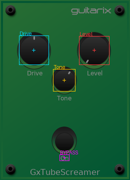
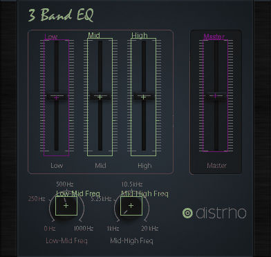

# Spike: a plugin's own GUI, headless, swept to find its controls (#28)

**Question.** Can we, with no screen and no person:

1. run an LV2 plugin's own GUI on a virtual X display,
2. move its parameters programmatically and see the GUI redraw,
3. screenshot each state, and
4. find each control by diffing screenshots?

**Answer: yes, all four, on both plugins tried.** Those were the TS9 overdrive (guitarix, GTK2) and DISTRHO's 3-band EQ (DPF, OpenGL on Mesa's software renderer).

## What works

**Carla's engine, driven from Python.** `carla_ui_host.py` loads `libcarla_standalone2` through Carla's own `carla_backend` bindings. It adds the plugin, opens its custom UI through a UI bridge, and serves OSC on 22752. The sweep sends exactly the rig's message, `/Carla/0/set_parameter_value <index> <value>`.

Parameter numbering is the same as `amp.py` found: control ports only, in port order. The TS9's LV2 ports 0, 1, 2 and 5 are Carla indices 0, 1, 2 and 3. The engine client must be named `Carla`, or Carla rejects the OSC prefix.

**Screenshots come from Xlib `GetImage` on the plugin window.** That's about 0.85 ms per grab, against 47 ms for ImageMagick `import`, and it works on the OpenGL window too.

## What doesn't

- **`jalv.gtk3` can't be driven after start-up.** The `symbol = value` console belongs to plain `jalv`. The GTK build's only control is `-c` at launch, which makes it one process per state at about 2.3 s each. Fine for looking at a GUI; useless for a sweep.
- **`carla -n project.carxp`** (how the rig runs the amp) never creates a GUI window, and OSC has no "show UI" call.
- **The full Carla GUI** hangs on an "Action in progress" modal under Xvfb.
- **`carla-single`** dies with `BadAtom`. See the first gotcha.

## Numbers

Window scale was 1.0, with no window manager. `GDK_SCALE` and `DPF_SCALE_FACTOR` changed nothing.

| | TS9 | 3-band EQ |
|---|---|---|
| Window | 260 × 360 | 392 × 372 |
| Redraw, OSC send → first changed frame (median / p95) | 37 / 43 ms | 66 / 79 ms |
| States (25 values per control, 2 per toggle) | 77 | 149 |
| Sweep / whole run, cold start to teardown | 13.0 / 16.6 s | 38.8 / 42.3 s |

At 9 values per control the TS9 takes 6.4 s to sweep, 9.6 s in all. Start-up is about 3.5 s.

**TS9 boxes against GTK's own widget rectangles** (25 values per control):

| Control | Box (x, y, w, h) | Box centre | GTK widget centre |
|---|---|---|---|
| Drive | 39, 72, 58, 57 | 67.5, 100 | 70, 102.5 |
| Level | 159, 73, 59, 56 | 188, 100.5 | 190, 102.5 |
| Tone | 107, 139, 43, 43 | 128, 160 | 130, 162.5 |
| Bypass | 120, 310, 18, 11 | 128.5, 315 | footswitch is 100, 240, 60 × 85 |

The knob centres land within 2–2.5 px of the real widgets, and the boxes were identical across 4 runs.

## What a box actually is

**The diff finds what moves.** For a knob that's the pointer's path, so the box is about 58 px against a knob body of about 66–68 px; the knob radius is roughly 1.15 × half the box. For a slider it's the thumb's travel.

**For a toggle it can be just a label.** The TS9's footswitch picture never changes; only its "On"/"Off" text does. So positions for control *centres* come from the sweep, but knob body sizes and toggle hit targets need the screenshot or toolkit hints as well. GTK2 exposes its child-window rectangles; DPF/OpenGL doesn't.

**Sample enough values.** At 9 values, guitarix's non-linear Level pointer covered only the left 40 px of its knob. 25 values fixed it.

## Gotchas

1. **Bare Xvfb breaks Carla's UI bridge.**
   - `carla-bridge-lv2-x11` interns `UTF8_STRING`, `WM_DELETE_WINDOW` and `WM_PROTOCOLS` with `only_if_exists=True`. With no window manager these don't exist yet, so it gets atom 0, `XChangeProperty` answers `BadAtom`, and the window is never made. Found by `LD_PRELOAD`ing a logging shim over `XInternAtom`.
   - Fix: intern them first (`prime_x.py`), and run Xvfb with **`-noreset`**, or the atoms vanish when the last client disconnects.
2. **`engine_idle()` must run about every 10 ms**, or the UI bridge is never serviced.
3. **A new window can be 1 × 1, or mid-resize.** `sweep.py` re-measures on `BadMatch`.
4. **JACK.** Use a private server name (`jackd -n`) and `JACK_NO_AUDIO_RESERVATION=1`, so a sweep can never touch a live rig. JACK as root warns about realtime, but works.
5. **Never `pkill -f carla`** from a shell whose own command line contains "carla": it kills itself. `run_sweep.sh` kills by PID.
6. **Environment-specific.** In the cloud container this ran in, `python3` is a 3.11 without PyQt5, so the `carla` launcher itself failed there. That's not the rig's laptop, but worth knowing for CI images.
7. **Not covered yet:**
   - Animated GUIs (meters, blinking LEDs). Check that two frames at rest are identical before sweeping an unseen plugin.
   - Only X11 plugin UIs were tried.
   - One of the 3-band EQ's 149 steps never changed and cost the full 1.5 s cap.

## Recommended for the production pipeline

1. **One Carla engine per plugin**, through `libcarla_standalone2` from Python, with its own Xvfb (`-noreset`) and its own JACK dummy server. Kept separate from the rig's `carla -n`.
2. **Drive it with the rig's own OSC**, so the sweep uses Carla's real numbering.
3. **Capture with Xlib.** Wait for change-then-quiet: poll until the frame changes, then until 80 ms pass with no change, with a 1.5 s cap. "Never changed" is reported loudly, never hidden.
4. **Sample each knob or slider at about 25 values, and a toggle at 2.** Diff against the all-defaults frame, and merge changed pixels within 14 px into one cluster per control.
5. **Give the model, per control:** name, Carla index, range, box, centre, an estimated radius for knobs, and the screenshots at min, default and max. Tell it a box is the moving part, not the control body or hit target.
6. **Budget** about 15 s for a simple GTK pedal and about 45 s for a large OpenGL plugin.

## Files

| File | What it does |
|---|---|
| `run_sweep.sh PLUGIN_URI OUT_DIR [--steps N]` | Orchestrator. Starts only what it needs, and cleans up. |
| `carla_ui_host.py` | Carla engine host: shows the GUI and serves OSC. |
| `sweep.py` | OSC sweep, Xlib capture and diff; writes `boxes.json`. |
| `prime_x.py` | Interns the X atoms Carla's bridge needs. |
| `overlay.py` | Draws the located boxes on the resting screenshot. |
| `try_jalv.py` | The jalv experiment, reproducible. |
| `evidence/` | Screenshots, 140 KB in all. |

Python dependencies, installed ad hoc for the spike and not in `pyproject.toml`: numpy, Pillow, scipy, python-osc, python-xlib.

**Re-verified** after the spike: a fresh 9-step TS9 run reproduced the boxes (Drive 40, 72, 57 × 57), a 35 ms median redraw and a 6.6 s sweep, and left no processes running.
